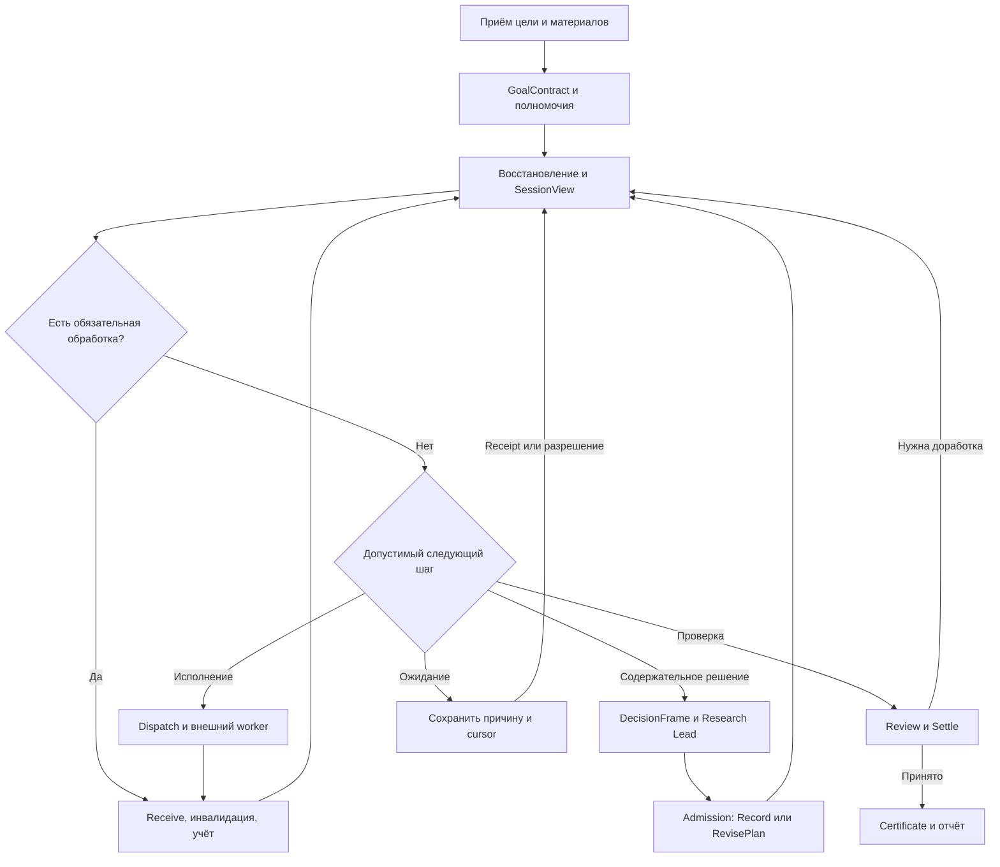

# ANIX Core — окончательный архитектурный аудит и единый план переработки

**Версия:** 2.0, 12 октября 2026 года.  
**Исполнитель реализации:** Sol.  
**Предмет:** существующий ANIX как единый исследовательский движок.  
**Решение:** сохранить Rust workspace, SQLite, три графа и прикладные API; заменить разрозненные правила исследовательского исполнения общими контрактами внутри существующих crates.  
**Статус:** аудит исходников и проектирование завершены в указанном ниже объёме; исходники не изменены. Готовность действующего или будущего движка к реальным исследованиям не подтверждена этим документом.

Этот документ заменяет предыдущий план 1.0 как руководство по реализации. RAP v0.1 и Zero-Loss v0.1 используются с уточнениями здесь. Исторические отчёты сохраняют значение свидетельств о своих версиях, но не являются доказательством состояния приложенного снимка. При расхождении нормативных решений Sol руководствуется настоящим документом; изменение решения требует процедуры §20.

## Содержание

1. Вывод и границы доказательств
2. Реальная архитектура и сквозной путь
3. Реестр архитектурных дефектов с доказательствами
4. Согласование RAP, Zero-Loss и прежнего P0–P8
5. Каноническая модель целевой системы
6. Команды, полномочия и общие правила допуска
7. Единый алгоритм исследовательского цикла
8. Планирование, декомпозиция, ветви и пересмотр
9. Наблюдения, знания, доказательства и научные методы
10. Контекст и долгосрочная память
11. Исполнение, сбои, контроль и бюджеты
12. Проверка результата и завершение
13. Хранилище, артефакты и миграция
14. Модели, маршрутизация и стоимость
15. Изменения по модулям и интерфейсам
16. Инварианты и система испытаний
17. План реализации P0–P8
18. Реальные модели и окончательные критерии готовности
19. Критическая самопроверка архитектуры
20. Инструкция Sol и пересмотр решений
21. Источники, воспроизводимость и выполненные проверки
22. Исполняемая ограниченная модель переходов

## 1. Вывод и границы доказательств

### 1.1. Главный вывод

ANIX уже имеет полезное транзакционное основание, историю, ограничения полномочий, граф работ, сохранённые контексты и реальные интеграции моделей. Полная замена этих механизмов не обоснована.

**Основной разрыв находится между исследовательским намерением, результатом операции, записью знания и принятием исследования.** В действующем длинном цикле модель выбирает преимущественно инструментальную работу и управление графом. Содержательные результаты записываются как свободные заметки и summaries; часть передачи результата выполняет тестовый harness. Условия завершения опираются на признаки выполненных инструментальных действий, существование сущностей и количество детей. Эти признаки не представляют обязательства исходной цели.

Это объясняет класс системных неудач, но не устанавливает единственную причину каждого старого model failure. В частности, без точного входа и сырого ответа iteration13 нельзя доказать, что seed664 ломается исключительно из-за модели, исключительно из-за архитектуры или из-за ошибочной постановки fixture.

Цель переработки: каждый принятый результат должен прослеживаться через цепочку:

**защищённая цель → выбранный метод → обязательства → исполняемые действия → сохранённые наблюдения → атрибутированные оценки → доступный контекст → пересмотр → проверенный результат → явное завершение.**

Переходы между звеньями должны принадлежать общему runtime. Evals наблюдает и проверяет этот runtime, а клиенты вызывают его API.

### 1.2. Что действительно исследовано

| Область | Доказательная база этой работы |
| --- | --- |
| Workspace и зависимости | `Cargo.toml`, manifests семи crates, `Cargo.lock`, toolchain declaration |
| Domain | `entities.rs`, `runtime.rs`, `policy.rs`, ID/error/state definitions |
| Core | Mutation boundary, proposals/Gates, human controls, runtime, completion, context, graph queries, services и tool ports |
| Agent | `run` и `run_step`, schemas/decisions, retrieval capabilities, routing, recorded model runtime |
| Integrations | Workspace, file reader, artifact offload/range helper, RecordedTool, structured Lead provider, local runtime boundaries |
| Storage | Миграции 1–5, hydration, diff persistence, immutable records, transactions, FTS |
| Evals и CLI | Long-horizon driver, synthetic adapters, branch/range capability fixtures, entrypoints и пользовательские команды |
| Тесты | Инвентаризация и чтение релевантных acceptance/runtime/provider/harness regressions; не выполнен Cargo test |
| Документы | Приложенные аудит, final report, план 1.0, RAP, Zero-Loss; актуальные README, architecture, development guide, micro-eval и связанные отчёты снимка |

Это не утверждение о независимой проверке каждой строки всех 35 Rust-файлов или каждого возможного входа. Покрытие ориентировано на публичные границы и взаимодействия полного исследовательского цикла. Предложенные воспроизведения дефектов требуют переноса в Rust-тесты.

### 1.3. Точное исходное состояние

Предоставлен архив `anix-main.zip`, а не checkout с историей Git. В распакованном дереве отсутствуют `.git`, `AGENTS.md`, `.runtime`, SQLite-базы и сырые JSONL Lead-трейсы iteration13. Два найденных JSONL — наборы micro-eval, а не эти трейсы. Commit SHA, dirty state и соответствие конкретному запуску 10 октября установить нельзя.

| Показатель | Установлено сейчас |
| --- | --- |
| ZIP SHA-256 | `fb3804146e68e5848fa2b5408659c0c4a16b61cc49de0f5e03b88942c093a633` |
| Crates | 7: domain, core, agent, storage, integrations, evals, cli |
| CLI package / binary | `anix-cli` / `anix`; старое `rn-cli` из аудита 09.10 уже не соответствует снимку |
| Rust source files | 35 |
| Test attributes | 185 вхождений `#[test]`, из них 2 `#[ignore...]`; это статический подсчёт, не Cargo-discovery и не число прошедших тестов |
| SQL migrations | 5; migration 5 добавляет `work_nodes.outcome` |
| Toolchain декларация | `stable`, `rustfmt`, `clippy`; конкретная версия не закреплена |
| Cargo/rustc в среде аудита | Отсутствуют: обе команды вернули `command not found` |
| Исполнено на SQL | Миграции 1–5 последовательно применены к пустой SQLite 3.53.1; `integrity_check=ok`, `foreign_key_check=[]`, FTS-таблица создана |
| Исполнено на целевой абстракции | Python BFS: 1413 состояний, 5080 переходов, без нарушений трёх проверяемых safety-свойств; две отрицательные мутации обнаружены |
| Rust/model/CLI acceptance | **NOT RUN** в этой работе |

SQL-проверка не проверяет rusqlite, Rust hydration, upgrade существующих данных, миграционный checksum runner или power-loss recovery. Абстрактная модель не исполняет ANIX и не является доказательством корректности его reducers.

### 1.4. Уровни утверждений

- **CODE:** свойство непосредственно следует из приложенного кода; указаны файл и символ/строки.
- **STATIC CE:** конструктивный контрпример по ветвлениям кода; Rust-воспроизведение ещё не запускалось.
- **EXEC-SQL / EXEC-MODEL:** фактически выполнена ограниченная SQL/абстрактная проверка.
- **HISTORICAL:** результат сообщён прежним отчётом; здесь не воспроизведён.
- **DESIGN:** нормативное решение для реализации Sol.
- **UNVERIFIED:** свойство требует испытаний или отсутствующих материалов.

Номера строк далее относятся только к ZIP указанного хеша. Во всех путях `crates/` подразумевается корень распакованного `anix-main`. При движении ветки главным ориентиром служит имя символа и контрпример.

### 1.5. Исторические результаты, которые нельзя объединять

| Источник | Результат | Ограничение |
| --- | --- | --- |
| Аудит 09.10 | 145 ordinary tests, 3 doctests; seed664: 40 calls, budget exceeded | Другая версия и старое имя CLI |
| Checkpoint 10.10 iteration13 | 177 ordinary tests, 3 doctests; build/check/Clippy заявлены PASS | Не текущий новый запуск; exact manifest отсутствует |
| Iteration12, Qwen3-8B, 664 | Inconclusive, 24 calls, две evidence branches | Не результат финальной iteration13 |
| Iteration13, Qwen3-8B, 654 | Blocked, 14 calls | Текущий профиль тогда не прошёл gate |
| Iteration13, Qwen3-14B, 654 | Completed, 6 calls | Один синтетический успех |
| Iteration13, Qwen3-14B, 664 | Blocked, 9 calls, одна evidence branch | Требуемая вторая ветвь не исполнена |
| Iteration13, 8B, 664; targeted/mixed20/200 | NOT RUN по отчёту | Нельзя заменять более ранними PASS |
| Независимая научная оценка iteration13 | NOT RUN | Integrity и provenance не равны научной состоятельности |

## 2. Реальная архитектура и сквозной путь

### 2.1. Модули и направление зависимостей

| Crate | Фактическая ответственность | Решение |
| --- | --- | --- |
| `anix-domain` | Научные сущности, WorkNode/Branch/PlanRevision, invocation records, control policy, статусы, retrieval derivation | Сохранить; расширить contracts и versioned evidence |
| `anix-core` | Координатор транзакций, сервисы, restricted AgentApi, контекст, Gates, lifecycle, checkpoints | Сделать единственным владельцем исследовательских переходов |
| `anix-storage` | SQLite implementation порта Storage, загрузка агрегата, diff writes, migrations/FTS | Сохранить; добавить необходимые структуры и затем оптимизировать измеренные узкие места |
| `anix-agent` | Одна Lead decision, выбор provider, tool dispatch, local/strong routing | Добавить общий ResearchSession runner; убрать доменные дубли правил |
| `anix-integrations` | Файлы, adapters, offload, HTTP/llama.cpp, recorded I/O | Перенести сюда пригодные общие source/range adapters из evals |
| `anix-evals` | Fixtures, driver, fake human, synthetic tools, counters, audits | Оставить fixtures/oracles; production execution передать runner |
| `anix-cli` | Composition root и команды доменных API, process/control, model/eval/demo | Добавить обычный project-to-research-result путь через общий runner |

Core и Domain не зависят от SQLite, HTTP или SDK модели. Integrations и Storage реализуют внешние порты. Это правильное разделение. Новый orchestration framework, graph DB, vector DB или восьмой crate для «нового ядра» сейчас не нужны.

### 2.2. Три графа и их фактические связи

| Граф | Канонические записи | Связи с остальными |
| --- | --- | --- |
| Knowledge/Evidence | Question, Source, Paper, Claim, Hypothesis, Experiment, ExperimentRun, Finding, Artifact, Relation | OutputContract ссылается на entity/artifact IDs; provenance ссылается на Run/Gate/Event |
| Process | WorkNode, WorkEdge, Branch, PlanRevision | WorkNode имеет capabilities/budget; Branch привязан к checkpoint; план хранит копии node/edge |
| Execution | Task, Run, ExecutionBinding, ModelInvocation, ToolInvocation, ContextSnapshot, ExecutionCheckpoint, ProcessMemory | Binding фиксирует Work/Branch/PlanRevision; invocation фиксирует work/run/context и artifacts |

Не существует отдельного канонического GoalContract с проверяемыми answer/method obligations. `OutputContract` содержит только существующие entity/artifact refs и `minimum_children`. `ResearchOutcome` уже существует, но не заменяет такого контракта.

`Claim` обязательно относится к Paper; `Finding` обязательно относится к ExperimentRun. Relations Supports/Contradicts/Qualifies допускают только Claim/Finding → Hypothesis. Эта модель полезна для литературы и экспериментов, но не даёт прямого общего типа для математического аргумента, вычислительного заключения или синтеза без фиктивной статьи/эксперимента.

### 2.3. Реальный длинный путь

1. CLI `eval research ...` вызывает `anix-evals`; обычный `research` управляет control state, а не запускает произвольное исследование.
2. `long_horizon::run_one_with_policy` создаёт синтетические Project/Question/Source/Paper, main Branch, composite root и parent Run.
3. Harness выбирает executable child либо root, формирует scenario-dependent goal и иногда ограничивает process actions.
4. `LeadAgent::run_step` стартует work/task/run, фиксирует binding, компилирует snapshot, вычисляет tools/handles, записывает ModelInvocation Running.
5. Provider самостоятельно строит компактную schema из `ModelRequest` и `Decision state` в текстовой памяти. Его внутренний retry/repair может выполнить несколько HTTP completions.
6. Agent валидирует ответ через собственную матрицу atomic/composite и вызывает Core или ApprovedTools.
7. RecordedTool сохраняет input artifact, invocation, output artifact и итог вызова несколькими транзакциями. Возвращает bounded output.
8. Harness превращает output в ProcessMemory; для обычного source observation сохраняет первые 400 символов сериализованного результата.
9. Core собирает следующие context notes из памяти и научных сущностей. Task result может быть отдельной свободной summary.
10. `finish_research_with_branch_reviews` проверяет readiness, evidence marker и перечисление branch IDs, затем пишет статусы и события.
11. Harness отдельно вычисляет capability outcome, закрывает оставшиеся executions и проверяет состояние после reopening.

**Ключевой вывод:** отключение harness сейчас меняет семантику работы с результатами и продолжения исследования. Его нельзя считать только внешним измерителем.

### 2.4. Что сохранить без повторного изобретения

| Механизм | Подтверждено чтением кода | Граница |
| --- | --- | --- |
| `Core::mutate` | Общая сериализация, callback внутри Storage transaction, события публикуются после commit | Несколько вызовов mutate не образуют одну транзакцию |
| SQLite | `foreign_keys=ON`, WAL, `synchronous=FULL`, `BEGIN IMMEDIATE`, согласованный read transaction | Нет общей атомарности с files/network |
| История | Immutable plans/snapshots/memories/bindings; append-only events/provenance; immutable ActionReceipt | Это не полный event-sourced rebuild всех прежних entity versions |
| Human boundary | Creator check для Human mutations; Agents получают ограниченный API | Actor enum — метка доверенного приложения, не внешняя аутентификация |
| Gate approval | Повторная проверка, версия/receipt; bound Run возобновляется вместо ложного завершения | Нужны дополнительные scoped и epoch contracts |
| Retrieval | Authorized handles, pending/refine/reject, direct supplied-source path | Два разных derivation path; зависимость от adapter metadata |
| Context | Pinned question/constraints, bounded child results, branch memory filtering, immutable snapshot | Нет гарантии доступности каждого отброшенного результата |
| Local HTTP/files | Redirect/proxy restrictions; workspace/path/storage guards | Не sandbox произвольного native plugin |
| Invocations | Running до I/O, identity checks, failed calls сохраняются | Нет единого operation/attempt/receipt протокола |
| Evals | Явное завершение, проверки branch evidence, отрицательные regressions | Capability fixture и научная независимая оценка — разные вещи |

Сохранение механизма означает сохранение его контракта и регрессий, а не запрет необходимого локального изменения реализации.

## 3. Реестр архитектурных дефектов с доказательствами

Все F-пункты ниже — результаты **CODE/STATIC CE**, если не обозначено иначе. Для каждого указан новый системный тест T из §16. Ни один proposed reproduction не объявляется исполненным Rust-тестом. Severity относится к целевой способности ANIX проводить исследования, а не автоматически к security vulnerability.

### F01. Производственный цикл и доставка наблюдения зависят от Evals — критический

**Код:** `anix-evals/src/long_horizon.rs:1020–1615`, `run_one_with_policy`; `anix-agent/src/lib.rs:653`, `run_step`; `anix-cli/src/main.rs:102–165, 691–730`.

Harness выбирает следующую работу, переключает scope, ведёт idle/fuel, записывает source observations и продолжает после результата ветви. `run_step` выполняет один шаг и возвращает `ToolOutput`, но сам не делает из любого tool result доступное следующему решению наблюдение. В CLI нет общего `research start/tick` для произвольного проекта: есть controls и eval/demo.

**Контрпример:** создать проект, дважды вызвать production `run_step` с RecordedTool без `long_horizon` glue. Первый шаг сохраняет raw artifact и ToolInvocation, но следующий snapshot не обязан содержать его substantive content: запись `Source content observation` делает harness. Возможность прочитать artifact отдельно тоже не включена автоматически.

**Исправление:** общий ResearchSession runner в Agent, typed observation ingestion в Core; Evals только создаёт fixture и вызывает тот же runner. **Приёмка:** T01, T07, T29. **Риск:** при простом переносе скопировать scenario rules и fake-human approvals в production; это запрещено.

### F02. В длинном цикле недостижим путь содержательных scientific proposals — критический

**Код:** `anix-agent/src/lib.rs:977–1025`, `step_contract_ok`; дальнейшая ветка `AgentDecision::Propose` существует, но матрица не допускает её ни для Composite, ни для Atomic. `test_lead.rs::step_response_schema` также не выдаёт scientific Record/Propose actions. `long_horizon.rs::composite_step_rejects_gate_proposals_and_passes_audit` закрепляет нынешнее ограничение.

**Контрпример:** после чтения источника модель возвращает корректный `Propose(CreateHypothesis)` либо `CreateRelation`. Ответ отвергается до `api.submit`. Legacy `LeadAgent::run` умеет proposals, но не даёт автоматически единый длительный цикл с Work/context/result contracts.

**Следствие:** требование harness «persist grounded evidence» не реализовано как полноценная модельная возможность в том же state machine. Summary в ProcessMemory не заменяет knowledge mutation.

**Исправление:** доступный из общего цикла `record_assessment`/`propose_scientific_change` с общей policy; модели разрешены атрибутированные суждения, а не самопровозглашённая истина. Legacy action и новый DTO сходятся к одному Core reducer. **Тесты:** T01, T02, T03.

### F03. Atomic привязан к инструменту, а Completed — к чтению — критический

**Код:** `run_step:795–832` блокирует Atomic без required tool и доступного provider; `AgentApi::validate_work_completion:2196–2257` требует `tool:` capability; `finish_research_with_branch_reviews:2070–2078` требует `read_outputs > 0` либо required Claim/Finding. `test_lead.rs:62–75` повторяет это ограничение schema.

**Контрпример:** цель — проверить арифметическое тождество на предоставленном наборе или доказать формализованную лемму. Есть корректный compute/proof artifact и reviewer receipt, поиска не требуется, Claim/Finding старого вида нет. Root Completed отвергается. Work с чистой интерпретацией или проверкой суждения без tool тоже невыразим этим Atomic-путём.

**Исправление:** Atomic означает один проверяемый локальный результат; execution kind и требуемый result contract задаются отдельно. `Completed` зависит от GoalContract и certificate, а не имени `read_source`. **Тесты:** T02, T03, T04. Простое удаление evidence check запрещено: его заменяет более сильная result/coverage validation.

### F04. OutputContract смешивает вход и результат; старый вызов удовлетворяет новой задаче — критический

**Код:** Domain `runtime.rs:120–151`; `create_work`, `set_work_contract`; `create_child_work_with_repeat:1960–1980` копирует required refs родителя. `required_tool_output_exists` и `validate_work_completion` ищут любой подходящий успешный invocation данного WorkNode, без проверки objective/contract/input revision.

**Контрпример A:** `required_entities=[Question Q]` существует до работы. Наличие Q и произвольного успешного tool output формально достаточно для task contract, хотя новый результат не сформирован.

**Контрпример B:** work выполнил tool X; owner-approved revision изменяет objective при том же WorkNodeId. Старый успешный X продолжает удовлетворять required-output predicate. Модель получает `required_tool_succeeded=true` и может перейти к completion новой задачи со старым output.

**Исправление:** отделить InputBindings от ожидаемых OutputSlots; привязывать accepted result к contract version, operation и input basis. Изменение релевантного контракта делает старый result stale, но не удаляет его. Повторное использование требует явной проверяемой совместимости. **Тесты:** T05, T06.

### F05. Разные API несовместимо определяют успешное завершение — критический

**Код:** `runtime.rs::decision_state:247–398`, `satisfied:498–509`, `transition_work:1987–2143`; `lib.rs::finish_research_with_branch_reviews`.

`decision_state` считает Failed/Cancelled/Superseded детей терминальными и отдельно считает минимум Succeeded. `transition_work(Succeeded)` требует Succeeded от всех Contains-детей. `decision_state` проверяет исходящие DependsOn, но не входящие Blocks, которые проверяет `satisfied`. `finish_research` напрямую меняет статус, минуя `transition_work`.

**Контрпример A:** один успешный ребёнок, один superseded после replan, `minimum_children=1`, evidence имеется. FinishResearch допускает готовность; обычный `transition_work(...Succeeded)` отклоняет.

**Контрпример B:** root уже Running; добавить допустимый Blocks от незавершённого узла к root. `satisfied` запрещает Succeeded, но completion readiness этого blocker не показывает; FinishResearch не вызывает `satisfied`.

**Исправление:** `evaluate_closure` — один чистый predicate; UI/schema/API/settlement используют один результат. Execution dependency и goal obligation имеют разные типы. Прямой Human API не обходит certificate. **Тесты:** T06, T08, T24.

### F06. Исход работы и состояние исследования расходятся — высокий

**Код:** `finish_research` записывает WorkNode/Run/Task/Event, но не `HumanControlState.status`; `require_agent_progress` блокирует только Paused/Cancelled; `transition_work` допускает Failed/Blocked → Ready, не сбрасывая `outcome`. Все упоминания `ResearchStatus::Completed/Inconclusive/Blocked/Failed` отсутствуют в production-переходах просмотренного снимка.

**Контрпример:** завершить root Inconclusive, затем owner переводит Failed → Ready → Running. `outcome=Inconclusive` остаётся; разные queries/scoped branch schemas могут видеть running work с уже заключённым outcome. После root Completed control view может оставаться Running.

**Исправление:** единый lifecycle текущего эпизода и производные flat statuses; при возобновлении закрытого исследования создаётся новый episode epoch, исторический certificate остаётся неизменным. Control отвечает за режим/директивы, не за независимую копию научного исхода. **Тесты:** T09, T10.

### F07. Offload сохраняет данные, но не обеспечивает их чтение Lead — критический

**Код:** `recorded_tool.rs:6–16` preview 1400 символов; `long_horizon.rs:1360–1388` observation обычно 400 символов; `runtime.rs:1040–1087` может оставить child result только как memory ID; `offload.rs:64–89` имеет range helper. Callable `ReadArtifactRangeTool` находится в `anix-evals/src/true_capabilities.rs:313–403`, а не в общем long-horizon registry.

**Контрпример:** ключевая оговорка находится после первых 1400 символов JSON или в результате тринадцатого ребёнка; его summary вытеснен. Bytes существуют, но текущий Lead action space не предоставляет `read_memory(id)`/обязательного reader к этому материалу. Даже последний сохранённый preview не решает проблему всего корпуса.

**Исправление:** production ReaderPort с bounded handles к immutable artifact/result/memory ranges, оглавлением и paging. Каждый omitted relevant result имеет работоспособный reader; обязательные результаты входят в delivery ledger. **Тесты:** T07, T11, T12. Существующий offloader сохраняется и расширяется.

### F08. Контекст решения смешивает исторические и текущие версии — высокий

**Код:** `compile_context_manifest` берёт objective/budget из PlanRevision, но `decision_state(s,work)` и entity render — из текущего state; `ContextBuilder::build_for_snapshot:480–516` перечитывает ResearchContext и лишь фильтрует IDs; `test_lead.rs::request_value` посылает и `context`, и `compiled_context`, и копию decision state.

**Контрпример:** между compile и `build_for_snapshot` меняется Hypothesis/контракт. Immutable entry содержит v1, дополнительный typed context — v2. Schema/handles были вычислены ещё раньше по отдельным чтениям. Exact replay snapshot уже не воспроизводит весь фактический запрос, если optional diagnostic trace не включён.

**Исправление:** один атомарно зафиксированный DecisionFrame; renderer использует только его snapshot payload и versioned refs. Current admission перепроверяет basis. Отдельно хранить actual wire payload digest и transport manifest. **Тесты:** T13, T14.

### F09. Исключение источника не имеет сквозной lineage-проверки памяти — высокий

**Код:** `runtime.rs::compile_context_manifest` фильтрует entity candidates через `check_entity_policy`, но ProcessMemory выбирает по namespace/work/текстовому prefix, без source dependency refs; `ProcessMemory` содержит только content/author/work. Аналогично source artifacts прикрепляются к свободной task summary, а не ко всем её зависимостям.

**Контрпример:** прочитать Source A, записать `Source content observation`, затем Human исключает A. Новая entity retrieval A отфильтрована; старая заметка A остаётся допустимой для упаковки по work scope. Это новый случай после сохранения derived memory, а не отрицание старой исправленной регрессии A03.

**Исправление:** typed content dependencies у notes/results; policy проверяет весь material path. Исторический snapshot остаётся историческим, но новый запрос не включает запрещённые производные. Если provenance старой заметки неизвестен, strict path не использует её как evidence. **Тесты:** T15, T16.

### F10. Нет общей проверки релевантного basis между решением и эффектом — критический

**Код:** ModelRequest/task snapshot, текущие checks в `run_step`, `record_tool_invocation` и `record_work_result`; tool context не несёт полного read set/goal-policy epoch; некоторые paths проверяют stale versions, другие проверяют только bound run и budget.

**Контрпример:** model call начат для objective v1; owner изменяет разрешённый scope/contract до возврата ответа. Содержательный action может исполняться по старому выбору, если конкретный path не имеет версии этого изменения. Исправленная проверка `runtime_source_ref` покрывает supplied source binding, но не общий класс.

**Исправление:** DecisionBasis с relevant versions, scope epoch, authority basis и contract digest. Проверки на admission, перед irreversible send и при semantic acceptance. Receive позднего результата не должен отвергаться только из-за старого epoch. **Тесты:** T14, T17, T18.

### F11. Логические transitions состоят из нескольких commits — высокий

**Код:** `create_child_work_with_repeat` вызывает `create_work`, `add_work_edge`, `transition_work` отдельно; Atomic completion в `run_step:1350–1379` выполняет validation → result memory → finish run → complete work отдельно.

**Контрпример A:** crash после создания ребёнка до Contains edge оставляет orphan; retry может создать ещё одного, поскольку dedup ищет через Contains.

**Контрпример B:** crash после `finish(run)` до `complete_work` оставляет Completed Run и Running Work. Это не обязательно порча БД, но требует специального восстановления составной операции; общего action receipt на всё действие нет.

**Исправление:** атомарные Core commands `revise_plan(AddChild...)` и `settle_work(...)` с idempotency receipt. I/O остаётся вне транзакции. **Тесты:** T19, T20.

### F12. Ветвь копирует execution status без явного импорта результата; review привязан к IDs — высокий

**Код:** `runtime.rs::create_branch:1723–1757` клонирует WorkNode с новым ID, оставляя status/outcome; invocations/memories не копируются. `finish_research_with_branch_reviews` проверяет набор reviewed WorkNode IDs и существование любого `BranchResultAvailable`, а не hash конкретного result snapshot и review basis.

**Контрпример A:** fork checkpoint с Succeeded work создаёт новый Succeeded WorkNode без явно связанного accepted result для нового ID. Наследование результата нельзя отличить от нового исполнения.

**Контрпример B:** branch review был рассчитан на result v1; ветвь открыта снова/изменена. Наличие прежнего event и того же WorkNodeId не устанавливает, что parent рассмотрел актуальный versioned result.

**Исправление:** fork включает структуру и явные frozen input/result bindings, а не фальшивое новое исполнение. Reconciliation Assessment ссылается на точные ResultSnapshot refs. **Тесты:** T21, T22, T10.

### F13. Policy flags не действуют, replan всегда требует Human Gate — высокий

**Код:** `AutonomyPolicy:28–47` содержит `allow_branch_creation`, `allow_plan_revision`, `review_termination`; поиск по production source находит их только в объявлении/default. `human_control.rs:58–66` безусловно gate-ит любой `ReviseWorkObjective/ReviseWorkPlan`.

**Контрпример A:** default `allow_branch_creation=false`, но легитимный bound Lead может создать branch; `review_termination=true` не вызывает termination review.

**Контрпример B:** в Autonomous Lead исправляет собственный неудачный метод при сохранении protected goal — всё равно нужен owner. Harness может разрешить Gate fake-human, скрывая зависимость от человека.

**Исправление:** одна versioned authority matrix; tactical replan разрешается заранее установленной policy, изменение protected goal/protocol — отдельное Human решение. Не делать «всегда без gate»: действующие пользовательские restrictions сохраняются. **Тесты:** T23, T24, T25.

### F14. Реальные provider attempts и расходы скрыты внутри одного invocation — высокий

**Код:** `test_lead.rs::generate:932–1160` содержит transport retry, targeted repair, full retry; `run_step` резервирует один ModelInvocation. Бюджеты Core считают записи invocation; harness дополнительно восстанавливает repair count из metadata/строк. При final error Agent записывает `TokenUsage::default()`.

**Контрпример:** лимит один model call, malformed response вызывает repair и новый completion. Число HTTP attempts превышает один, расходы не полностью представлены durable records; crash внутри retries теряет их точный учёт. Названия `local-test-lead`/substring `strong` участвуют в определении роли в Core.

**Исправление:** logical decision отдельно от каждый external attempt; резервировать каждый send, записывать наблюдённую и неизвестную usage; роль, locality и provider identity — разные поля. **Тесты:** T26, T27. Если лимит намеренно относится к decisions, назвать его `max_decisions`, дополнительно ограничить attempts/spend.

### F15. Внешнее исполнение не имеет полного operation/outbox/receipt протокола — высокий, обязательный до side-effect adapters

**Код:** `recorded_tool.rs:61–177`, `durable.rs:65–117`, `resume_checkpoint:679–806`. Есть begin-before-I/O и список uncertain running tools. Нет общего logical OperationId, outbox lease/fence, receipt sequence или adapter reconciliation command.

**Контрпример:** процесс падает после реального внешнего эффекта до записи output. Runtime правильно не переигрывает running tool автоматически, но нет общего пути выяснить effect status и принять поздний receipt. При pause/cancel `register_execution_artifact` требует Run Running, что может воспрепятствовать сохранению поздних bytes уже совершённого действия.

**Исправление:** durable dispatch/receive протокол §11. Unknown effect не считать failed-no-effect; late receipt сохраняется независимо от terminal Work, но не возрождает его. **Тесты:** T17, T18, T28. Текущие ApprovedTools допускают только read-only; реальный duplicate consequential effect здесь не воспроизведён.

### F16. Научная модель не хранит достаточного basis для доказательств — критический

**Код:** Domain `entities.rs:90–116`, `Relation`, `policy.rs:89–139`; `Meta::update` и current tables; `EvidenceTrace` строится из текущих relations/entities. Claim/Finding/Hypothesis не имеют общего Assessment с точными premise versions, методом, assumptions, review scope, trust freshness.

**Контрпример:** Hypothesis statement меняется, а прежняя Supports relation по тому же HypothesisId продолжает выглядеть поддержкой новой формулировки. Точный source hash сам по себе не фиксирует, какой вывод и при каких условиях поддерживался. Два источника с общим первичным исследованием могут выглядеть независимыми.

**Исправление:** versioned scientific records, Assessment, EvidenceUse на существующих Relations, явные dependencies/lineage/freshness. Не добавлять второй самостоятельный Knowledge Graph. **Тесты:** T03, T16, T30, T31.

### F17. Span grounding опирается на текст вызывающего, а не material receipt — высокий

**Код:** `runtime.rs::promote_candidate:1538–1597` проверяет `source_text.contains(source_quote)` и `quote.contains(candidate.text)`, где `source_text: &str` передан вызывающим. Не связан с immutable Artifact/version/selector. В обычном `add_claim` source provenance также не доказывает entailment.

**Контрпример:** trusted Human caller передаёт другую строку, содержащую candidate quote; structural check проходит без проверки bytes зарегистрированного Source. Это слабость доказательного контракта, а не доказанный способ модели обойти Human boundary.

**Исправление:** typed MaterialRef, exact range/hash и runtime-owned reader receipt; semantic entailment проверяется отдельным assessment. **Тесты:** T12, T30. Human может зарегистрировать мнение без source, но оно маркируется Human assertion и не маскируется под проверенную цитату.

### F18. Retrieval имеет два источника семантики и ordering по wall clock — высокий

**Код:** `domain/runtime.rs::derive_retrieval_batches:348–469` и `core/runtime.rs::has_pending_retrieval:399–465`. Первый учитывает branch/root-run scope, tool names, первый metadata artifact и supersedes предыдущую pending batch при новой search/refine; второй обходит все metadata artifacts, ориентируется на work set и явные refinement/rejection refs. Оба сортируют по `started_at`, не commit sequence.

**Контрпример:** два допустимых bound runs одного root/branch начали search до появления batch другого. Первый reducer при чтении общей истории делает старую batch Superseded, второй сохраняет pending по обоим разным work owners. После consumption новой batch schema и completion могут расходиться. Это конкурентный STATIC CE; последовательный исправленный refine с `previous_search_id` этим примером не объявляется сломанным.

**Исправление:** typed receipt → единственный RetrievalBatch reducer с owner scope и explicit supersedes; последовательность — durable sequence. Search result не становится обязательством «прочитать всё» автоматически. **Тесты:** T32, T33.

### F19. Приоритеты и границы ресурсов не совпадают с фактическим scheduler — средний/высокий для долгих исследований

**Код:** `queries.rs::current_activity` сортирует по human priorities; `runtime.rs::executable_children:511–553` — Running, created_at, id. Harness берёт `.first()`. WorkBudget копируется каждому ребёнку; project bounds необязательны; max_steps используется как число WorkNodes, тогда как harness имеет отдельные calls/meaningful_steps counters.

**Контрпример:** Human ставит ребёнку Critical, activity его показывает первым, но runner продолжает более старую ready задачу. Без project cap повторное создание детей размножает per-work allowance.

**Исправление:** общий SchedulerView с precedence, scoped budget reservations, fair queue и терминологией `max_work_nodes`, `decision_fuel`, `max_attempts`. Приоритет не обходится через UI-only sorting. **Тесты:** T27, T34.

### F20. Хранилище и plan history растут дороже каждого следующего шага — масштабируемость, требует измерения

**Код:** Storage `read_state:512–581` загружает весь проект; `transaction:765–790` клонирует его целиком и сравнивает; `runtime.rs::revision:178–245` копирует nodes/edges ветви и создаёт checkpoint при каждом work transition. Context compile сохраняет новую decision memory.

**Следствие по структуре:** память и работа каждой транзакции зависят от всей накопленной истории; plan storage приблизительно растёт как сумма размеров графа по revisions. Нельзя объявлять уже измеренную катастрофическую latency: benchmark отсутствует.

**Исправление:** сначала budgets/growth instrumentation; затем paging/history snapshots и узкий UnitOfWork с той же атомарностью. Разделить structural plan revision и execution-state sequence. **Тесты:** T35, T36; оптимизация P8, но correctness при растущей истории — P4/P5.

### F21. Регистрация артефакта подтверждает metadata, а не доступность bytes — высокий

**Код:** `lib.rs::persist_artifact:394–460` валидирует путь и форму SHA-256 без чтения; `Workspace::write_new:113–133` делает file sync, но не содержит отдельной публикации с directory durability/manifest; `offload::read_range` проверяет hash, затем открывает файл заново. Общей DB/file транзакции нет.

**Контрпример:** зарегистрировать допустимый путь/64-hex hash для отсутствующего файла через Human API; OutputContract считает Artifact существующим. Реальный crash publication требует отдельной platform-specific fault проверки. Native adapter с доступом к Core/Workspace считается доверенным: read_only flag не является OS sandbox.

**Исправление:** stage/verify/publish receipt и runtime-owned ArtifactStore; closure принимает только materialized output. Прямой register остаётся declared/unverified import до ingest. Open/hash/read на устойчивом handle либо immutable storage discipline. **Тесты:** T12, T28, T36.

### F22. Испытания подтверждают более узкий путь, чем обещание «полноценное исследование» — критический для приёмки

**Код:** acceptance `complete_question_to_finding_and_restart` вручную создаёт источники/claims и Human-командами выполняет часть science chain; `long_horizon.rs:1295–1332` имеет goal/schema interventions для branching/long-context; fake-human resolver и post-run cleanup меняют state; independent quality oracle не выполняет полноценную оценку свободной synthesis.

**Контрпример:** два одинаковых source facts и две ветви удовлетворяют части mechanical checks, но не дают независимых доказательств. Тест может подтвердить branch transport без autonomous strategy selection. Core может выдать terminal summary с неподдержанным выводом, сохранив идеальную integrity.

**Исправление:** сохранить component/capability regressions с точными названиями; добавить общий API E2E, pre-cleanup snapshot, отдельные методологические oracles, held-out science review и mutation tests. **Тесты:** T01, T29–T31, T37–T40.

### 3.1. Что не объявлено дефектом без доказательств

- Наличие SQLite вместо распределённой БД.
- Отсутствие обязательного vector store, POMDP/HTN planner, нескольких Lead-агентов или Apple host.
- Сам по себе отрицательный или неопределённый научный вывод.
- Qwen3-8B как класс моделей: известны отдельные failures, не доказана универсальная неспособность.
- Отсутствие автоматического replay неизвестного tool effect: действующая осторожность правильна.
- Creator-only Human policy: допустимое продуктовое ограничение, пока не обещаны collaborators.
- Старые исправленные A01–A13 без нового сценария нарушения. Их named regressions должны сохраняться.

### 3.2. Причинная карта

| Локально корректно | Совместный провал | Требуемый общий контракт |
| --- | --- | --- |
| Tool сохранил JSON; Core записал invocation | Lead не получил существенную часть результата | Observation + Reader + Delivery |
| Child завершён; parent видит Succeeded | Итог не использует результат ребёнка | ResultSnapshot + input binding + assessment |
| Все children terminal | Часть исходной цели потеряна при replan | Obligation conservation |
| Gate approved; new Run стартует | Выполнен уже изменившийся метод | Relevant basis + authority fence |
| Source есть и цитата совпадает | Цитата не поддерживает заключение | Domain review с точным scope |
| Все таблицы целы после reopening | Исследование не умеет продолжаться с нужного места | Session cursor + operation reconciliation |
| Micro JSON прошёл schema | Потеряно отрицание/условие; изменился поиск | Strict routing/noninterference |
| Harness сообщил completed | Пользовательский проект не имеет аналогичного пути | Один runner + независимый oracle |

## 4. Согласование RAP, Zero-Loss и прежнего P0–P8

### 4.1. Решения, которые сохраняются

| Основание | Сохранённое решение | Уточнение по исходникам |
| --- | --- | --- |
| RAP | Исследование — последовательность контролируемых изменений зарегистрированного состояния и взаимодействий с внешним миром | Не требуется интерпретатор нового языка; typed commands проходят существующий Core |
| RAP | Девять семантических примитивов; атомарность внутреннего commit отделена от внешнего эффекта | `RecordedTool` и `ModelInvocation` расширяются общим operation/receipt contract |
| RAP | Evidence — отношение материала к конкретному утверждению при указанных предпосылках | Расширить существующие Relation и scientific records; не создавать параллельную сеть «истин» |
| RAP | Сохранение обязательств при декомпозиции; ветвь экспортирует результат; неопределённость допустима | Нынешние child count, branch ID и summary недостаточны |
| Zero-Loss | Rust выполняет детерминированные преобразования; квалифицированный Lead принимает содержательные решения | Локальность модели не определяет её полномочия или качество |
| Zero-Loss | Strict: micro выключены на причинном пути исследования | Валидность JSON и сохранение mandatory terms не доказывают отсутствие смысловой потери |
| План 1.0 | Один admission, один closure predicate, versioned basis, exact reader, isolated shadow | Реальные gaps F04–F21 подтверждают необходимость этих границ |
| План 1.0 | Rust/SQLite/три графа/shared API; последовательность P0–P8 | Не строить новый framework, UI, универсальный научный planner или отдельную «эпистемическую БД» |
| План 1.0 | Model-backed campaign, independent oracle, cost per accepted research | Исторические component PASS недостаточны для G6/G7 |

### 4.2. Исправления прежнего плана

1. **P0 больше не начинается с отсутствия исходников.** Этот аудит даёт source map и контрпримеры. Необходимы сопоставление с реальным checkout и исполняемый baseline; повторять весь анализ без обнаруженного расхождения не нужно.
2. **Нельзя отложить все operation fences и durable receive до P4.** P2 уже вызывает внешний provider/tool, получает поздний ответ и перезапускается. Минимальная безопасность этих путей обязательна в P2; concurrency, fault campaign и полный migration corpus остаются P4.
3. **Продуктовый runner появляется в P2, а не впервые в P7.** P7 принимает пользовательский сценарий, эксплуатационные свойства и отчёт; он не создаёт второй runtime после успешных evals.
4. **Не нужен отдельный универсальный тип KnowledgeItem рядом с Claim/Finding.** Tagged origins, версии и Assessment расширяют существующую модель. Это минимальная структурная переработка, необходимая F16.
5. **Уже реализованные guards не переписываются.** Source access, invocation identity, required read validity, explicit branch scope, owner Gate, immutable snapshots и budget reservation сохраняются и включаются в общие reducers. «Отсутствует» из документального плана заменяется фактическим статусом §2–3.
6. **Абстрактная проверка частично выполнена сейчас.** §22 содержит проверенный небольшой конечный автомат. Он не закрывает G1 и не подменяет model/property/fault suite реализации.
7. **Не вводится обязательный второй сильный LLM на каждое действие.** Научная review procedure определяется риском и видом вывода. Независимость не появляется от запуска того же prompt второй раз.
8. **Source freshness — не всегда “latest”.** Историческое исследование может намеренно закрепить версию. Инвалидация зависит от подписанных input contracts: pinned version, follow-head или effective time.
9. **Научный отрицательный ответ может быть Completed.** Если цель — проверить гипотезу, её обоснованное опровержение удовлетворяет цели. Inconclusive означает неразрешённые обязательства по допустимому протоколу, а не “модель не смогла продолжить”.
10. **Резерв последних шагов — часть общего лимита, а не добавочный бюджет.** Он обеспечивает сохранение/диагностику/закрытие без возможности обойти исчерпание лимитов через replan.

### 4.3. RAP как классификация существующих и новых API

| Примитив | Содержательный эффект | Реализация в ANIX |
| --- | --- | --- |
| `Record` | Зарегистрировать материал, наблюдение, оценку, версию научной сущности или evidence relation | Scientific services + ingestion/assessment reducers |
| `RevisePlan` | Уточнить, заменить, разветвить, упорядочить работу с сохранением обязательств | WorkPlan/Branch services; один typed plan delta |
| `Dispatch` | Создать разрешённую логическую операцию и намерение её исполнения | Core admission + durable dispatch outbox; provider/tool worker |
| `Receive` | Записать внешний ответ/часть/позднюю квитанцию и фактическое расходование | Core receipt ingestion; не зависит от активности старого Run |
| `RequestDecision` | Создать scoped Gate о конкретном изменении или полномочии | Существующий Gate, дополненный basis/effect scope |
| `ResolveDecision` | Зафиксировать решение уполномоченного субъекта | Gate resolution + повторная проверка basis |
| `Govern` | Изменить policy/goal protection/resource limits/доступ | Human control API; Lead может запросить, но не применить |
| `Control` | Pause/resume/cancel/reopen/focus в пределах полномочий | Общий episode/work control reducer |
| `Settle` | Принять result snapshot и/или закрыть работу/эпизод по общей проверке | Заменяет расходящиеся completion paths |

`RequestDecision` здесь означает запрос авторитетного решения, обычно Human Gate; обычный вызов Research Lead — `Dispatch` с operation kind `ModelDecision`. Иначе слово «decision» снова создаст две несовместимые машины состояний.

## 5. Каноническая модель целевой системы

### 5.1. Единственный владелец каждого факта

Каноническое состояние обозначим `S = (G, P, X, K, M, A, U)`: цель/обязательства, process graph, execution graph, knowledge graph, material/context references, authority/control, resource ledger. Это проекции существующих агрегатов, не семь новых хранилищ.

| Факт | Каноническое место | Производные представления |
| --- | --- | --- |
| Что требуется установить | Versioned GoalContract корневой работы | UI goal summary, prompt goals |
| Какой план действителен | Structural PlanRevision + active WorkNode/edges | Frontier, schedule, rendered plan |
| Что было отправлено/получено | LogicalOperation + invocation attempts + receipts | Activity, tool status, costs |
| Что утверждается и почему | Версии Claim/Finding/Hypothesis, Assessment и EvidenceUse | Evidence map, report |
| Что фактически доступно модели | Immutable DecisionFrame + provider payload manifest | Debug preview |
| Кто что разрешил | Policy version, scoped Gate resolution, control epoch | Allowed actions, UI permissions |
| Каков принятый итог | ResultSnapshot и ResearchCertificate | WorkStatus, ResearchStatus, final report |

`ResearchEpisode` — небольшая запись жизненного цикла, привязанная к существующему root WorkNode: `(root_work_id, epoch)`. Она **не** заменяет Project, Branch, Work, Run или три графа. Один Project может содержать несколько независимых root-исследований. Связь между ними осуществляется через явные result/input bindings, а не через глобальное ожидание всех Gates проекта.

Episode хранит current GoalContract ref, control epoch, lifecycle, cursor/lease координатора, latest certificate ref и monotonic state sequence. Root closure — единственный источник научного итога эпизода. `HumanControlState` хранит policy/директивы/режим управления; его старое поле `research_status` становится совместимой проекцией, а не независимо записываемым исходом.

### 5.2. Identity и версии

Каждая изменяемая значимая сущность получает устойчивый ID и монотонную версию. Внутренний `VersionRef<T> = (id, version)`; material дополнительно имеет hash. UUID обозначает identity, а не версию содержимого. `state_seq` задаёт порядок commit внутри проекта; timestamps сохраняются для наблюдаемости и не определяют причинный порядок.

`RelevantBasis` содержит:

- episode ID/epoch и control epoch;
- GoalContract/WorkContract/структурный plan revision, релевантные действию;
- входные entity/result/material refs, их freshness mode и dependency digest;
- policy/grant refs, требуемые права и effect scope;
- registry/schema version и DecisionFrame ID для модельного решения.

`control_epoch` — fence отмены/смены episode execution scope; он увеличивается при cancel/reopen, а не при каждой обычной записи. Pause/resume меняют режим допуска без автоматического уничтожения прежнего input basis. Избирательный отзыв grant проверяется по grant/policy version; он не делает нерелевантные знания другого scope устаревшими.

Admission проверяет read set конкретного действия. Любое изменение во всём проекте не должно инвалидировать каждое решение: новая независимая заметка в соседней ветви не конфликтует с чтением закреплённого PDF. Изменение цели, запрещение источника, отмена текущего эпизода или версия потреблённого вывода конфликтует. Проверяемая совместимость создаёт новое binding/assessment с объяснением; она не переписывает basis старого результата.

### 5.3. GoalContract и обязательства

Нормативная форма (псевдокод контракта, **не скомпилированный Rust**):

```rust
GoalContract {
    id, version, root_work_id, question_refs,
    scope: { population, time_range, definitions, exclusions },
    obligations: Vec<Obligation>,
    permitted_outcomes, review_policy, method_constraints,
    authority_policy_ref, resource_policy_ref,
}
Obligation {
    id, origin, protection, statement, output_slot,
    acceptance: AcceptanceProcedure,
    uncertainty_policy, coverage_rule,
}
```

`origin` различает user goal, human-approved method/protocol, derived subgoal и planner tactic. `protection` — Protected или Tactical. Lead вправе изменять тактику при policy allow; защищённые смысловые требования изменяет только разрешённый Gate/Govern. Изменение формулировки без изменения семантики всё равно оставляет новую версию и обоснование совместимости.

У каждого обязательства статус, вычисленный из coverage/results: `Open`, `CoveredPending`, `Satisfied(result_ref)`, `Unresolved(reason)`, `Waived(authority_ref)`. Это не независимая свободно редактируемая enum: ledger rows и общий reducer проверяют переход. `Unresolved` не превращается в `Satisfied`; решение «прекратить выяснение» не является доказательством.

`AcceptanceProcedure` — именованная версия процедуры: deterministic validator, domain validator, qualified reviewer, human decision или их композиция. Она задаёт входные slots, проверяемые условия, требуемую независимость и пределы применимости. Свободная фраза «результат качественный» не является исполняемым контрактом. Для открытого исследования процедура может требовать мотивированную экспертную оценку; Core проверяет наличие, scope и происхождение этой оценки, но не выдаёт её за математическую истинность.

### 5.4. WorkContract: входы отдельно от выходов

```rust
WorkContract {
    work_id, version, episode_ref, branch_id,
    obligation_ids, intent, execution_kind,
    inputs: Vec<InputBinding>, outputs: Vec<OutputSlot>,
    acceptance, dependencies, resource_envelope,
}
InputBinding { role, versioned_ref, freshness_mode, access_scope }
OutputSlot { id, type_tag, required, validator_ref, acceptance_scope }
ExecutionKind { Composite, LeadAssessment, ToolBound(capability), Deferred }
```

`Atomic` сохраняется как гранулярность проверяемого локального результата. Она не означает обязательный внешний tool call, ровно один model call или отсутствие нескольких receipt chunks. `LeadAssessment` допустим только с явно описанным output/acceptance; он не становится способом присвоить Completed без основания. `Deferred` обозначает ещё не разложенную работу с известным обязательством, бюджетом и условием refinement; такую работу нельзя dispatch или считать покрывшей результат.

Dependency имеет явную семантику: `RequiresAcceptedResult(slot, disposition)`, `AfterTerminal(work)` либо `BlockedBy(condition)`. Для first kind перечисляются допустимые dispositions. Например, отрицательный принятый эксперимент может разблокировать синтез; технически упавший tool без пригодного результата — нет. Старые DependsOn/Blocks отображаются в эти predicates с сохранением исходного направления. В каждом cycle check участвуют все precedence constraints; нельзя забыть обратное представление Blocks.

### 5.5. ResultSnapshot, Assessment и Certificate

Эти три записи не дублируют друг друга:

| Запись | Отвечает на вопрос | Состав |
| --- | --- | --- |
| `Assessment` | Кто и на каком основании интерпретировал материалы? | Автор, targets/versions, input materials/results, метод, assumptions, reasoning artifact, uncertainty, review refs |
| `ResultSnapshot` | Какой результат работа экспортирует потребителю? | WorkContract ref, slot bindings, assessments, immutable material refs, disposition, limitations, basis digest |
| `ResearchCertificate` | На каком основании закрыт эпизод относительно цели? | GoalContract ref, обязательства и их dispositions, принятые result refs, reviews, unresolved/waived, operation barrier, final outcome, hashes |

Result может быть partial и пригодным для дальнейшего анализа до завершения branch/work. При экспорте фиксируются slots и ограничения, без ложного статуса целой работы. Принятые partial/negative/inconclusive результаты входят в result catalog и доступны parent по явно определённому scope. Нынешняя фильтрация только Succeeded children исключается.

Certificate — структурированное решение о завершении, а не автоматически истинная статья. Пользовательский отчёт с выводами и ссылками строится из него и accepted assessments; report hash входит в certificate. Если итоговый текст вносит новое существенное утверждение, оно сначала проходит Assessment/Review, затем выдаётся новый согласованный report/certificate.

### 5.6. Состояния без конкурирующих трактовок

| Объект | Состояния | Что состояние НЕ означает |
| --- | --- | --- |
| Episode | Active; Suspended(reason); Closed(outcome, certificate) | Active не означает наличие исполняемой работы сейчас |
| Work | Planned; Ready; Active; Waiting(reason); Settled(disposition, result_ref?) | Running/Active не доказывает прогресс, Satisfied не доказывает истинность вне acceptance scope |
| LogicalOperation | Prepared; Queued; InFlight; AwaitingReconciliation; Received; Settled; AbortedBeforeSend | Timeout не означает «эффект не произошёл» |
| Invocation attempt | Reserved; Sending; Responded; FailedKnown; Unknown; CancelRequested | Отмена запроса не подтверждает отмену внешнего действия |
| Material | Declared; Staged; Materialized; Quarantined; Unavailable | Наличие ArtifactId не означает читаемые bytes |
| Result validity | Current; Stale; Revoked; Unassessed | Старая запись остаётся в истории, но не автоматически пригодна текущему потребителю |

Work disposition: `Satisfied`, `Inconclusive`, `Blocked`, `Cancelled`, `Superseded`, `Failed`. Episode outcome: `Completed`, `Inconclusive`, `Blocked`, `Cancelled`, `Failed`. Work Satisfied соответствует успешному локальному контракту; Completed относится к GoalContract эпизода. Execution failure не обязан закрывать научную работу: runtime может сохранить failure observation и выбрать новую стратегию.

Waiting — временное ожидание Gate, receipt, input, capability или review. Blocked как **закрытый исход** применяется только по §12: описан релевантный frontier и требуемое внешнее изменение. Resume временной остановки сохраняет epoch; reopen любого Closed создаёт следующий epoch и связывает предыдущий certificate как историю. Старые results можно переиспользовать только с совместимыми input bindings и новой оценкой актуальности.

Старые WorkStatus/ResearchStatus остаются DTO совместимости до миграции клиентов. Их lossy mapping нельзя использовать в admission/closure: например, старое Failed объединяло scientific Inconclusive и execution failure. Потребитель получает подробный disposition и contract version. Старый `outcome` при открытии нового epoch не переносится как текущий.

### 5.7. Изменение версии и propagation

Record/RevisePlan/Govern, затрагивающий dependency, в той же транзакции:

1. Записывает новую версию и событие.
2. Инвалидирует использующие её follow-head bindings; pinned inputs остаются исторически валидными в своём scope.
3. Помечает зависимые assessments/results dirty/stale по обратному индексу dependencies.
4. Снимает актуальное satisfaction только затронутых obligations.
5. Отзывает несовместимые queued grants/dispatch intents и создаёт задачи revalidation.
6. Увеличивает state sequence; публикует уведомление после commit.

Полное каскадное вычисление может быть отложено, но **dirty marker и closure barrier должны фиксироваться атомарно**. Пока есть dirty dependency closure в scope корня, завершение запрещено. Недоступный result не исчезает бесследно: context показывает причину его непригодности.

### 5.8. Допустимые переходы lifecycle

Таблица задаёт нормативный skeleton reducers; иные переходы отвергаются. Команды с внешним I/O сначала проходят §6/11. Resource/access/read-set checks применяются в том scope, который действительно нужен переходу.

| Объект и переход | Триггер / полномочие | Guard и atomic postcondition |
| --- | --- | --- |
| Episode absent → Active | `start_research`, authorised caller | Goal/material/profile валидны; root/obligations/control cursor созданы вместе |
| Active → Suspended | Human control либо runtime resource/capability/strategy stop | Сохранён typed reason/wake condition; queued dispatch отозван/заморожен; receipts продолжаются |
| Suspended → Active | Authorised resume или declared wake event | Причина снята, basis/resources revalidated; тот же epoch; scientific outcome не присваивается |
| Active/Suspended → Closed(Cancelled) | Уполномоченный cancel | Новый control epoch, revoke queued work, durable cancellation record и перечень in-flight unknown; завершённая science не требуется |
| Active → Closed(Completed/Inconclusive/Blocked) | `Settle` по policy/review | Outcome-specific ClosureView eligible; certificate/result refs и projections записаны атомарно |
| Active/Suspended → Closed(Failed) | Authorised техническая termination после невозможности recovery | Failure certificate с diagnostic/effect dispositions; не научный вывод |
| Closed → новый Active epoch | Authorised reopen | Старый certificate/episode immutable; новый GoalContract ref и явные reuse bindings; история не оживает |
| Work Planned → Ready | Детерминированный frontier reducer | Contract уточнён, dependencies/guards/resources/capabilities допускают старт; Deferred сначала refine |
| Ready → Active | Admit/dispatch либо authorised local assessment | Execution binding/basis создан; одно logical work ownership; дополнительная попытка не новый accepted result |
| Planned/Ready/Active → Waiting | Gate/input/receipt/review/capability ожидание | Typed reason; действующие operations перечислены; отсутствие progress не маскируется успехом |
| Waiting → Ready/Active | Wake/reconciliation | Preconditions rechecked; Active только при действующем execution scope, иначе Ready |
| Planned/Ready/Active/Waiting → Settled | `Settle`, sanctioned retire/cancel | Disposition-specific checks; accepted ResultSnapshot там, где требуется; closure/coverage consumers согласованы |
| Settled work → новая работа/версия эпизода | Replicate/ReplaceTactic/Reopen | Старый результат не переписывается; новая Work identity для новой подзадачи, либо новая episode/contract version стабильного root |
| Operation Prepared → Queued | Admission | Intent/reservation/outbox атомарны; Prepared может существовать только внутри подготовки транзакции |
| Queued → InFlight | Worker claim/send | Current grant/control/lease/budget проверены; attempt Sending сохранён перед I/O |
| Queued → AbortedBeforeSend | Cancel/revoke/stale intent | Только если отправки ещё не было; reserve освобождён, cancellation receipt сохранён |
| InFlight → AwaitingReconciliation | Crash/timeout/неопределённая отмена | Не считать absence of effect; attempt Unknown и ресурсная неопределённость сохранены |
| InFlight/AwaitingReconciliation → Received | Authenticated `Receive` | Dedup, raw material/usage/effect observation сохранены; partial stream ещё не terminal response |
| Received → Settled | Проверка полноты/статуса и accounting | Технический operation result зафиксирован; scientific acceptance выполняется отдельно |
| AwaitingReconciliation → новая attempt | Reconcile + replay policy | Доказана допустимость повторения; новая reservation; старые attempts/unknown facts сохраняются |

Ready — восстанавливаемая проекция допустимости, а не бессрочный dispatch permit. При изменении basis/запрете ресурса она может вернуться в Planned/Waiting с reason до фактического старта; это не потеря истории. Active work с отозванными inputs получает dirty/waiting state, но его late receipts по-прежнему принимаются. Уже Settled локальная работа не «открывается» простым сбросом status: новый Work/epoch сохраняет причинную связь.

## 6. Команды, полномочия и общие правила допуска

### 6.1. ActionEnvelope и один registry

Расширить существующий `ActionEnvelope`, не заводить альтернативный generic endpoint с иными правами:

```rust
CommandEnvelope {
    command_id, schema_version, episode_ref, actor_identity,
    idempotency_key, relevant_basis, requested_effects,
    payload: TypedCommand,
}
AdmissionResult = Accepted(receipt_id, new_state_seq)
                | AlreadyApplied(receipt_id)
                | Rejected(TypedReason)
                | RequiresDecision(gate_ref)
                | Stale(rebase_requirements);
```

ActorIdentity создаётся trusted application boundary из authenticated principal/worker capability. Поле `Actor::Human("owner")`, переданное произвольным клиентом, не является аутентификацией. Для embedded CLI доверенная локальная граница остаётся допустимой; remote API обязан аутентифицировать caller до Core. Scope capability не сериализуется из ответа LLM.

Один `ActionRegistry` в Core описывает operation kind, входную схему, effect summary, required authority, basis dependencies, чистый applicability predicate и reducer. Provider получает сгенерированную model-facing schema/handles; он не копирует domain conditions. `advertise` и `admit` используют один predicate, но при commit всегда повторная проверка текущего состояния. Устаревшая реклама действий допускает отказ `Stale`, а не несанкционированное действие.

Registry описывает конечный набор эффектов, а не исполняет произвольный Rust/SQL/скрипт из LLM. Domain-specific action расширяет typed payload и validators, но не получает bypass к store, policy или certificate.

### 6.2. Последовательность admission

В одной Core transaction, без сетевого I/O:

1. Проверить envelope schema, identity, episode scope, idempotency key и payload hash. Тот же key с тем же payload возвращает старую квитанцию; с иным payload — `IdempotencyConflict`.
2. Проверить lifecycle/control epoch, resource policy и границы caller capability.
3. Проверить RelevantBasis/read set; при допустимом explicit reuse создать новый binding, иначе вернуть `StaleBasis`.
4. Разрешить model-facing handles через сохранённый DecisionFrame, проверить scope/доступ/версии. UUID из произвольной строки не получает прав.
5. Проверить domain preconditions и output schema. Structural correctness здесь не заменяет scientific acceptance.
6. Вычислить effects и решение policy. Создать/найти **один** scoped Gate при необходимости; gate request не исполняет запрещённый effect.
7. Проверить и зарезервировать бюджет для внешней операции/попытки; выполнить детерминированный reducer.
8. Записать canonical rows, immutable facts/events, action receipt, outbox или certificate и update sequence.
9. Commit; только затем notify/dispatch. При rollback уведомления и частичные semantic writes отсутствуют.

На границе отправки повторно проверяются control/grant/lease fences. На границе принятия содержательного результата повторно проверяется его basis и acceptance. Это три разных момента: разрешение поставить действие в очередь, разрешение реально отправить, разрешение использовать полученное как текущий результат.

### 6.3. Полномочия по роли

| Действие | Rust runtime | Qualified Research Lead | Auxiliary/micro | Human / authorised reviewer |
| --- | --- | --- | --- | --- |
| Вычислить hashes, quotas, readiness, schema | Исполняет | Получает результат | Не требуется | Видит |
| Выбрать метод, вывод, тактику | Проверяет контракт | Предлагает/оценивает в scope | Strict: не участвует | Может направить/оценить |
| Изменить защищённую цель/доступ/лимит | Применяет санкционированный command | Только RequestDecision | Нет | Govern/ResolveDecision |
| Изменить тактический план | Применяет с conservation check | Да, если policy разрешает | Нет | Может разрешить/ограничить |
| Создать ветвь | Проверяет scope/лимит/coverage | По policy | Нет | Gate при необходимости |
| Зарегистрировать receipt | Проверяет worker identity, op/attempt/bytes | Не фабрикует | Только собственный isolated shadow ledger | Может импортировать с меткой происхождения |
| Зарегистрировать научное суждение | Хранит атрибуцию | Да; subject to review | Strict: нет | Да; Human assertion не автоматически verified |
| Завершить исследование | Только через общий predicate | Предлагает certificate | Нет | По review policy; не обходит material/identity integrity |

Human может отменить работу, изменить цель или принять документ как своё экспертное суждение. Это новые явные действия с provenance. Нельзя через Human API молча пометить невыполненный старый контракт Completed или приписать источнику несуществующую цитату.

### 6.4. Policy и Gates

Существующие `allow_plan_revision`, `allow_branch_creation`, `allow_experiment_activation`, `review_termination` получают проверяемую семантику. Неизвестное/неподдержанное право возвращает typed error или требует Gate; UI не обещает доступный режим по неисполняемому флагу.

Gate содержит subject, requested effect digest, basis/read set, scope, approver rule, expiry/revocation version и resolution. Tactical revision в разрешённом scope не создаёт Gate. Защищённая method requirement, consequential external effect, рост ресурса или новое разрешение требуют своего authority decision. Повтор такого же запроса с актуальным basis возвращает существующий pending Gate.

Одобрение старого plan delta после изменения его dependencies не применяется автоматически. Gate resolve заново проверяет basis и показывает `StaleDecision` с причинами. Нерелевантный Gate другой root-работы не блокирует closure; global pause/policy действительно блокирует нужные effects всего проекта.

### 6.5. Typed ошибки и feedback

Минимальный общий набор: `InvalidSchema`, `Unauthorised`, `PolicyDenied`, `StaleBasis`, `InvalidHandle`, `DependencyUnsatisfied`, `OutputInvalid`, `ReviewRequired`, `BudgetExhausted`, `CapabilityUnavailable`, `MaterialUnavailable`, `EffectUnknown`, `NoProgress`, `IdempotencyConflict`, `StorageFailure`.

Каждая ошибка имеет `retry_class`, current relevant refs, допустимые корректирующие действия и machine-readable scope. Prompt получает короткую причину и следующий допустимый выбор. Не следует заставлять модель парсить текстовые префиксы ProcessMemory. Schema repair исправляет представление; он не даёт разрешения изменить желаемый effect или обойти scientific validation.

## 7. Единый алгоритм исследовательского цикла

### 7.1. Разделение координатора и переходов

`ResearchSession` в `anix-agent` координирует один episode через публичный Core API. Все изменения состояния выполняет Core. Координатор можно остановить и создать заново: authoritative cursor, очередь, frames, operations, receipts и результаты сохранены. Loop не держит единственную копию важных данных в локальных переменных.

Core предоставляет атомарно согласованную `SessionView`: control, pending receipts/dirty markers, frontier, required decisions, resource availability, active operation summary, closure candidates. View имеет `state_seq`; дальнейшая команда всё равно проверяет relevant basis. Provider, CLI и Evals не вычисляют собственную readiness.



Diagram показывает один loop. Review — обычная работа/операция с контрактом, а не скрытый второй агент, который меняет state независимо.

### 7.2. Инициализация

1. Пользователь передаёт вопрос, ограничения, материалы, разрешённые providers/tools и бюджет. Material ingestion проверяет bytes и сохраняет immutable refs.
2. Lead может помочь сформулировать GoalContract и первоначальную стратегию. Предложение содержит интерпретацию неоднозначностей. Пользовательское исходное требование сохраняется неизменным как provenance.
3. Явные пользовательские требования сразу защищены. Существенная новая трактовка цели или методологических ограничений требует решения владельца; routine tactics допускаются действующей policy.
4. Core создаёт root Work, episode, GoalContract, initial obligations и план. У каждого обязательства есть planned coverage либо явная причина, почему нужен refinement/input.
5. Session может стартовать при неполном детальном плане: Deferred jobs допустимы. Нельзя стартовать с пустым контрактом «исследуй и когда-нибудь заверши» без хотя бы понятного вопроса, scope и процедуры оценки результата.

### 7.3. Одна итерация runner

Нормативный порядок:

```text
reconcile durable receipts and unfinished operations
apply pending control changes and propagate dirty dependencies
read SessionView
if Closed: deliver the accepted certificate; process late receipts separately
if Suspended: persist wait reason; do not create new dispatches
if an authorised deterministic transition is ready: apply it, return to loop
if an already specified operation is ready: reserve attempt, dispatch, return
if review is ready: schedule the declared review procedure, return
if goal closure is proposed: evaluate_closure; Settle or return typed deficits
if no executable frontier exists:
    diagnose missing input / gate / capability / unknown effect / unresolved strategy
    wait, request decision, or ask Lead for a bounded strategy revision
else:
    build immutable DecisionFrame from one consistent state
    reserve and dispatch one Lead decision attempt
    Receive and persist the raw response and usage
    parse through the advertised schema; admit the typed command
    expose accepted changes or exact rejection in the next frame
checkpoint progress cursor and resource state
```

Порядок не предполагает, что каждый новый receipt ждёт следующего LLM turn для сохранения. Сначала данные становятся долговечными, затем происходит интерпретация. Если результат уже однозначно валидируется детерминированно, лишний model call не нужен. Если tool завершился технически успешно, но вывод не интерпретирован по required output slots, работа остаётся незавершённой.

Coordinator не вызывает `finish_research` по числу steps/idle loops. Он может приостановить работу с диагностикой; научное закрытие требует §12. Нельзя автоматическим cleanup превратить активную, заблокированную или неопределённую работу в Completed.

### 7.4. От наблюдения к новому решению

Пример обязательной сквозной связи:

1. Work W требует оценить зависимость `y(x)` на переданных данных D@3.
2. Operation O с контрактом W@2 получает material M и receipt R. R указывает D@3, параметры, adapter version, errors и units.
3. Validator принимает shape и воспроизводимость вычисления. Он не заявляет причинность.
4. Lead регистрирует Assessment A: обнаружена корреляция в этих данных; перечисляет ограничения, проверяет альтернативное объяснение.
5. ResultSnapshot Q связывает slot W с M, A и validation receipts. Parent явно потребляет Q@1.
6. Новая DecisionFrame содержит Q, unresolved assumption и obligation delta. Lead выбирает дополнительную проверку либо допустимый итог.
7. Goal closure проверяет не факт запуска анализа, а принятый ответ в нужном scope и выполненную review procedure.

Если между шагами 3 и 4 D меняется на D@4 при follow-head input, A нельзя принять как актуальное для W@2 без revalidation. Receipt R сохраняется как наблюдение D@3. Если input был исторически pinned на D@3, изменение head не мешает этому исследованию.

### 7.5. Минимально необходимый прогресс

Progress vector включает: новые валидные материалы; новые проверенные assessments; устранённую неопределённость обязательств; принятые outputs; разрешённые blockers; полезную замену стратегии. Число созданных WorkNode, длина текста, смена focus или запись очередного summary не считаются достаточным progress сами по себе.

Однако отсутствие измеримого прогресса не запрещает допустимый научный шаг: репликация может дать тот же результат, чтение может подтвердить нерелевантность. Runtime ограничивает повторные **решения без изменения basis или информации**, а не запрещает науку с нулевым или отрицательным результатом.

Loop fingerprint: episode, relevant contract/input versions, action kind, normalized arguments, replication intent, unresolved frontier. При повторе без новой информации Core возвращает prior receipt/result и diagnostic counter. После profile-defined лимита unproductive decisions Lead получает запрос пересмотра; затем — Suspended(StrategyStalled) или RequestDecision. Replan/focus не обнуляют счётчик потраченного бюджета или total decision fuel.

### 7.6. Событийное ожидание

Gate pending, внешний job running, отсутствующий материал и исчерпанный допустимый ресурс имеют разные wait reasons и wake conditions. Runner ждёт событие/дедлайн; он не тратит model calls, спрашивая каждые несколько секунд «что делать теперь». Возобновление повторно проверяет authority, basis, remaining budget и availability. Human directives входят в следующий frame с сохранённой версией и scope.

## 8. Планирование, декомпозиция, ветви и пересмотр

### 8.1. План — программа покрытия обязательств

`PlanRevision` фиксирует structural delta: добавление/замена работ, dependency edges, coverage mapping, guards, branch scopes. Статус Running/Succeeded не создаёт полную новую копию структурного плана. Execution transitions имеют отдельный state sequence. Исторический checkpoint связывает обе версии.

Для каждого protected obligation O после любого допустимого plan delta выполняется:

`O существует ∧ (O покрывается активным планом ∨ имеет принятый результат ∨ явно unresolved ∨ санкционированно waived)`.

Покрытие не означает удовлетворение. Удаление ребёнка нельзя компенсировать пустым текстом «covered by parent». Coverage mapping называет output slots и способ composition. Для conjunctive obligations должны сохраняться все части; для alternatives — явно разрешённая ветвь выбора; для количественных исследований — заранее определённые измерения/выборка. Это domain predicate, а не универсальное `minimum_children`.

### 8.2. Разрешённые операции планирования

| Операция | Предусловие | Атомарный результат |
| --- | --- | --- |
| Refine | Deferred/Composite, известны obligations и budget | Дети + deps + coverage; parent contract сохраняется |
| ReplaceTactic | Не меняется protected meaning; нет неучтённых consequential effects | Новая тактика; старая Superseded с reason; переназначены все входящие потребители |
| AddAlternative | Alternative имеет вопрос/метод, budget и reconciliation rule | Branch + fork basis + обязательства сравнения |
| Iterate | Нужны новые параметры/данные/проверка; fuel доступен | Новая работа/попытка, связанная с предыдущей; DAG остаётся ацикличным |
| Replicate | Явный replication intent, independence assumptions, разрешённый budget | Новая operation/work identity; old result не выдаётся вместо нового измерения |
| Retire | Obligation удовлетворено/заменено/waived; внешние effects согласованы | Retired work + checked rewiring; чужие consumers не остаются зависшими |
| Reprioritize | Policy допускает; не нарушается precedence/fairness | Изменение scheduler priorities без переписывания scientific state |

Scientific iteration не требует циклов в Work DAG: каждая итерация создаёт новую версию задачи, а связь с прошлой — lineage/input ref. Ожидаемое количество итераций может быть неизвестно, но total budget/fuel конечен и обновляется только уполномоченным Govern.

### 8.3. Декомпозиция и ограничения роста

Операция refinement атомарно проверяет глубину, максимальное число живых nodes/edges, выделение ресурсов, существующие consumers, отсутствующие dependencies и DAG. Частично созданный ребёнок без edge или edge без coverage невозможен.

Обязательны profile fields `max_live_work_nodes`, `max_refinement_depth`, `max_branches`, `max_decision_attempts`, `max_tool_attempts`, `max_material_bytes`, `wall_time_limit`; профиль не может оставлять их неограниченными по умолчанию. Значения фиксируются до campaign. Для baseline 654/664 сохраняются старые лимиты 40 Lead decisions / 60 tool calls с отдельным учётом transport attempts; отсутствие общего profile в пользовательском запуске разрешается явно выбранным documented default, а не скрытым unlimited.

Work/resource envelope ребёнка — допустимая доля общего остатка, а не копия нового полного бюджета. Нельзя получить N×budget созданием N детей или ветвей. Конкретные доли Lead может предложить в plan delta, Core проверяет parent/project caps.

### 8.4. Ветвление

Branch создаётся для содержательно отличимой гипотезы, метода, репликации или альтернативы решения. В контракте ветви задаются question, divergence, inputs, export slots, сравнение с другими ветвями и resource ceiling. Ветвление ради выполнения тестового счётчика недопустимо.

Fork использует immutable refs к доступным исходным данным и принятым результатам. Унаследованные знания помечаются shared lineage. Новые работы получают новые IDs и состояния Planned/Ready; скопированный Succeeded без собственного result binding запрещён. Не требуется копировать все WorkNode исходной branch.

`create_branch` сохраняет текущие проверки scope/parent ownership и расширяет их RelevantBasis/coverage. Ветки не имеют независимого права менять root goal, глобальную policy или бюджет проекта. Source exclusions и revoked authority действуют и на fork.

### 8.5. Reconciliation

Parent получает не «branch ID reviewed», а immutable ResultSnapshot с version/hash, limitations, unresolved items и dependency lineage. `ReconciliationAssessment` — разновидность Assessment: указывает input result versions, вывод сравнения, противоречия, принятые/отклонённые части, причины и review procedure.

Изменение export ветви не меняет уже рассмотренный snapshot. При follow-head parent получает stale marker и должен оценить новый экспорт. Terminal branch может иметь полезный Inconclusive/negative result; Active branch может экспортировать partial result, не выдавая его за завершённый итог.

Независимость evidence проверяется по исходным данным, измерениям, процедуре и происхождению. Две ветви, два prompt или два LLM, пересказывающие один paper, не дают две независимые репликации. Зависимость не обесценивает данные, но должна быть отражена в силе вывода.

### 8.6. Неправильная стратегия

Trigger пересмотра: отрицательный результат, противоречие, недоступный метод/источник, disproved assumption, systematic validation failure, information plateau или предложение более подходящего метода. Frame показывает причины и текущие obligations, а не только фразу «try another plan».

Lead выбирает: изменить tactic, уточнить question в допустимых рамках, предложить Gate на изменение защищённого protocol, запросить данные, обосновать Inconclusive/Blocked. Core не предписывает «всегда искать больше источников» или «всегда создать вторую branch». Он запрещает потерю исходных требований и несанкционированное смягчение критериев после неудачи.

## 9. Наблюдения, знания, доказательства и научные методы

### 9.1. Пять разных фактов

1. **Receipt:** внешний вызов вернул определённые bytes/status/usage.
2. **Observation:** из receipt получено типизированное наблюдение с units, scope, provenance и uncertainty.
3. **Assessment:** автор интерпретировал observation относительно вопроса/утверждения.
4. **EvidenceUse:** конкретный material/result поддерживает, опровергает или ограничивает конкретную версию claim/hypothesis при указанном методе.
5. **Accepted result:** result прошёл объявленную процедуру принятия для output slot.

Переход 1→5 не автоматический. Tool success подтверждает техническое исполнение, а не валидность статистического вывода. Schema-valid LLM output подтверждает структуру, а не правильность суждения. Human assertion сохраняется как авторское суждение, а не как полученное экспериментальное измерение.

### 9.2. Расширение текущих scientific entities

Сохранить IDs и сущности. `Claim.paper_id` преобразовать в tagged origin: `Literature { paper_ref, material_ref }`, `Formal { derivation_ref }`, `Computed { operation_ref, material_ref }`, `Synthesis { assessment_ref }`, `HumanAssertion { actor_ref }`. Для compatibility literature origin отображается в прежний paper_id; прочие виды не создают фиктивный Paper.

`Finding.experiment_run_id` аналогично становится происхождением `Experiment`, `Computation` или `ObservationImport` с различимыми validator requirements. `Hypothesis` сохраняет statement/status, но обновления confidence/status получают Assessment refs. Произвольное число confidence без калиброванного метода маркируется субъективным, не используется как вероятность в автоматическом closure.

Каждая содержательная версия хранит payload, provenance и supersedes relation. Current entity table указывает head; история immutable. `Relation` расширяется для versioned endpoints и EvidenceUse: relation kind, material refs, assessment ref, scope, assumptions, reviewed status. Исправление/отзыв создаёт новую версию и dependency invalidation, а не удаляет inconvenient evidence.

### 9.3. MaterialRef и grounding

`MaterialRef` содержит artifact/source snapshot, hash, media type, extraction/adapter version, location semantics и диапазон. Для text offsets явно фиксируется encoding и единица: UTF-8 byte range либо logical paragraph/page locator, разрешённый через versioned extractor. PDF page number без snapshot hash не является устойчивой ссылкой.

Runtime читает range из immutable material, проверяет hash и создаёт `ReadReceipt` с точными bytes/locator. Caller-provided `source_text` не используется как источник истины. Quotation grounding проверяет совпадение с этим материалом. Entailment («цитата действительно поддерживает вывод») требует отдельной review procedure. Эти две проверки нельзя объединить в один boolean `verified`.

Content внешнего документа — данные, не authority. Инструкция в paper, search snippet или tool output не может изменять policy, вызывать tool либо стать системным prompt. DecisionFrame отделяет runtime directives от untrusted material; model-issued command в любом случае проходит admission.

### 9.4. Противоречия и неопределённость

Противоречащие утверждения могут одновременно храниться и быть обоснованными в разных populations/timeframes/assumptions. Conflict set — индекс/проекция Relations, не новый независимый truth engine. Lead должен попытаться разделить scope, оценить методические различия, ошибки/зависимость данных; он не обязан немедленно выбрать одного победителя.

Uncertainty имеет вид и основание: statistical interval, measurement uncertainty, model assumptions, incomplete evidence, disagreement, unverified derivation. Недопустимо сложить их в универсальную числовую confidence без модели. Review может принять вывод «данных недостаточно для различения H1/H2» при выполненном protocol.

Negative results и исключённые кандидаты сохраняются с reason. Они предотвращают бессмысленные повторы и нужны для итоговой оценки. Неподходящий источник не считается прочитанным подтверждением, но documented rejection может завершить обязанность screening.

### 9.5. Методологическая широта

| Метод | Что считается наблюдением/материалом | Что требуется для принятия | Типичный ложный успех, который надо отвергнуть |
| --- | --- | --- | --- |
| Математика | Формулировка, assumptions, derivation, counterexample, checker output | Проверяемая цепочка или квалифицированная review; ограничения checker | «LLM написал доказательство», наличие read_source |
| Анализ переданных данных | Версии dataset/code/параметров, reproducible outputs | Units, missing data, валидный метод, sensitivity/reproduction по контракту | Число вычислено из не той версии данных |
| Экспериментальное ML | Config, seeds, splits, code/model/dataset refs, метрики | Leakage checks, uncertainty, сравнимый baseline, replication protocol | Лучший единственный seed выбран после просмотра всех |
| Систематический обзор | Search protocol, screening decisions, source snapshots | Заранее заданный scope, dedup по source lineage, критическая оценка | Много snippets считаются независимыми доказательствами |
| Наблюдательное исследование | Датированные observations, population, measurement method | Confounding/selection limitations, корректная сила вывода | Корреляция объявлена причинностью |
| Инженерное R&D | Требования, measurements, simulation/prototype outputs | Проверка всех защищённых constraints, trade-offs, uncertainty | Оптимизирована одна метрика, остальные удалены replan |
| Междисциплинарный синтез | Results разных methods с units/definitions | Согласование несовместимых понятий и уровня доказательств | Числа из разных domains усреднены без модели |

Core обеспечивает provenance, contract execution и отсутствие известных нарушений. Научная валидность метода остаётся предметом domain validator/reviewer. Для P5 реализуются только adapters, необходимые выбранному пилоту; математическая выразительность не обязывает Sol строить универсальный theorem prover или лабораторную автоматику.

## 10. Контекст и долгосрочная память

### 10.1. DecisionFrame — один согласованный снимок

ContextCompiler в Core становится единственным создателем immutable `DecisionFrame`. Существующий ContextSnapshot расширяется либо получает versioned manifest; рядом не создаётся второй независимо компилируемый context. Построение читает согласованный snapshot состояния, фиксирует relevant refs и потом записывает manifest после проверки basis. Долгое чтение файлов не выполняется под общей write transaction.

Frame содержит:

- episode/work/goal/plan refs, state sequence и control epoch;
- текущую цель, защищённые ограничения, applicable policy и required decisions;
- актуальные obligations, uncovered deficits, dependency/closure view;
- ordered input/result/material manifests, origin и validity;
- непроинтерпретированные observations и требуемые reconciliation/review items;
- known relevant contradictions/limitations;
- допустимые actions и runtime-owned handles с registry version;
- resource envelope, remaining decision fuel и stop rules;
- недоставленные объекты с доступными readers и причинами omission;
- сериализованный provider payload или его immutable artifact/hash, tokenizer/counting method, model/profile version.

Agent/provider не достраивает frame чтением current entities по старым IDs. Provider получает готовые ordered sections и schema; adapter может менять transport framing, но не выбирать другую версию entity или добавлять непроверенную память. Exact semantic replay означает восстановление того же payload из artifact без нового model call; оно не обещает битовую воспроизводимость генерации модели.

### 10.2. Четыре свойства доступа

| Свойство | Проверяемое свидетельство | Недостаточное свидетельство |
| --- | --- | --- |
| Stored | Materialized artifact/record и hash | ArtifactId без bytes |
| Retrievable | Действующий ReaderPort, доступный range/record по этому ref | Путь, который agent не умеет открыть |
| Delivered | Exact frame/read receipt с bytes или явным typed content | Preview каталога с одним названием |
| Considered | Assessment/reconciliation с input refs, выводом и review | Сам факт присутствия текста в prompt |

Даже `Considered` — зарегистрированное свидетельство работы автора, а не доступ к внутреннему пониманию LLM. Scientific oracle проверяет, использован ли материал правильно. Ledger не даёт основания заявить «модель точно поняла каждую страницу».

### 10.3. ReaderPort

Общий reader предоставляет `describe(handle)`, `read_range(handle, cursor, limit)`, `read_record(handle)` и bounded listing результатов. Он обслуживает sources, artifacts, ResultSnapshot и большие process notes через единый access check. Handle связан с frame/episode/material version и не является произвольным filesystem path или raw UUID.

Ответ включает exact range, total length, encoding/media type, hash, next cursor, truncated flag, extraction lineage и read receipt. Для UTF-8 строки нельзя тихо заменять порезанные codepoints `lossy`-текстом: reader выравнивает границы либо возвращает bytes/явный decode status. Для PDF/OCR original bytes и extracted text хранятся раздельно; цитата относится к конкретному extractor output и locator оригинала.

Offload threshold не меняет смысла доступности. Маленький и большой материал предоставляют одинаковый контракт, отличаясь количеством страниц. Контекст может содержать preview, но существенный вывод обязан ссылаться на exact material/read receipt, а не на непроверенный fragment summary.

### 10.4. Packing без скрытой потери требований

Compiler сначала резервирует обязательный control/goal/action envelope, затем релевантные непрочитанные/непроверенные результаты и известные critical counterevidence, затем useful history. Большие bodies заменяются компактными descriptors с readers; нельзя молча обрезать JSON, список обязательств или содержание санкционированного ограничения.

Если обязательный envelope не помещается, результат — `ContextCapacityExceeded` с точным deficit. Runtime выбирает разрешённый larger-context profile, более узкий WorkContract/подзадачу или просит решение; он не удаляет неудобные требования. Глобальная цель может быть доступна по manifest с validated scope summary, но полный registry обязательств остаётся authoritative; relevant obligations текущего действия и unresolved closure deficits не прячутся за summary.

Budget учитывает реально сериализованную schema, system/user framing, tool descriptions, inputs и reserve на output. Если provider даёт tokenizer, сохраняются version/count. Иначе применяется проверенная для этого profile консервативная оценка с запасом; она маркируется estimated и валидируется на corpus. Нынешние byte estimates нельзя переименовать в measured tokens. Максимальные 224 output tokens не закрепляются как общая норма: достаточность для plan/assessment/reconciliation schemas определяется frozen profile и P6, отдельно от model quality.

### 10.5. Память и исключённые материалы

ProcessMemory сохраняется как typed note с provenance dependencies, scope, validity и reader ref. Свободные legacy notes импортируются с `provenance=Unknown`; они не могут служить самостоятельным accepted evidence. Summaries являются derived materials и сохраняют ссылки на оригиналы. Автор/метод сокращения и omissions фиксируются.

Изменение source access propagates к notes, summaries, result previews, retrieval caches и provider conversation caches, которые зависят от источника. При неизвестном происхождении legacy memory strict source exclusion требует quarantine/review соответствующей памяти, а не обещания точного автоматического удаления фрагментов.

Запрещение новых использований не делает вид, что уже отправленные внешнему provider bytes никогда не отправлялись. Runtime прекращает последующую delivery, инвалидирует caches/sessions и сохраняет audit trail. Для воспроизводимой политики предпочтительны self-contained stateless requests; stateful provider session допускается только с проверяемой reset/isolation семантикой.

### 10.6. Retrieval как часть общего material pipeline

Search/Refine/Reject/Read создают typed receipts и один canonical `RetrievalBatch` reducer. Batch содержит owner work/branch, query/version, candidates, source identity/lineage, screening state, explicit `supersedes_batch_id` и obligations. Domain/UI/context используют эту же проекцию.

Последовательность задаёт commit sequence; параллельные batches разных jobs не supersede друг друга по совпадению времени или порядку обхода. Refinement явно наследует нужные candidate decisions. Search не создаёт универсального обязательства прочитать все результаты: такое требование появляется из systematic-review protocol либо явного output contract. Если метод требует screening всего corpus, каждый candidate получает read/reject/unavailable disposition и reason.

### 10.7. Долгие исследования

Для истории в тысячи шагов обязательны bounded queries/catalogs, checkpoints, dependency indexes, pageable history и artifact retention policy. Восстановление получает актуальный compact frontier и точные refs, а не весь transcript в одном prompt.

Сохранённый canonical факт не удаляется только из-за context budget. Retrieval/compaction не может удалить provenance, на который ссылается current accepted result или certificate. Старые закрытые эпизоды можно архивировать, сохраняя manifest и доступ к bytes по retention contract. Если материал действительно утрачен, result становится unavailable/stale в соответствующем scope; checksum не восстанавливает потерянные данные.

## 11. Исполнение, сбои, контроль и бюджеты

### 11.1. Одна логическая операция, несколько попыток

`LogicalOperation` содержит intent, WorkContract ref, immutable args, RelevantBasis, requested effects, replay class, adapter/model profile и resource envelope. Существующие ModelInvocation/ToolInvocation становятся attempt records с `operation_id`, `attempt_no`, reservation ref и provider request ID. Отдельная дублирующая Attempt table не нужна.

Повтор сетевой передачи, schema repair и новый научный эксперимент имеют разные identity:

- transport retry — новая attempt того же operation; тот же внешний idempotency key, если сервис действительно поддерживает его;
- schema repair — новый учитываемый model attempt с parent response ref и bounded разрешением исправить форму;
- изменённые method/args/input basis — новая logical operation;
- независимая репликация — новая operation и replication lineage, даже при равных arguments.

Provider adapter не выполняет скрытые retries. Если SDK требует внутренний retry, он обязан до каждой фактической отправки получить reservation/attempt ID у общего runtime и отдать receipt. Profile без такой observability не квалифицируется для строгого budget enforcement.

### 11.2. Durable dispatch/receive

Последовательность для любого внешнего вызова:

1. Admission записывает operation, resource reservation и outbox intent одной транзакцией.
2. Worker атомарно получает lease/attempt и fence token. Проверяет актуальность control/grant и отмечает Sending перед сетевым I/O.
3. Внешний запрос получает operation/idempotency metadata, если protocol позволяет.
4. Ответ сначала сохраняется как immutable raw material; runtime регистрирует receipt с operation/attempt identity, provider IDs, observed effect status и usage.
5. `Receive` дедуплицирует receipt, проводит accounting и создаёт typed observation/diagnostic в одной транзакции. Completion order берётся из receipt sequence, не wall clock.
6. Дальнейший Record/Settle решает пригодность полученного для текущего WorkContract. Receipt может быть корректным и одновременно устаревшим для научного вывода.

Невозможно сделать SQLite transaction атомарной с произвольным внешним сервисом. Окно после Sending и до подтверждения означает **Unknown**, а не доказанный failure без эффекта. Exactly-once внутренний effect достигается idempotency/reducer; exactly-once внешний effect заявляется только при доказанном contract внешнего сервиса и тестах.

### 11.3. Replay classes

| Класс | После crash/timeout | Условия повторения |
| --- | --- | --- |
| Pure local deterministic | Можно воспроизвести с теми же inputs | Версии кода/данных совпадают; charge/runtime отдельно учитывается |
| Read-only external | Можно предложить новую попытку по policy | Содержимое может измениться; новая receipt/snapshot, стоимость учтена |
| Idempotent external | Reconcile по external key, затем retry | Проверенная поддержка idempotency и expiry window |
| Consequential/non-idempotent | AwaitingReconciliation | Query status, human decision или специально разрешённая компенсация; auto replay запрещён |

`ToolDescriptor.read_only=true` — декларация adapter, а не sandbox. Расширить descriptor effect/capability contracts; реальное ограничение файлов, процессов, сети и credentials реализуется на execution boundary. Нынешний отказ регистрировать write tools сохранить до отдельной квалификации effectful adapters. Тест на fake service не разрешает автоматически реальную лабораторную/платёжную операцию.

### 11.4. Pause, cancel и поздние результаты

| Событие | Новые dispatch | Уже отправленное | Receive/учёт | Принятие в текущий результат |
| --- | --- | --- | --- | --- |
| Pause | Запрещены, кроме явно разрешённого служебного reconciliation | Не предполагается остановленным | Разрешены | Сохранить pending; semantic acceptance ждёт resume/отдельного полномочия |
| Cancel | Отозвать queued; best-effort отменить active | Может завершиться | Обязательны | Не возрождает cancelled episode |
| Goal/policy revision | Только с новым допустимым basis | Может вернуть old-basis result | Обязательны | Stale либо explicit compatibility review |
| Episode closed | Нет новых исследовательских effects старого epoch | Необязательные pending effects должны быть явно dispositioned | Обязательны | Certificate неизменен; существенное новое evidence требует нового epoch/amendment |
| Budget exhausted | Нет новых платных attempts без нового Govern | Pending responses возможны | Обязательны | Allowed deterministic persistence/accounting; итог не фабрикуется |

Контрольный fence гарантирует, что worker, не прошедший актуальную проверку, не получит новое разрешение отправки. Физически остановить уже начатый сетевой вызов при одновременном revoke обычно нельзя. Для опасного effect policy требует достаточно сильный внешний protocol/lease; иначе состояние Unknown и reconciliation. Документ не обещает невозможную мгновенную отмену внешнего мира.

Late receipt имеет право materialize artifact, даже если исходный Run завершён. Право основано на зарегистрированной operation/attempt capability, а не на произвольном `Actor::Tool` или требовании Run Running. Поздняя квитанция не меняет historical conclusion тихо и не освобождает неучтённые charges.

### 11.5. Atomic semantic commands

Следующие операции становятся одним Core commit: create child + edge + coverage + ready; complete local work + accepted ResultSnapshot + compatible Run/Task projections; root settle + certificate + report ref + root outcome + closure event; plan revision + retirement/rewiring + invalidation; gate resolution + разрешённый effect/grant.

Внешняя подготовка bytes может предшествовать commit через staged immutable artifact. Если commit не произошёл, artifact остаётся orphan для безопасного GC, а не частично принятым результатом. Run/Task status отражает технический жизненный цикл и не служит отдельным источником научного завершения. Unknown operations остаются в execution graph для reconciliation после закрытия своего coordinating Run.

### 11.6. Бюджеты и concurrency

Все платные отправки резервируют ресурс **до** I/O. Resource ledger учитывает logical decisions, provider attempts, input/output tokens, tool attempts, wall time, artifact bytes и денежную стоимость, если известен tariff. Цена имеет currency/tariff version и `measured/estimated/unknown`; неизвестную стоимость нельзя молча считать нулевой.

Резерв на attempt — достаточная верхняя оценка по profile/max tokens либо санкционированный предел. Если provider не сообщает usage при timeout, charge остаётся uncertain/reserved до reconciliation; нельзя сразу вернуть весь резерв и повторять бесконечно. Receipt дедуплицируется, поэтому один фактический ответ не списывается дважды. Разные реальные retries учитываются каждый.

Project/root/branch/work limits проверяются вместе; один charge имеет одну identity и учитывается в агрегатах всех enclosing scopes, но не является несколькими платежами. Сумма active reservations не превышает остаток cap. Review/recovery reserve выделяется внутри cap; fallback strong model проходит отдельную reservation и access policy.

В P2 — один coordinator и последовательный dispatch, кроме приёма уже отправленных receipts. P4 допускает bounded workers после fault/concurrency tests. Lease expiry не доказывает, что старый worker прекратил внешний effect; takeover сначала reconciliation, потом replay по class. `ExecutionBinding` не заменяет lease/fence.

### 11.7. Scheduler

Один SchedulerView учитывает dependencies, valid input bindings, policy, required capabilities, pending Gates, reserved resources, priorities и fairness. Порядок: обязательные receipts/control/reconciliation, готовая работа по приоритету и предотвращению starvation, then planning/refinement. Deterministic tie-break — state sequence/ID, не случайный порядок HashMap.

Смена priority реально меняет выбор runner. Ни UI sorting, ни выбор `children.first()` в evals не считаются scheduling policy. Разные branches не получают неограниченные ресурсы; root-level pending safety/review может иметь предопределённый приоритет, но ordinary долгий job не должен бесконечно голодать без показанной причины.

### 11.8. Частичные и конфликтующие ответы

Streaming chunk сохраняется с `(operation, attempt, provider_stream, sequence)` и hash. Дубликат с тем же содержимым — no-op; тот же identity с другим содержимым — `ReceiptConflict`, quarantine и reconciliation, без перезаписи истории. Out-of-order chunks не составляют завершённый ответ до проверки полноты/terminal marker по adapter protocol.

Usage adapter явно указывает cumulative либо incremental counters; Core не суммирует повторно cumulative totals. Частичный material допустим как observation с partial status, но незаконченный model JSON не исполняется как команда. Partial scientific ResultSnapshot публикуется отдельным Record/assessment по declared slots; он не возникает автоматически из первого stream fragment.

Короткая техническая ошибка тоже receipt, а не исчезновение operation. После materialization failure сохранить bounded diagnostic и attempt/effect/usage identity в DB, если storage доступен; повторное получение bytes — reconciliation, не новый эксперимент. Если недоступна сама durable storage, runner прекращает новые sends и не заявляет, что состояние надёжно записано.

## 12. Проверка результата и завершение

### 12.1. Один `evaluate_closure`

`evaluate_closure(state, work_or_episode, proposed_result, basis)` — чистая Core/domain функция. Она возвращает `ClosureView { eligible_outcomes, deficits, required_reviews, barrier, basis_digest }`. Её вызывают advertisement, ContextCompiler, CLI/UI и окончательный Settle. Последний повторяет вычисление внутри commit.

Проверки применяются по запрошенному outcome. Completed требует полный accepted result; Inconclusive и Blocked — свои protocol/frontier условия и честный partial result. Cancelled/Failed требуют identity, authority, сохранение фактов и effect dispositions, но **не** удовлетворение научной цели, все reviews или отсутствие unknown внешнего эффекта. Cancel остаётся доступным при недоступном материале или незавершённом эксперименте. Его certificate — операционная запись прекращения, не scientific acceptance.

Общий каталог проверок:

1. Текущий episode/control/goal/work basis совпадает; actor имеет право предложить/принять итог.
2. Все защищённые obligations присутствуют; coverage graph не потерял ни одного требования.
3. Required output slots связаны с materialized, доступными и проверенными текущими results.
4. Assessment/review scope соответствует конкретным statements, versions, assumptions и методологии.
5. Relevant prerequisites и Blocks удовлетворены; partial/terminal допускается только contract-defined dependency.
6. Все обязательные branch exports reconciled по exact versions; unresolved contradictions явно учтены.
7. Нет dirty dependencies, pending обязательных reviews или unresolved consequential effects, способных изменить conclusion/нарушить authority.
8. Remaining operations имеют explicit disposition; related Gates согласованы. Нерелевантные процессы другого root не мешают.
9. Report согласован с accepted claims/evidence и корректно представляет uncertainty/limitations.
10. Итог соответствует одному из разрешённых outcomes, без вывода «все вызовы закончились → цель достигнута».

### 12.2. Семантика исходов

| Итог | Необходимое условие | Что недостаточно |
| --- | --- | --- |
| Completed | Goal obligations удовлетворены принятыми results/санкционированными изменениями цели; review пройдена | Read count, children count, assertions автора без review |
| Inconclusive | Goal допускает; достаточная часть protocol исполнена; unresolved вопросы и причины перечислены; допустимые дальнейшие проверки рассмотрены в заданном scope | Budget exhausted, model parse error, idle loop |
| Blocked | В релевантном frontier нет допустимого продолжения без названного external change; сформирован useful partial report | Доказательство невозможности всей науки не требуется; один неудобный tool failure не всегда достаточен |
| Cancelled | Уполномоченный cancel; effects/accounting disposition сохранены | Автоматическое превращение в Inconclusive |
| Failed | Невосстановимая техническая ошибка в данном execution scope с failure record | Научное опровержение гипотезы |
| Suspended(reason) | Работа не закрыта; ждёт ресурс, разрешение, capability, review или исправление | Не является accepted research outcome |

Если цель «оценить, позволяет ли текущий набор данных различить две гипотезы», обоснованное «не позволяет» может быть Completed: выполнена именно оценка различимости. Если цель «получить точную величину X», а X осталось неизвестным, то это Inconclusive, Blocked или Suspended по контракту. Решение не принимается по одному слову в финальном тексте.

### 12.3. Closure barrier и late evidence

Settle использует read set всех required results/reviews и material availability; одновременная source/result revision заставляет повторить проверку. Barrier учитывает pending operations по relevance, а не просто требует пустой project queue.

Обязательная незавершённая операция и неизвестный consequential effect блокируют обычный Completed. Необязательную read-only операцию можно disposition как abandoned/cancel requested, если она не заявлена частью доказательной базы; факт её возможного позднего ответа фиксируется. Новое существенное противоречащее evidence после closed certificate запускает alert/new episode, не перезаписывает старое заключение. Report обязан показывать as-of и version scope.

### 12.4. Atomic Settle

В одном commit: accepted ResultSnapshot, obligation dispositions, review links, root/work lifecycle, совместимые Run/Task projection transitions, certificate/report refs, event и idempotent command receipt. Старые `complete_work`, `transition_work(Succeeded)`, `finish_research...` и direct Human paths становятся facades этого reducer либо явно legacy-only read/migration paths. Ни один не имеет более слабого completion predicate.

## 13. Хранилище, артефакты и миграция

### 13.1. Расширения SQLite с ясным назначением

Предлагаемые имена новых таблиц — **design**, не утверждение об их наличии. Sol может согласовать naming с repo conventions, сохранив смысл и constraints.

| Изменение | Канонические данные / constraints |
| --- | --- |
| `research_episodes`, `goal_contract_versions` | Root+epoch unique; immutable goal payload; один current head; certificate ref |
| `obligations`, `obligation_coverage` | Stable IDs, origin/protection, versioned coverage links; no dangling consumers |
| Work contract/input/output tables | Версии contracts, versioned bindings и output slot specs; старые refs отделены от outputs |
| `entity_versions` | Immutable typed scientific snapshots + head refs; existing typed entity tables остаются рабочими canonical heads |
| `assessments`, расширение Relations | Named interpretation/review, versioned endpoints, dependencies и evidence scope |
| `result_snapshots`, `research_certificates` | Immutable structured manifests; body/report artifacts по hash; no mutable duplicate result text |
| `operations`, `dispatch_outbox`, `receipts` | Логическое действие, lease/send state, append-only incoming facts; unique operation/attempt/receipt keys |
| Model/ToolInvocation extensions | Operation ID, attempt number, basis, reservation, provider IDs; не отдельный второй журнал attempts |
| Resource reservations/charges | One charge identity; measured/estimated/unknown usage; scoped sums |
| ContextSnapshot extensions | Exact DecisionFrame manifest/payload, ordered refs, delivery/read receipts |
| Memory/material extensions | Provenance dependencies, validity, materialization status, immutable source snapshots |
| Dependency/retrieval projections | Dirty flags/indexes, canonical typed batch state, commit sequence |

Таблицы разделяются по identity/constraint/query needs; не хранить весь Core в одном `(type,json)` blob. Immutable manifest body может быть JSON с schema version; searchable IDs/versions/status/foreign keys должны оставаться проверяемыми. Добавление новой таблицы обосновывается конкретным ownership gap выше, а не полнотой UML.

### 13.2. Транзакции и события

Сохранить `Core::mutate` как общий writer boundary и after-commit events. До P8 допустим current aggregate approach, если correctness tests проходят и bounded limits измерены. Большие full-state clones и plan snapshots инструментируются сразу; оптимизировать на targeted UnitOfWork/SQL queries только после данных, сохранив тот же externally observable transaction contract.

Events используются для audit/notification и восстановления проекций в заявленном scope. Этот план не объявляет проект event-sourced автоматически: существующие events не содержат все версии scientific payloads. Source of truth для replay — versioned canonical records + receipts + snapshots, а не реконструкция недостающей истории из кратких текстовых events.

### 13.3. ArtifactStore и публикация

ArtifactStore — единственный authority на bytes:

1. Записать staging file в разрешённой области с уникальным именем, bounded size и hash.
2. Проверить length/hash/media metadata, закрыть и синхронизировать file.
3. Опубликовать immutable content-addressed object безопасным rename/create protocol; обеспечить требуемую durability directory metadata на заявленной платформе.
4. Выдать materialization receipt; Core атомарно связывает его с operation/result.
5. Неиспользованный staging/object становится orphan, который GC может удалить после grace period и проверки отсутствия ссылок/active attempts.

DB commit не делает внешний file durable. Режим durability, filesystem/OS и подтверждённые power-loss assumptions записываются в manifest. При старте integrity scan сверяет referenced material; absent/corrupt bytes → Unavailable/Quarantined + blocked use, а не придуманный пустой output. Открытие/hash/read выполняется на одном устойчивом handle либо под доказанной immutability; защищённость только имени файла недостаточна против подмены.

GC сохраняет объекты, достижимые из accepted results/certificates, open operations, checkpoints, snapshots и удерживаемой истории. Reference count без transactional updates/repair не достаточен. Удаление сырья, нужного для воспроизводимости certificate, требует явной retention policy и отображённого ограничения.

### 13.4. Durability и backup

SQLite обеспечивает атомарность своих транзакций при задокументированных предположениях о storage/flush; это не распространяется автоматически на artifacts и remote effects. WAL durability зависит от режима синхронизации, а WAL deployment требует соответствующей локальной файловой конфигурации. Выбор `journal_mode`/`synchronous` фиксируется и испытывается на поддерживаемой платформе, а не угадывается по unit tests. См. первичные источники [SQLite Atomic Commit](https://www.sqlite.org/atomiccommit.html) и [SQLite WAL](https://www.sqlite.org/wal.html).

Backup создаётся согласованным способом, например SQLite backup API, затем связывается с immutable artifact manifest и schema/profile versions. Простое копирование только основного DB file при активной WAL не принимается как проверенный backup. Restore запускается на отдельном workspace, сверяет hashes, refs, pending effects и возможность продолжить episode. [SQLite Online Backup](https://www.sqlite.org/backup.html) описывает механизм копирования БД; согласование с ANIX artifacts — дополнительный контракт приложения.

### 13.5. Миграция существующих проектов

1. Freeze manifest и consistent backup DB+artifacts. Проверить existing migration checksums; старые пять migrations не редактировать.
2. Добавить schema additive migrations и compatibility readers. Для каждого шага — populated upgrade и interrupted-upgrade tests.
3. Legacy Work required refs импортировать как InputBindings, а не доказанные outputs. Outcome/imported completion пометить `LegacyUnassessed` до проверки; не создавать фиктивный certificate.
4. Legacy Model/ToolInvocation получает one imported operation/attempt там, где identity восстановима. Неизвестные retries/usage явно Unknown; не изобретать историю.
5. Legacy Claim/Paper и Finding/ExperimentRun получают соответствующий tagged origin; первая известная версия помечается imported snapshot. Старые неизвестные версии не реконструируются как точные.
6. Исторические branches сохраняют lineage; cloned Succeeded без result material не переносится как newly verified result. Reassessment work создаётся только при попытке использовать это как текущее evidence.
7. Старые contexts сохраняются неизменными и readable; новые frames используют новый format version. Нельзя открыть old snapshot и тихо заполнить current entities.
8. Сверить counts/IDs, required references, evidence graph, costs, materials, Gates и recovery frontier на compatibility corpus. Только потом включать новый writer для проекта.

Feature/version flag выбирается **на весь episode/project protocol**, а не отдельно на components. Нельзя включить новый compiler со старым admission или новый branch exporter со старым closure. При upgrade single writer; старый executable не имеет write access к неизвестной новой schema.

### 13.6. Откат

До новых external effects допустим возврат к consistent backup с соответствующими artifacts, если явно принят риск потери последующих внутренних изменений. После внешнего dispatch предпочтительны остановка new work, сохранение receive/reconciliation и forward fix. Rollback DB не отменяет внешний effect и может уничтожить сведения о нём; поэтому такой rollback без reconciliation запрещён.

Отключение feature flag переводит episode в compatibility read-only/suspended mode, если старый runtime не понимает новые contracts. Не допускается «для отката» продолжить то же исследование по более слабому completion predicate. Все stages имеют собственный stop/rollback scope в §17.

## 14. Модели, маршрутизация и стоимость

### 14.1. Вывод из исследования локальных моделей

Из `docs/minicpm5-micro-eval.md`: у Qwen3-1.7B Q8_0 classification — 24/25 на synthetic и 11/25 на realistic; realistic extraction — 20/30 quality и 23/30 schema, tagging — 8/20, summary — 16/20, compression — 19/20. Rewrite — 25/25 в realistic. Это **исторические измерения отчёта**, не выполненные заново здесь.

Существующий paired gate допускает только QueryRewrite среди этих Qwen tasks. Это полезное ограничение, но не доказательство Zero-Loss: сохранение ключевых строк не гарантирует одинакового смысла, поискового охвата и downstream research outcome. Поэтому текущая code eligibility и целевая Strict policy различаются намеренно, с новым тестом и migration note. Нельзя утверждать, что micro уже испортил long-horizon runs: в известных отчётах там не было соответствующего использования.

### 14.2. Role и locality независимы

| Поле профиля | Пример смысла |
| --- | --- |
| `role` | QualifiedLead, QualifiedReviewer, AuxiliaryCandidate |
| `locality` | OnDevice, LocalServer, ApprovedRemote |
| `model_identity` | Точный provider/model ID, revision/weights hash, quantization |
| `capabilities` | Context/output limits, structured output, tools, modalities, tokenizer |
| `qualification` | Corpus/profile/rubric version и результаты |
| `data_policy` | Допустимые classification/egress, retention/session rules |
| `resource_profile` | Limits, tariffs, RAM/VRAM, concurrency, warm/cold behavior |

Модель становится Research Lead после role qualification, а не потому, что она remote или содержит `strong` в name/metadata. Локальная большая Qwen может быть квалифицированным Lead; небольшая auxiliary model не получает эти права из-за низкой цены.

Для development допускаются документированные профили Qwen и Groq GPT-OSS 120B при наличии доступа и разрешённого scope. Итоговый профиль, называемый «DeepSeek Pro», нельзя принять по маркетинговому имени: перед G6 фиксируются точный endpoint/model ID, версия, capabilities, privacy и budget. Этот аудит не подтверждает его текущую доступность, цену, лимиты или качество и не выполнял вызовов.

### 14.3. Strict baseline

На причинном пути исследования:

- Rust: schemas, state transitions, hashing, exact extraction/ranges, filtering по явным predicates, dedup identity, budget/scheduling, checksums, deterministic compute.
- Qualified Lead: strategy, semantic interpretation, selection of method, claim/assumption formation, synthesis, uncertainty и proposals.
- Qualified review procedure: принятие научного вывода в заданном scope.
- Auxiliary micro: **OFF** для выбора источников, query replacement, summaries вместо обязательных материалов, decisions, evidence ranking, pruning, closure и confidence.

Никакое исключение не вводится через `LowRisk` строку от caller. Детерминированный fallback на Rust либо qualified model должен обеспечивать тот же контракт и бюджет; private/offline task не отправляется remote автоматически.

### 14.4. Optional auxiliary/shadow после работоспособного baseline

В P8 разрешён isolated shadow на frozen завершённых frames. Shadow output не попадает в production context/cache/results, не меняет scheduling и не конкурирует за защищённые latency/RAM/budget ресурсы активного исследования. Это эксперимент измерения, не скрытый participant.

Включение auxiliary в production требует одного из двух оснований: результат полностью проверяется sound deterministic checker для нужного контракта либо он остаётся непотребляемым советом вне причинного пути. Если проверка смысла требует повторного полного strong reasoning, нужно считать полную стоимость и риск; экономия может оказаться отрицательной.

Apple Foundation Models/Qwen micro host не являются обязательным deliverable. Конкретные SDK/device constraints проверяются только при обоснованном отдельном эксперименте на фактическом устройстве. Допустимый итог P8 — `NOT JUSTIFIED`, без внедрения micro.

### 14.5. Экономия без снижения требований

Порядок оптимизаций: убрать повторные бессодержательные решения; выполнять уже специфицированные deterministic jobs без LLM; устранить дубли контекста/schema; дать результату сразу правильный reader/slot; не заставлять модель восстанавливать прошлые ошибки из prose; уменьшить stale/retry work; кэшировать чистые versioned операции; только затем исследовать модельный routing.

Cache key включает input hashes/versions, method/code/adapter/schema/profile, relevant policy/access и requested contract. Transport/result cache не заменяет новое независимое измерение. Reuse accepted assessment требует совместимого scope и provenance; совпадение текста prompt недостаточно. Privacy change инвалидирует зависимые caches. Model-generated summary cache не становится authoritative evidence.

Целевая метрика — стоимость **принятого полного исследования**, включая неуспешные попытки, review, retries, recovery и ручное вмешательство. Экономия tokens ценой необработанных counterevidence не является оптимизацией.

## 15. Изменения по модулям и интерфейсам

### 15.1. Размещение ответственности

Пути ниже — от корня workspace. Указанные существующие файлы проверены; предложенные новые внутренние модули названы явно как design. Новых crates не требуется.

| Модуль | Изменения | Сохраняется / зависимость |
| --- | --- | --- |
| `anix-domain/src/runtime.rs` | Goal/Work contracts, versioned refs, episode/result/outcome types, typed retrieval records, operation/attempt linkage | IDs, Work/Branch/Plan concepts; pure types/predicates |
| `anix-domain/src/entities.rs`, `policy.rs` | Tagged origins, entity versions, Assessment/EvidenceUse, review scope, source lineage | Existing scientific IDs и текущие literature/experiment variants |
| `anix-core/src/lib.rs` | Command envelope admission, one transaction boundary; legacy AgentApi delegates; Receive/Settle | `Core::mutate`, storage port, after-commit notifications |
| `anix-core/src/runtime.rs` | Contract-aware frontier, closure, basis fencing, episode lifecycle, branch snapshots, context compilation | DAG/scope checks, checkpoint mechanisms, input access enforcement |
| `anix-core/src/actions.rs` | Atomic typed plan delta, obligation conservation, scientific Record path | Existing proposal/Gate machinery и защищённые external dependencies |
| `anix-core/src/human_control.rs` | Полная матрица flags, scoped grants, resource/control epochs | Owner checks, persisted directives, budget policy |
| `anix-core/src/queries.rs` | SessionView/SchedulerView/ClosureView, paged result/evidence catalogs | Read-only query ownership; без собственного второго predicate |
| `anix-core/src/tools.rs`, `services.rs` | Reader/ArtifactStore/operation ports, descriptors effects, adapter admission | Отсутствие HTTP/SQLite деталей в Core |
| `anix-agent/src/lib.rs`, `durable.rs` | ResearchSession, one turn protocol, process responses через Core; удалить step-contract semantic duplication | Provider/tool abstractions; legacy API facade на общий путь |
| `anix-agent/src/intelligence.rs` | Role-qualified deterministic router, Strict mode, accounting hooks | Fail-closed private route и проверяемые capabilities |
| `anix-storage/src/lib.rs`, migrations | Новые records/constraints, hydration compatibility, durable outbox/receipts/resource ledger | Explicit tables, immutable migrations; targeted performance refactor только по профилю |
| `anix-integrations/src/recorded_tool.rs` | Worker protocol, exact raw receipt, staged artifacts, no arbitrary active-Run-only ingestion | Recording wrapper; adapter result validation |
| `anix-integrations/src/offload.rs`, workspace implementation | Общий ReaderPort, stable read/hash, publication/restore contracts | Bounded reads, traversal/symlink safeguards |
| `anix-integrations/src/test_lead.rs`, `groq.rs`, `model_runtime.rs` | Один frame payload, registry schema, observed/reserved attempts, exact model manifests | Реальные transports/runtime lifecycle; не доменное планирование |
| `anix-evals/src/long_horizon.rs`, `true_capabilities.rs` | Common runner client, fixtures/oracles only, pre-cleanup manifests, negative/mutation cases | Synthetic datasets и полезные capability tests |
| `anix-cli/src/main.rs`, tests | Start/status/pause/resume/review/report через same API | CLI composition; не новый planner и не mandatory UI |

Допустимо выделить внутренние `contracts`, `admission`, `closure`, `operations`, `context` modules из больших файлов для ясных owner boundaries. Это перемещение ответственности, не основание переписать рабочие adapter/storage implementation целиком.

### 15.2. Обязательный API surface

Сигнатуры ниже задают семантику; concrete Rust lifetimes/generics и naming следует согласовать с существующим style. Все mutating методы — facades общего admission/reducer, а не параллельные mutation routes.

| API | Вход | Выход / postcondition |
| --- | --- | --- |
| `start_research` | Auth context, goal proposal/material refs, profile, idempotency | Episode/GoalContract/initial Work refs либо scoped Gate |
| `session_view` | Episode, actor access | Один согласованный frontier/control/results/closure/resource view |
| `compile_decision_frame` | Work/episode, declared intent, profile | Immutable frame + exact payload/schema handles; no hidden live lookups |
| `submit_command` | CommandEnvelope | Accepted/AlreadyApplied/RequiresDecision/Stale/Rejected |
| `reserve_and_queue` | Typed operation proposal | Operation/outbox/reservation atomically committed |
| `claim_dispatch` | Worker capability, operation | Lease/fence/attempt ref либо reason not dispatchable |
| `receive` | Registered attempt capability, raw material receipt, usage/effect status | Durable deduplicated receipt; late allowed; no auto scientific acceptance |
| `record_assessment` | Target/input refs, assessment payload, author/model provenance | Versioned Assessment и dependencies; policy/review status |
| `publish_result` | WorkContract ref, slot bindings, disposition | Immutable ResultSnapshot либо exact deficits |
| `revise_plan` | Closed typed delta, basis, coverage/resource explanation | One revision + new/retired bindings/invalidations |
| `read_material` | Scoped handle + cursor/range | Exact bytes/typed content + read receipt + next cursor |
| `evaluate_closure` | View/result/basis | Pure ClosureView, общий для всех клиентов |
| `settle` | Proposed certificate/result, current basis, authority | Atomic accepted result/lifecycle/certificate либо refusal |
| `control` / `resolve_decision` | Auth context, versioned request | Explicit mode/authority change; no direct scientific bypass |
| `reconcile_operation` | Operation ref, external status evidence | Retry/receipt/compensation decision по replay class |

Agent-facing JSON использует bounded typed variants и handles из frame. Существующие convenience methods могут оставаться, но integration test должен доказать совпадение результата с `submit_command`. Нельзя сохранить старый completion API как «полезный escape hatch».

### 15.3. Что удаляется после переключения клиентов

Удалить дубли readiness/schema branching из provider, `step_contract_ok` как отдельную доменную матрицу, harness-owned result-to-memory writes, текстовый парсинг `Decision state:` и prefixes для planning feedback, второй retrieval reducer, implicit child-budget replication и branch-ID-only reconciliation. Удаление выполняется после нового positive E2E, с доказанным mapping старых call sites.

Не удалять текущие guards только потому, что новый registry «должен всё покрывать». Каждый guard переносится с regression test и получает owner. Например, malformed observation не удовлетворяет read, source exclusion применяется к прямому tool access, invocation identity неизменна, Gate approval revalidates staleness, atomic work не получает children, cross-branch dependencies проверяются.

## 16. Инварианты и система испытаний

### 16.1. Формальные инварианты

Инварианты относятся к каждому reachable committed state. `accepted(r)` означает принято в declared scope, а не универсальную научную истинность.

| ID | Утверждение | Enforcement | Системные испытания |
| --- | --- | --- | --- |
| I01 | Protected goal/obligation не исчезает без санкционированной версии/waiver | Goal/plan reducer | T25, T31, T37 |
| I02 | Command/receipt/material принадлежит правильному project/episode/work scope | Admission + capability resolution | T12, T14, T17, T21 |
| I03 | Advertised/preflight/committed action используют один смысл preconditions | Registry и final recheck | T06, T08, T24 |
| I04 | `accepted(r) ⇒ compatible(r.basis,current relevant basis)` | Version checks + dirty barrier | T05, T13, T14, T16, T22 |
| I05 | Один idempotency key с одним payload даёт один logical effect | Action receipts/unique constraints | T19, T20, T26, T28 |
| I06 | Внешний receipt сохраняется независимо от текущего scientific lifecycle | Receive capability | T17, T18, T28 |
| I07 | Используемый material доступен по immutable identity/hash | ArtifactStore + material validity | T07, T12, T28, T36 |
| I08 | Required relevant result либо доставлен, либо доступен через reader и явно ожидает consideration | Frame/delivery/result contracts | T07, T11, T29 |
| I09 | Evidence имеет точные target/input versions, lineage и declared review scope | Assessment/EvidenceUse validation | T03, T12, T30, T31 |
| I10 | Retracted/dirty/follow-head stale premise не удовлетворяет current output | Dependency propagation | T15, T16, T22 |
| I11 | Refinement/replan сохраняет coverage protected obligations | Plan delta conservation | T21, T25, T31 |
| I12 | Ready/Settle учитывают все typed dependencies и guards; DAG ацикличен | Common frontier/closure | T06, T08, T32 |
| I13 | Branch result reuse/reconciliation указывает immutable result version | Fork/export/reconcile | T10, T21, T22 |
| I14 | Completed следует из GoalContract, accepted results и review; не из call counts | evaluate_closure/Settle | T01–T04, T24, T30 |
| I15 | Episode/Work/Run/Task views не утверждают несовместимых текущих исходов | Atomic transitions/projections | T09, T10, T20, T29 |
| I16 | `spent + active reservations ≤ authorised cap`, кроме отдельно отмеченной неопределённой внешней usage | Resource ledger/admission | T26, T27 |
| I17 | Каждый фактический provider/tool send имеет attempt и reservation; повтор receipt не создаёт новый charge | Worker/Receive | T26–T28 |
| I18 | Unknown consequential effect не повторяется автоматически и не трактуется как failed-no-effect | Replay class/reconciliation | T17, T18, T28 |
| I19 | Policy/Gate относится к точному effect/basis; source restriction распространяется на delivery | Shared authority/dependency access | T14, T15, T23, T24 |
| I20 | Strict causal research path не зависит от auxiliary output | Router + cache/resource isolation | T38, T40 |
| I21 | Budget/fuel не восстанавливается replan/focus; scheduler исполняет declared priorities/fairness | Ledger + scheduler | T27, T34, T35 |
| I22 | Snapshot replay восстанавливает тот же ordered input/payload, не latest state | Immutable frames | T13, T29, T36 |
| I23 | Upgrade/restore не фабрикует evidence, outcomes, usage или provenance | Migration mapping + audit | T28, T36 |
| I24 | Приёмочный oracle не является тем же predicate, который он должен проверять | Independent fixtures/review/mutations | T30, T31, T37–T40 |

Для I16: authorised **dispatch commitments** всегда bounded. Если внешний сервис нарушил declared cap или вернул непредсказуемый bill, это explicit overrun incident/Unknown charge, а не допустимый способ заказать новые attempts. Такой профиль не получает обещание абсолютного денежного hard cap без внешнего enforcement.

### 16.2. Safety, liveness и научная пригодность

Safety: недопустимый effect/closure не происходит. Liveness: при доступных ресурсах, справедливом scheduler, конечных ответах внешних сервисов и разрешимой задаче движок имеет путь к прогрессу/завершению. Без этих предпосылок universal termination невозможна; runtime обязан корректно waiting/suspend/close с reason.

Все safety suites содержат positive traces. Реализация, отвергающая каждую команду, не проходит T01/T02/T03, хотя могла бы не нарушить запреты. Научная пригодность дополнительно требует независимой оценки итогового ответа и корректного выбора outcome. Она не выводится из property tests state machine.

### 16.3. Реестр новых системных испытаний для Sol

Все T01–T40 ниже — **спецификации необходимых испытаний, NOT RUN в этом аудите**. Unit tests допустимы как локальная диагностика, но acceptance этих IDs требует полного API path/состояния, указанного в строке. Scripted provider нужен для воспроизводимости переходов; live variant проверяет качество модели отдельно.

| ID | Последовательность / вход | Проверяемый системный результат |
| --- | --- | --- |
| T01 | Новый project → goal → provided source → один analysis job → assessment → review → report через публичный runner, затем restart | Ответ содержит проверяемый вывод и refs; все результаты доступны без eval memory glue; certificate/state после restart совпадают |
| T02 | Детерминированный анализ supplied data и отдельный LeadAssessment без search и без фиктивного tool | Оба достигают результата по своим contracts; убрать required assessment — closure отвергается |
| T03 | Формальная гипотеза с найденным проверяемым контрпримером; scientific Record из длительного цикла | Создаются versioned claim/assessment/evidence; отрицательный ответ корректно Completed, без фиктивного Paper/ExperimentRun |
| T04 | Много успешных tools/children, но ни одного ответа на обязательный вопрос | Completed отвергнут; same pipeline с accepted answer проходит |
| T05 | Tool X выполнен при contract v1; objective/input меняется на v2; попытка complete со старым X | Stale result не удовлетворяет v2; explicit compatible reuse либо новый result разрешает |
| T06 | Один набор состояний прогнать через direct API, Agent facade, UI view и Settle; смешать inputs/outputs и terminal children | Все дают одинаковый смысл readiness; существование входного Question не считается output |
| T07 | Существенная оговорка после preview и в 13-м child; output offloaded; следующий Lead turn | Reader доступен; outcome учитывает оговорку; mutation удаления reader/доставки обнаруживается |
| T08 | Prerequisite DependsOn и incoming Blocks; один superseded child с transferred coverage | Ready/settle совпадают по blockers; legitimate transferred coverage проходит; dangling blocker не обходится |
| T09 | Закрыть Completed/Inconclusive/Blocked, сравнить episode, control view, Work, Run, Task, events | Один согласованный current outcome; terminal projections не оставляют ложный Running |
| T10 | Reopen closed root/branch; получить новые данные; попытаться использовать прежний reviewed ID | Новый epoch; старый certificate сохранён; старый outcome не выдаётся за новый; требуется exact result binding |
| T11 | Длинная история, несколько negative/inconclusive partial exports, context pressure и смена branch | Нужные limitations/results retrievable и considered; sibling isolation сохранена; нет только-positive-memory bias |
| T12 | Поддельный source_text/hash/path/range/handle, missing bytes, UTF-8 boundary; затем корректный read | Подделка отвергнута; true material читается с точной provenance; совпадение цитаты не автоматически entailment |
| T13 | Compile frame v1 → изменить entities/policy → render/restart replay v1 | Replay payload идентичен v1; live acceptance устаревшего basis отвергнуто; никаких current-entity примесей |
| T14 | Между advertise, admission и send/accept поменять goal/grant/source scope; также изменить нерелевантную соседнюю заметку | Relevant изменения блокируют stale effect; irrelevant изменение не вызывает ложную глобальную инвалидизацию |
| T15 | Source A прочитан, summary/memory/cache созданы; затем A excluded | Новые requests/readers не раскрывают A/derived bytes; неизвестная legacy provenance quarantine; history не фальсифицируется |
| T16 | Принятый result зависит от claim/material v1; revoke или follow-head v2 во время closure | Atomic dirty marker блокирует closure; revalidation восстанавливает path; pinned historical scope работает |
| T17 | Pause/cancel/revoke во время model/tool send; поздние success/failure/usage и duplicate receipt | Bytes/charge сохранены один раз; нет resurrection или forbidden next send; resume/reopen различаются |
| T18 | Fake non-idempotent external service совершил effect, процесс упал до receipt; status query доступен/недоступен | Unknown не replay автоматически; reconciliation обнаруживает effect или ждёт Human; новый опыт явно отдельный |
| T19 | Crash/fail storage в каждой точке AddChild+edge+coverage+ready; retry same command | Либо нет изменений, либо целый child; один logical effect, нет orphan/duplicate |
| T20 | Crash между prepared report/artifact и Settle, на commit и notify; duplicate completion | Один certificate/result; согласованные Work/Run/Task; notify loss не меняет canonical outcome |
| T21 | Fork после accepted result, active job и partial export; selective inputs | Новые работы не наследуют ложный execution success; shared knowledge имеет lineage; независимость не выдумана |
| T22 | Parent review result v1; branch выпускает v2; конфликтующие exports из двух branches | Нужна re-reconciliation нужных versions; conflicting evidence отражено; branch IDs недостаточны |
| T23 | Все autonomy modes/flags × tactical plan/branch/experiment changes | Advertise и actual admission совпадают; разрешённая tactic автономна; prohibited branch/Gate обход запрещён |
| T24 | review_termination true/false и unrelated/relevant pending Gates; все completion API | Required review нельзя обойти; чужой Gate не мешает независимому root; direct Human acceptance не подделывает integrity |
| T25 | Generated histories refine/replace/retire/iterate/waive с protected goal | Ни одно обязательство не исчезает; legal tactics проходят; unauthorized scope relaxation отвергается |
| T26 | Malformed model response → repair → timeout → retry при attempts cap=1/2; duplicate response | Каждый send зарезервирован; отказ до лишнего send; unknown usage не ноль; один receipt не удваивает bill |
| T27 | Два конкурентных workers/branches при одном остатке budget; child creation/focus/replan | Cap не размножается; не более разрешённого send; role определяется profile, не строкой model name |
| T28 | Fault matrix §16.5 на DB/file/outbox/receipt/lease, corruption, cancellation | Integrity, receipt durability, no unsafe replay, материализованные outputs и bounded reconciliation сохраняются |
| T29 | Одинаковый scenario через CLI/API/evals; restart в середине; snapshot до cleanup | Canonical transitions/результаты эквивалентны; harness не добавляет scientific state и не улучшает outcome cleanup |
| T30 | Точная цитата не поддерживает claim; две secondary sources одного первичного; planted contradiction | Grounding может пройти, semantic review отвергает неверный вывод; independence не считается по числу refs |
| T31 | Сценарии S01–S12 с разными methods, valid uncertainty и wrong strategy | Методологические predicates различаются, runtime один; quality/outcome проверены независимыми oracles |
| T32 | Concurrent search batches разных work owners; read/reject только один batch | Второй остаётся pending по своему contract; view/schema/closure совпадают |
| T33 | Refine с explicit parent, out-of-order receipts и равными/обратными timestamps | Supersession только заданного batch; commit sequence deterministic; повтор не обнуляет stall/fuel |
| T34 | Human priority change, долгий low-priority ready job, competing branches | Scheduler obeys priority и declared fairness; waiting причины видимы; manual activity sorting не влияет скрыто |
| T35 | 10×/100× увеличение истории и repeated reopen/refinement в bounded stress profile | Нет semantic drift; size/latency/RAM/calls измерены; limits дают явный stop, а не OOM/пропуск evidence |
| T36 | Upgrade populated historical corpus; backup/restore DB+artifacts; interrupted migration | IDs/meaning preserved; legacy unassessed не certified; точный continuation и missing-byte detection |
| T37 | Мутации pipeline/oracle §16.6, включая reject-all implementation | Каждая critical mutation делает соответствующий тест красным; positive reachability сохранена |
| T38 | Strict run с micro OFF и isolated shadow ON при одинаковых frozen inputs | Causal requests/results/policy одинаковы; shadow не меняет budget/resources/latency сверх declared isolation envelope |
| T39 | Frozen диагностика и повтор seeds654/664 на qualified development profiles | Причины различены; raw manifests сохранены; current-version threshold §18 пройден |
| T40 | Held-out mixed20/200 + реальные исследования через CLI/API; full costs и science review | Goal success/outcome calibration/reliability/cost в пределах preregistered criteria; critical errors ноль |

Числа 10×/100× в T35 задают относительные stress points к базовой истории, а не обещанный SLA. Дополнительно зафиксировать representative long project (не менее 1000 turns/records в выбранной смеси) и smaller control; wall-time/memory thresholds определяются пилотным hardware manifest до теста. Если заданный resource cap ниже, tested contract — корректный bounded stop с сохранённым progress, а не обязанность превысить cap.

### 16.4. Существующие regressions: сохранять и уточнять

| Группа и реальные tests | Что сохраняется | Чего они ещё не доказывают |
| --- | --- | --- |
| `tests/runtime_v2.rs`: `dag_rejects_cycles_dependencies_and_atomic_children`, `composite_verifies_children` | Graph safety и локальная completion validation | Goal coverage и одинаковый predicate всех paths |
| `strategy_approval_rechecks_revision_and_does_not_mutate_on_staleness`, `work_strategy_scope_and_active_child_execution_are_protected`, `work_strategy_cannot_retire_a_prerequisite_used_outside_its_parent` | Stale Gate и внешние consumer guards | Полный RelevantBasis/obligation conservation |
| `duplicate_child_work_reuses_existing_state_despite_title_change`, `legitimate_experiment_replications_remain_distinct_and_gated` | Dedup vs replication | Atomic multi-record command и explicit operation identity |
| `human_control_policy_pause_budget_and_directives_survive_restart`, `autonomy_policy_enforces_gate_matrix_and_agent_cannot_change_it` | Persisted policy и owner boundaries | Enforcement ранее reserved flags |
| `strong_call_budget_is_reserved_before_provider_invocation`, `failed_strong_call_counts_across_restart_and_human_can_extend`, `invocation_identity_and_strong_route_cannot_be_retagged_at_completion` | Reservation/identity fixes | Каждый скрытый provider retry и role qualification |
| `invalid_source_observation_cannot_satisfy_a_required_read`, `direct_completion_cannot_ignore_a_pending_retrieval_batch`, `source_access_checks_exclusion_archive_and_project_scope` | Существующие input/result guards | Derived-memory exclusion и canonical multi-batch reducer |
| `context_is_budgeted_pinned_immutable_and_restartable`, `versioned_context_provider_payload_survives_restart`, `child_result_previews_preserve_pinned_question_and_full_persisted_results` | Stored snapshots и bounded previews | Полный actual request без current-state примесей, reader reachability |
| `independent_branch_results_require_scoped_selection_and_explicit_review`, `parent_context_receives_completed_child_results_without_sibling_branch_memory` | Explicit branch scope и isolation | Versioned result reconciliation и negative/partial exports |
| `crash_resume_skips_a_b_and_resumes_c`, `crash_process_checkpoint_resume`, `recorded_tools_offload_and_survive_restart`, `upgrade_existing_v1_database_preserves_knowledge_and_builds_fts` | Реальные recovery/storage regressions | Весь outbox/late receipt/artifact durability protocol |
| `tests/acceptance.rs`: `complete_question_to_finding_and_restart`; evals `independent_branches_execute_return_results_and_reconcile_through_real_driver` | Ручной domain chain и branch transport | Autonomous science и product runner без harness scaffolding |

Некоторые tests расположены в crate source modules, а не все в `runtime_v2.rs`; P0 manifest фиксирует точный `cargo test --list` path. Названия перечислены для поиска, не как новый результат выполнения.

`composite_step_rejects_gate_proposals_and_passes_audit` требует осмысленной переработки: запрет неавторизованных proposals сохраняется, но общий запрет любого scientific Record устраняется F02. Добавить positive authorised scientific path. Аналогично старые tests «любая replan требует Gate» становятся policy-specific. Нельзя просто удалить падающий тест или переписать expected status без ссылки на новый нормативный контракт.

### 16.5. Fault injection

Минимальные точки: до/после reservation commit; до claim lease; после Sending, до network; после remote effect, до response; после response, до file sync; после file sync, до publish; после publish, до DB receipt; до/после receipt commit; до semantic acceptance; во время dependency revision; до/после Settle commit; до notification; при checkpoint/restore и lease expiry.

В каждой точке проверить: durable rows, bytes, resource accounting, pending effects, current obligations, available context и правильный continuation. Варианты: process kill, storage error, partial write, duplicate/out-of-order receipt, clock skew, lost notification, worker timeout, corrupted artifact. Power-loss гарантии FS нельзя доказать одним process kill; они отдельно маркируются tested/supported assumptions.

### 16.6. Независимый oracle и мутации

Oracle читает frozen goal/materials/results, но не вызывает `evaluate_closure` как единственный способ решить, верен ли вывод. Для arithmetic/data — независимый расчёт и perturbations; для literature — evidence rubric и source checking; для открытых задач — blind qualified review с adjudication disagreements. LLM judge, особенно тот же Lead, может помогать triage, но не является единственным oracle final science acceptance.

Обязательные негативные мутации: считать любой tool success ответом; забыть incoming Blocks; убрать goal obligation при replan; не передать child13; скрыть negative evidence; смешать v1/v2 context; принять поддельный source_text; игнорировать revoke; replay unknown effect; не учитывать repair; считать shared-source branches независимыми; завершить по idle counter; объявить strict micro rewrite безопасным по schema. Каждая должна ломать свой тест. Дополнительно reject-all mutation должна провалить positive E2E.

### 16.7. Исследовательские сценарии S01–S12

| ID | Задача и риск | Ожидаемый полный цикл и итог |
| --- | --- | --- |
| S01 | Анализ предоставленного dataset без поиска | Goal → reproducible compute → assessment/limits → review → Completed; отсутствие search не blocker |
| S02 | Формальная гипотеза неверна; найден контрпример | Lead меняет tactic «доказать» на «проверить опровержение», сохраняет исходный вопрос; validated counterexample даёт ответ |
| S03 | ML experiment не различает методы при заданном protocol | Replications/uncertainty сохранены; не объявлять победителя; допустимый Inconclusive или Completed оценки различимости |
| S04 | Обзор с дубликатами и недоступными full texts | Screening protocol, source lineage, unavailable reasons; ограничения полноты в accepted report |
| S05 | Противоречащие evidence в разных временных/population scopes | Две versioned оценки, reconciliation, условный вывод либо unresolved disagreement |
| S06 | Инженерный выбор с несколькими защищёнными constraints | Branch alternatives → measurements → comparison; нельзя удалить неудобный constraint ради лучшего score |
| S07 | Source/input меняется во время review/closure | Pinned version остаётся исторической; follow-head result dirty; race не выдаёт stale current conclusion |
| S08 | Согласован внешний эксперимент, затем cancel и crash | Effect Unknown → reconciliation/late receipt; no auto replay/resurrection; стоимость и partial observation сохранены |
| S09 | Большой корпус, ключевая оговорка вне preview | Reader/paging/context plan доставляют материал; проверяется semantic use, а не только existence |
| S10 | Начальная стратегия систематически не работает | Bounded diagnostics → permitted tactic revision → новая проверка; защищённая цель сохраняется |
| S11 | Долгая работа с конкурентными branches и общим budget | Reservations/fairness, partial exports, restart; resource stop виден, не маскируется scientific outcome |
| S12 | Необходимые данные недоступны | Frontier analysis → RequestDecision/wait или scoped Blocked с useful partial report; не выдумывать answer |

Сценарии — семейства с variations, а не фиксированные scripts единственной последовательности. Менять расположение evidence, источники, порядок responses, число branches, формулировку goals, noise и valid outcome. Новый held-out метод должен выражаться теми же runtime contracts без `if scenario == ...` в production.

## 17. План реализации P0–P8

### 17.1. Порядок и общая форма приёмки

Критический путь сохраняется: **P0 → P1 → P2 → P3 → P4 → P5 → P6 → P7**. P8 необязателен для работоспособности и не снимает G0–G7. Малые patches внутри этапа допускаются; завершение этапа — только после его сквозного gate.

| Этап | Необходимые входы | Проверяемый целостный результат |
| --- | --- | --- |
| P0 | Архив/checkout, отчёты, доступная среда тестов | Доказуемый baseline и воспроизводимые gaps |
| P1 | G0 и этот документ | Непротиворечивые contracts, reference model и независимые predicates |
| P2 | G1 | Один реальный API/CLI research path с observations → knowledge → closure и restart |
| P3 | G2 | Динамическая стратегия/ветви без потери цели и результатов |
| P4 | G3 + минимальные fences/receipts из P2 | Тот же цикл выдерживает сбои, concurrency, migration и authority changes |
| P5 | G4 | Тот же runtime работает на разных методах/больших материалах |
| P6 | G5 | Подтверждённые live-model outcomes, science quality и стоимость |
| P7 | G6 | Пользовательский пилот без eval-only действий и скрытого вмешательства |
| P8 | G7 и измеренный bottleneck | Экономия с сохранением acceptance; optional micro может быть отвергнут |

Каждый patch содержит: изменяемое поведение, F/I/T refs, owner transitions, schema/API impact, migration/compatibility, проверенный positive и negative path, risks/rollback. Новый semantic writer включается только для согласованной версии всего episode protocol.

### P0. Зафиксировать реальный baseline и завершить исполняемую диагностику

**Поведение:** не меняется. Этот аудит уже завершает source-reading часть в объёме §1; Sol не повторяет её механически.

**Шаги и зависимости:**

1. Сопоставить полученный checkout с ZIP/hash manifest. Если checkout отличается — сохранить diff и проверить затронутые F01–F22, а не переносить line numbers вслепую. Зафиксировать commit, dirty state, toolchain exact version, OS/CPU/GPU, lockfile, profiles и migrations.
2. Выполнить `cargo metadata`, test discovery, check/build/tests/Clippy/format на frozen source. Для Windows сохранять реальный exit code native process; wrapper status не заменяет его.
3. Снять baseline DB+artifact backup, если пользовательские данные доступны. При их отсутствии использовать reproducible populated fixtures; не объявлять реальные проекты мигрированными.
4. Воспроизвести минимальные critical static counterexamples F02/F04/F05/F08/F11/F14; сохранить failing traces. Сначала различить дефект проверки и ошибку постановки fixture.
5. Найти старые raw traces654/664, если они доступны. Если их нет, явно оставить historical cause Unknown и выполнить новый current-version diagnostic run позже, не фабрикуя исходный request.
6. Зафиксировать baseline limits/model/prompt schemas и реальное назначение ignored tests. Найденный production gap остаётся gap даже при зелёной текущей suite.

**Код/компоненты:** только диагностические fixtures/tests/log capture и manifests; production behavior до G0 не изменять. Затронуты workspace, evals/CLI/tests, migrations inventory.

**Инварианты/системные проверки:** baseline existing regressions; source assertions F01–F22; подготовленные reproductions T04–T06/T13/T19/T26. Это не требование сразу реализовать всю новую suite.

**Gate G0:** source и binary идентифицированы; реальные checks имеют stdout/stderr/exit status; каждый production change имеет достаточное основание; baseline failures объяснены/сохранены. Отсутствие старых недоступных traces не блокирует исправление доказанного code defect, но запрещает вывод о причине конкретного historical failure.

**Риски и откат:** риск неверного baseline, спутанных моделей и tests не той версии. Откат — отказаться от выводов несопоставленного запуска и повторить на правильном snapshot. Архитектурных migrations нет.

### P1. Зафиксировать семантику и проверить опасные переходы

**Поведение:** подготовить контрактную основу; existing user projects пока работают по явно legacy protocol. До полноценного P2 новый path не объявляется готовым.

**Шаги:**

1. В `anix-domain` описать версии/refs, Goal/Work contracts, dispositions, ResultSnapshot/Assessment, operation/basis и authority types из §5–6. Closed enums и typed errors вместо свободных строк.
2. В Core выделить registry/common pure predicates: coverage, applicability, dependencies, closure и access. Их inputs/outputs не зависят от model provider.
3. Принять storage mapping/migration ADR по §13, compatibility mapping старых statuses/outputs/notes и immutable artifact contract. У каждого нового record один owner.
4. Расширить §22 model на approval→send→receive→accept, input revision, two workers, lease expiry, reservation, unknown effect, reopen. Проверить positive reachability, safety и bounded liveness при явных fairness assumptions.
5. Создать независимые test fixtures/oracles до реализации corresponding reducers. Зафиксировать semantics legacy654/664: что именно является goal и почему нужны branch/reading obligations.
6. Разбить P2 на минимальный vertical slice с теми же финальными semantics. Невошедшие capabilities возвращают typed unsupported, а не упрощённый unsafe success.

**Код/компоненты и зависимости:** Domain contracts; pure Core helpers; migration definitions design; Evals/reference model. Требует G0. Нельзя скрыть неподдержанный outcome за старым WorkStatus.

**Инварианты/тесты:** I01–I06/I11–I19; abstract/model/property variants T05/T08/T14/T17–T20/T25–T27. Results model проверки имеют size, transitions, assumptions и counterexample traces.

**Gate G1:** каждый effect имеет owner, applicable rights и проверяемую postcondition; нет известного critical counterexample; есть полезный positive path; список невозможных универсальных гарантий принят (§19). Не требуется доказать произвольную научную истину.

**Риски/откат:** избыточные сущности, смешение lifecycle и scientific outcome, бесконечный design. Удалять дубликаты и возвращаться к минимальному contract, сохраняя указанные инварианты. Пока новые writers не включены, откат — удаление неиспользуемого scaffolding; без изменения пользовательского состояния.

### P2. Построить один полный путь через общие контракты

**Поведение:** пользовательская цель и supplied material впервые проходят один production runner до принятого результата и restart без Evals glue.

**Последовательность patches внутри этапа:**

1. Additive migrations для minimal episode/contract/version/frame/operation/receipt/result/certificate path; artifact materialization и identity constraints. Сразу migration/legacy reads, чтобы не отложить совместимость до конца.
2. `submit_command`, common `evaluate_closure`, full RelevantBasis и authority fence для supported commands. Legacy helpers делегируют; unsupported target commands fail closed.
3. Single-coordinator `ResearchSession`; durable Dispatch/Receive с одной attempt, resource reservation и late-receipt ingestion. Model retry временно ограничен единичной наблюдаемой attempt, пока P4 не квалифицирует расширенную concurrency/retry.
4. Production ReaderPort и exact DecisionFrame/payload; перенести generic пригодные adapters из evals, оставить synthetic world отдельно. Никакого чтения current context после frame freeze.
5. Доступный scientific Record/Assessment, typed Observation, output slot publication и atomic local/root Settle. Положительный и отрицательный вывод проходят declared deterministic/qualified review.
6. CLI/API start/status/report/resume для slice. Evals вызывает тот же runner; удалить result-to-memory glue для нового protocol.
7. Scripted full E2E, restart/failure, затем bounded live development smoke. Smoke не заменяет G6.

**Компоненты:** все семь crates в узком согласованном vertical slice. Core владеет переходами, Agent координацией, Integrations I/O, Storage durability, CLI/Evals клиентами. Это обоснованное изменение границ, а не параллельная перепись всех возможностей.

**Инварианты/тесты:** I02–I10/I14–I19/I22; T01–T07, T12–T14, T17, T19–T20, T26, T29. Обязательны no-search positive, bogus artifact/stale output negative, offload reader и restart.

**Gate G2:** полный provided-material research path выдаёт проверяемый output/certificate; ToolInvocation success сам не завершает работу; generic receiver доставляет/сохраняет результат; external attempt учтён; CLI и Evals эквивалентны; ошибки оставляют корректный continuation. Нет скрытой fake-human санкции. Текущие security/regression guards сохранены либо явно усилены.

**Риски/откат:** скопировать сценарные prompts/hardcoded branch intervention; принять snapshot без payload freeze; допустить старый completion bypass. До external sends rollback backup допустим по §13; после — suspend new dispatch, retain receive, forward fix. Новый protocol не смешивается со старым в одном episode.

### P3. Переработать planning, obligations, ветви и stop semantics

**Поведение:** движок меняет неудачную тактику, уточняет план, создаёт обоснованные ветви, возвращает и reconciles результаты, сохраняя исходную цель.

**Шаги:**

1. Atomic RevisePlan constructors §8; origin/protection/coverage enforcement и resource envelopes вместо наследования полных budgets.
2. Deferred refinement/iteration с bounded fuel; dedup operational intent отдельно от scientific replication.
3. Selective fork с input/result lineage; partial/negative/inconclusive exports; exact-version reconciliation assessment.
4. Policy flags применяются в registry/admission. Разрешённая tactic автономна; protected goal/protocol — только санкционированная версия.
5. Common scheduler учитывает human priorities/dependencies/fairness; retrieval batches один reducer.
6. Stop taxonomy и reopen epochs; correct progress diagnostics; neither branch switch nor repeated plan gives new budget.

**Компоненты/зависимости:** Domain, Core actions/runtime/control/queries, Agent scheduler loop, Storage version/coverage links, Evals scenarios. Требует G2 и использует существующие frames/receipts, не изобретает отдельный planner state.

**Инварианты/тесты:** I01/I04/I10–I15/I19/I21; T08–T11, T16, T21–T25, T27, T31–T34. S02/S03/S05/S10/S12 через тот же публичный path; property-generated plan histories.

**Gate G3:** goal conservation holds; неправильная tactic заменяется без лишнего Human Gate при разрешённой policy; protected obligations и обязательная ветвь не теряются; parent использует версию результата, а не ID или summary presence; legal replication проходит; scientific Inconclusive отличается от budget suspension.

**Риски/откат:** чрезмерная свобода tactic; дублирование branch scope; starvation; циклы refinement. Не удалять историю при repair. При выявленной ошибке отключить новые plan mutations для affected episode, сохранить receipts, провести explicit corrective revision; не возвращаться к слабому closure.

### P4. Закрыть execution, concurrency, authority и migration риски

**Поведение:** уже работающий цикл становится восстанавливаемым при конкуренции, crash/cancel, late results и populated upgrade. Минимальные основы уже находятся в P2.

**Шаги:**

1. Расширить attempts/retry/repair только через reservation/receipt hooks; measured/estimated/unknown costs. Убрать hidden SDK/provider retry.
2. Ввести bounded workers, leases/fences, idempotent receive, reconciliation commands и external replay classes. Sequential mode остаётся рабочим fallback.
3. Выполнить authority interleavings: approval stale, revoke-before-send, revoke-during-send, cancel-late-receipt, reopen/no resurrection. Проверить actual effects, не только statuses.
4. Полный ArtifactStore publication/quarantine/GC/restore; bytes availability в closure; source restriction through derived material/cache.
5. Пройти populated compatibility corpus, migration interruption, restore checkpoints/frames и effect unknown history. Уточнить support matrix OS/FS/durability.
6. Проверить trusted adapter boundary, path/process/network limits и remote egress policy; реальные effectful adapters остаются отдельно qualified.

**Компоненты/зависимости:** Storage, Integrations, Core operation/authority/resource reducers, Agent workers, CLI diagnostics, Evals fault service. Требует G3; не открывает новый scientific completion path.

**Инварианты/тесты:** I02/I04–I07/I15–I19/I22–I23; T12–T20, T26–T29, T36. Все crash points §16.5; concurrency test с одним доступным reservation; late receipt after closed Run.

**Gate G4:** нет duplicate logical effect/charge от internal replay; реальные retries не скрыты; unknown non-idempotent effect не повторён; restore DB+artifacts позволяет продолжение; legacy data не становится certified без review; budget/policy/identity guards выдержали fault suite. Пределы power-loss и external guarantees задокументированы.

**Риски/откат:** ошибочная вера в lease/exactly-once, double charge, orphan bytes, потеря external status. При нарушении freeze dispatch, reconcile open ops, repair forward. Возврат к single worker разрешён, но не к отсутствию receipt/fences.

### P5. Проверить методологическую широту и большие материалы

**Поведение:** один runtime поддерживает выбранные scientific methods, неопределённые/отрицательные результаты и материалы больше prompt budget.

**Шаги:**

1. Сделать S01–S12 исполнимыми families с independent predicates и variations.
2. Реализовать только pilot adapters: supplied files/exact ranges, bounded deterministic compute, доступный science source path. Generic reader/output contracts общие.
3. Ввести нужные domain validators/review procedures, tagged scientific origins, lineage и conflict handling в полном pilot scope.
4. Context-pressure matrix, child13/tail counterevidence, source revision/retraction, negative result memory, corrupt/missing material.
5. Growth tests на длительной истории; сохранить same closure semantics при paging/compaction.
6. Провести oracle/pipeline mutation campaign; добавить unseen method без изменения fundamental primitives.

**Компоненты/зависимости:** Domain science contracts, Core context/evidence/closure, Integrations pilot adapters, Evals independent graders. Требует G4. Новые adapters подчиняются уже проверенным operation/material contracts.

**Инварианты/тесты:** I01/I07–I14/I22–I24; T02–T04, T07, T11–T16, T21–T22, T30–T31, T35–T37; S01–S12.

**Gate G5:** positive/negative/inconclusive scenarios выражаются общими commands; semantic errors ловятся сверх schema/provenance; не требуется обязательный search или число branches без method contract; reader и acceptance работают на long materials; oracle выявляет mutations. Это implementation/method expressivity gate, ещё не live-model reliability.

**Риски/откат:** спрятать сценарную логику в adapters/oracle; расширить domain scope до неуправляемого; подменить science review LLM self-rating. Исключить неквалифицированный adapter/method из support manifest, оставив рабочий согласованный subset; не ослаблять общий result contract.

### P6. Провести причинную диагностику и model-backed приёмку

**Поведение:** подтвердить, что реальные модели используют новый цикл для исследования, а не только следуют scripted test provider.

**Шаги:**

1. Выполнить frozen diagnosis §18.2 по seeds654/664 и новым failures. Различить visibility, representation/schema, authority, tool/data, model reasoning и oracle errors.
2. Зафиксировать development QualifiedLead profiles; меняя representation, сохранить цель, факты, budget и code version. Увеличение context/output limits — новый profile, не тихая поправка failed run.
3. Повторить 654/664 и targeted capabilities на текущем source. Старые и новые результаты не объединять в PASS одной кампании.
4. Заморозить model/prompt/schema/goal/validator/tool/hardware manifests; выполнить mixed20, затем новый mixed200 holdout.
5. Провести blind scientific review, outcome calibration, full-cost analysis; сохранить failures, interventions и unknown bills.
6. На исправной архитектуре отдельно выполнить финальный точный профиль «DeepSeek Pro»; отсутствие его проверки оставляет final-profile gate открытым, даже если development Qwen/Groq прошёл.

**Компоненты/зависимости:** общий runner без changes during holdout; profile/configuration, Evals manifests/independent review, Integrations observability. Требует G5. Critical invariant failure возвращает affected implementation к нужному предыдущему этапу.

**Инварианты/тесты:** все I01–I24 наблюдаются в runtime traces; T29–T31/T37–T40. Численные criteria §18.

**Gate G6:** thresholds заранее зафиксированы и выполнены на точном release candidate; critical scientific/safety failures отсутствуют; final model реально проверен; стоимость/ручная помощь/пределы выборки раскрыты. Зелёные unit tests или один хороший ответ не заменяют gate.

**Риски/откат:** overfit654/664, неоднозначный oracle, неучтённые repairs, смена model за стабильным alias. Новый versioned campaign после исправления; старый failure остаётся. Недостаточная модель может быть заменена квалифицированной в том же protocol без переписывания исправных storage/graph modules.

### P7. Принять продуктовый путь через CLI/API

**Поведение:** пользователь создаёт и проводит настоящее исследование без заранее подготовленного fixture state.

**Шаги:**

1. Минимум пять pilot projects разных задач в declared support scope, включая данные без поиска, source synthesis, contradiction/negative result, iterative strategy и долгий pause/restart path. Хотя бы один dataset/question не использовался в разработке.
2. Все материалы ingested публичным API, все decisions/approvals происходят через нормальный human interface. Никаких direct DB edits, вызовов fixture helpers или устных подсказок модели вне protocol.
3. Два независимых процесса/сеанса продолжают сохранённый проект после закрытия приложения; проверить ограничения источников и sanctioned goal revision в середине.
4. Пользователь получает report, evidence map, limits, final disposition, remaining work, расходы и полный machine-readable certificate bundle.
5. Проверить backup/restore, profile unavailable, low resource, missing material, понятную blocker diagnostics на заявленной platform. UI остаётся существующим CLI/API; новый TUI/Theia/MCP клиент не условие gate.

**Компоненты/зависимости:** CLI, shared API/runner, Storage/ArtifactStore, reporting, support docs. Требует G6. Это acceptance ранее созданного production path, не перенос harness в конце проекта.

**Инварианты/тесты:** T01/T09/T10/T15/T17/T29/T36/T40 и весь обязательный regression set.

**Gate G7:** pilot завершён с independently accepted outcomes в заявленном scope, доступен воспроизводимый bundle, restart/control/report не требуют помощи разработчика. Невыполненное исследование может корректно показать Blocked, но не заменяет нужные positive successful pilot cases. Release readiness описана по methods/models/platforms, без обещания универсальной научной автономии.

**Риски/откат:** пользовательский интерфейс скрывает uncertainty/ongoing effects; продукт зависит от секретных setup steps. Suspend affected capability/profile, исправить общий API и повторить pilot. Не «починить UI» прямой записью статуса.

### P8. Оптимизировать измеренные узкие места

**Поведение:** уменьшить цену/latency/рост состояния без изменения исследовательских обязательств и качества.

**Шаги:** baseline profiling complete research → выбрать один bottleneck → paired experiment → проверка I01–I24 → acceptance/cost comparison. Кандидаты: context duplication, redundant Lead calls, versioned deterministic cache, targeted SQL, structural plan deltas, bounded catalogs, scheduling concurrency. Apple/Qwen micro — только по §14.4 после economic/checker review.

**Компоненты/зависимости:** только измеренно затронутые modules; требует G7 и frozen baseline. Изменение correctness contracts возвращается к P1/P4/P5, а не называется оптимизацией.

**Инварианты/тесты:** T13/T26–T29/T35/T38/T40 плюс affected suites. Compare same goals, acceptance rubric, hardware/profile and cost categories; cold/warm и p95 отдельно.

**Gate G8:** net cost/latency улучшились на declared workload без critical losses; confidence/variance/maintenance costs раскрыты; выключение оптимизации возвращает проверенный baseline. Micro `NOT JUSTIFIED` — допустимое завершение направления.

**Риски/откат:** cache stale/access leak, hidden auxiliary influence, увеличение tail latency. Для reversible pure optimization — feature disable/cache invalidation; для новых external operations действует reconciliation protocol. Artifact/DB cleanup не используется как способ скрыть потери.

### 17.2. Трассировка исправлений к этапам

| Дефекты | Основной этап | Полная проверка |
| --- | --- | --- |
| F01–F05, F08, F10–F11 | P1/P2 | G2, затем G5/G6/G7 |
| F06, F12–F13, F18–F19 | P3 | G3 и fault/live gates |
| F07, F09, F16–F17 | Minimum P2; расширение P5 | G4/G5/G6 |
| F14–F15, F21 | Minimum P2; hardening P4 | G4/G6 |
| F20 | Instrumentation P2/P4/P5; optimization P8 | T35/T36 и G8 |
| F22 | Oracle design P1; common runner P2; full P5–P7 | G5/G6/G7 |

Не допускается отметить F07 «исправлен» только потому, что reader function появился, F16 — только потому, что таблица Assessment создана, F14 — только потому, что retries посчитаны в посмертном log parser. Закрытие defect требует его systemic counterexample и positive path.

## 18. Реальные модели и окончательные критерии готовности

### 18.1. AcceptanceManifest

На каждый запуск: source commit/ZIP digest и dirty patch; schema/migration version; goal/fixture/oracle versions; method/review policy; input materials hashes; model/provider/revision/quantization/tokenizer; prompt/schema/profile hashes; router/Strict mode; tool/adapter versions и external snapshot dates; hardware/OS/runtime; seed/temperature/limits; raw requests/responses; attempts/receipts/usage; frame/result/certificate refs; start/end/interventions; final quality verdict и причины.

Secrets и credentials не входят в bundle; вместо них provider/account capability label. Если provider не фиксирует model revision, drift risk отражается явно и qualification имеет ограниченный срок/условия повторной проверки. Sensitive materials не становятся публичными eval data автоматически.

### 18.2. Причинная диагностика 654/664 и других сбоев

Для каждого failure сначала собрать одну точку принятия решения: exact frozen frame, advertised schema, current authority/budget, pending results и ожидаемое допустимое действие. Затем сравнить:

| Вариант | Что фиксировано | Что меняется | Что можно заключить |
| --- | --- | --- | --- |
| A | Исторический/current исходный payload, profile и contracts | Только повтор с учётом stochasticity | Воспроизводимость, не причина сама по себе |
| B | Модель, факты, goal, budget | Устранены только missing delivery/дубли/schema inconsistency | Влияние representation/architecture при сохранении semantics |
| C | Тот же исправленный frame/contracts | Более сильный qualified Lead | Недостаток reasoning/инструкционного следования выбранного профиля |
| D | Runtime/contracts | Scripted admissible decision sequence | Есть ли рабочий execution path вообще |
| E | Report/evidence/goal | Независимая проверка oracle | Ошибка rubric или невыполнимое требование fixture |

Порядок ответа raw → parsed → admitted → dispatched → received → assessed → accepted сохраняется. Failure классифицируется по первой нарушенной границе. Например, модель предложила правильный Record, но `step_contract_ok` его запрещал: это architecture/action-space failure. Модель получила точные results и допустимую schema, но сделала неподдержанный вывод: reasoning/review failure. Model quality не исправляется добавлением случайных новых tables.

Нельзя в B подсказать конкретную «правильную вторую branch» и назвать это устранением context bug. Такой intervention — отдельный assisted capability experiment, полезный для диагностики, но не autonomous success. Старый scenario-specific harness остаётся diagnostic evidence, а новый production runner не знает seed.

### 18.3. Кампания и пороги

Пороговые значения ниже — **нормативные критерии предлагаемой приёмки**, а не полученные результаты и не математическая гарантия будущего качества. Они сохраняют staged mixed20/200 approach прежнего плана.

1. **Known regression qualification:** 654 и 664 — по пять полных запусков каждого на одном frozen candidate profile/code. Если исходный контракт требует Completed, нужно 5/5 correct Completed для каждого, с фактическим использованием требуемых результатов. Blocked/Inconclusive не засчитывать как этот успех. Исправление ошибочной цели/oracle оформляется отдельной версией, не ретроспективным PASS.
2. **Targeted capabilities:** все обязательные deterministic/fault/method suites проходят; live selection проверяет no-search, replan, branch reconciliation, exact-reader, valid uncertainty, pause/restart. Critical invariant violations — 0.
3. **Mixed20 screening:** не менее 19/20 independently accepted full-research outcomes; 0 critical scientific/safety errors. При изменении candidate после просмотра результатов это development, не скрытый holdout PASS.
4. **Mixed200 confirmation:** не менее 190/200 accepted outcomes на новом зафиксированном корпусе/распределении; 0 critical errors; failures/interventions включены в знаменатель. Breakdown по methodology и difficulty обязателен; нельзя компенсировать полный провал одного обязательного метода лёгкими задачами другого.
5. **Final profile:** exact release Lead profile проходит тот же applicable qualification; development success не переносится автоматически на «DeepSeek Pro».
6. **Product pilot:** G7, включая successful positive studies и корректно обработанный uncertainty/blocked case; independent reviewers подписывают acceptance в declared scope.

Accepted outcome для mixed corpus — совпадение с допустимым исходом и качеством ответа по goal-specific rubric. Completed ложного ответа — failure. Inconclusive при объективно недостаточных данных может быть success. Бесконечно осторожный движок, всегда отвечающий «не знаю», проваливает положительные resolvable cases.

95% наблюдаемого success rate не означает нижнюю доверительную границу ≥95%. Report включает binomial interval и, при связанных задачах/повторах, cluster-level analysis. Пять seeds одного шаблона не равны пяти независимым научным проблемам. Ноль critical errors в 200 trials не доказывает нулевую вероятность ошибки вне корпуса. Для утверждения более строгого reliability target нужно отдельно рассчитать sample size и distribution, не подменять его этой campaign.

### 18.4. Rubric исследовательской состоятельности

Каждый итог независимо оценивается по следующим признакам:

- Ответ действительно относится к защищённому вопросу/scope; обязательства не заменены удобными.
- Метод соответствует задаче и данным; assumptions/units/выборка/ограничения явны.
- Существенные утверждения поддержаны точными materials/results; источники доступны и не выдают чужую зависимость за независимость.
- Противоречия, negative results и unavailable evidence учтены; уровень уверенности соразмерен основанию.
- Результаты операций реально влияют на subsequent decisions; нет декоративных citations или «прочитал и забыл».
- Неподходящая стратегия пересмотрена при необходимости; лишние действия/ветви не создаются для счётчиков.
- Итоговый outcome корректен; report не добавляет unsupported claims сверх accepted result.
- Исследование можно продолжить/проверить по сохранённым данным и manifests в declared retention scope.

Critical scientific error: materially false/unsupported major conclusion, выдуманное evidence/измерение, скрытое противоречие, неправомерная причинность или нарушение защищённого метода, меняющее итог. Severity rubric фиксируется до evaluation. Reviewer disagreement оформляется и adjudicated; нельзя считать disagreement автоматическим PASS.

### 18.5. Метрики и стоимость полного исследования

| Метрика | Явный знаменатель/смысл |
| --- | --- |
| Goal success rate | Accepted correct full outcomes / все назначенные starts |
| Outcome calibration | Таблица expected vs reported Completed/Inconclusive/Blocked/technical stop |
| Unsupported major claim rate | Неподдержанные major claims / все reviewed major claims; critical counts отдельно |
| Evidence coverage | Obligations с accepted adequate evidence / required obligations; не число refs |
| Result-use rate | Required results с корректным consideration / required available results |
| Autonomous completion | Accepted outcomes без внепротокольной human помощи / starts; normal declared Gates отдельно |
| Recovery success | Correct continuation/outcome / faulted eligible runs; unknown effects не скрывать |
| Repeat waste | Необоснованные duplicate attempts/decisions и их стоимость / full cost |
| Context delivery | Required delivered/considered items, omitted blockers, reader failures, actual/estimated tokens |
| Resource efficiency | Full spend, time, RAM/VRAM, artifact/DB growth на accepted research; p50/p95/max, cold/warm |
| Economic cost | Model + tools + compute + storage + reviews + retries/recovery + human time; failed starts включены |
| Limit compliance | Attempts/cost/time/material use vs frozen caps; unknown bills и overruns отдельно |

`Cost per accepted research = total campaign cost / accepted outcomes`, включая стоимость неуспешных runs. При нуле accepted outcome метрика не равна нулю: она undefined/infinite для этого campaign. Human time показывать отдельно в минутах и, если монетизируется, с declared rate.

До каждого campaign фиксируются resource caps и support workload. Для known seeds нельзя просто поднять старые 40/60 limits и считать прежний gate пройденным; expanded profile сравнивается отдельно. Для новых scientific tasks бюджет определяется контрактом и feasibility review, а не универсальным лимитом 40. Отсутствие денег на required review ведёт к Suspended/непринятому result, а не bypass review.

### 18.6. Окончательный release gate

Release в declared scope допускается только при выполнении **всех** условий:

- G0–G7 закрыты конкретными evidence bundles; нет unresolved critical F или I violation.
- Все mutations, fault suites, migration/restore и positive E2E проходят на release candidate.
- Qualified actual Lead строит/пересматривает план, получает и использует результаты, делает научные записи и выдаёт independently accepted conclusions через обычный API.
- Selected methods поддерживают positive, negative и inconclusive outcomes; technical stops различимы и recoverable.
- Источники/результаты/версии/report проверяемы; strict access, budgets и late effects выдерживают контроль.
- Reliability/cost thresholds соблюдены без hidden intervention, отбрасывания failures или подмены модели.
- Support manifest перечисляет модели, методы, platforms, adapters, limits и непроверенные области. «Работает вся наука» не является допустимым release claim.

## 19. Критическая самопроверка архитектуры

### 19.1. Контрпримеры к самому предлагаемому плану

Проверка ниже — логический разбор DESIGN, кроме отдельно отмеченной абстрактной модели. Она выявляет ограничения решения; не является выполненной Rust suite.

| Возможное противоречие | Контрпример | Принятое уточнение | Исполняемая проверка |
| --- | --- | --- | --- |
| Один общий project revision чрезмерно инвалидирует решения | Соседняя branch записала нерелевантную заметку | Relevant read set, не глобальное равенство всех versions | T14 |
| P2 без execution protection опасен до P4 | Первый remote call вернулся после cancel | Minimal operation/receive/fence в P2; P4 расширяет, не создаёт их впервые | T17/T18 |
| Production runner отложен до P7 | P6 снова работает только благодаря harness | Runner/CLI E2E в P2, эксплуатационный pilot в P7 | T01/T29 |
| Goal contract превращается в статический план | Новое evidence требует неизвестной заранее проверки | Stable obligations + dynamic tactics + Deferred refinement | T25/T31 |
| Autonomy означает право менять критерий успеха | Lead удаляет неудобное ограничение | Origin/protection и sanctioned goal versions | T23/T25 |
| Conservation принимается по пустому coverage label | Удалённый child «покрыт parent», output отсутствует | Slot-level coverage + acceptance; coverage ≠ satisfaction | T04/T25 |
| Только tool work считается atomic | Нужна интерпретация двух уже полученных результатов | LeadAssessment с explicit output/review | T02/T03 |
| Evidence только paper/experiment | Формальное доказательство требует фиктивную статью | Tagged origins существующих сущностей | T03 |
| Только положительный исход передаётся parent | Неудавшаяся репликация исчезает из memory | Partial/negative/inconclusive exports и explicit consideration | T11/T22 |
| Все terminal children означают complete | Cancelled обязательная ветвь не дала результата | Closure по obligations/results, не по terminality | T04/T06 |
| Успешная science требует окончательной определённости | Данные не различают H1/H2 | Outcome относительно точного GoalContract и uncertainty protocol | T03/T31 |
| Любой resource stop — Inconclusive | Provider недоступен после первого шага | Suspended technical reason; scientific closure отдельно | T09/T31 |
| Latest source обязателен всегда | Исторический обзор as-of заданной даты | Pinned/follow-head/effective-time input modes | T16 |
| Snapshot immutable, запрос всё же изменяем | Provider перечитывает current entities | Exact stored frame/payload, no post-freeze augmentation | T13 |
| Всё важное нужно постоянно держать в prompt | Тысячи obligations и огромный corpus | Paged exact readers + scoped contracts; mandatory envelope overflow явно блокирует turn | T07/T11/T35 |
| Присутствие текста означает использование | Модель цитирует child, но игнорирует его оговорку | Assessment/review и независимый science oracle; delivery ledger не доказывает понимание | T30/T31 |
| Exclude source работает только на IDs | Derived summary продолжает раскрывать материал | Dependency access propagation, legacy quarantine, session/cache invalidation | T15 |
| Approval решает send race навсегда | Revoke после проверки и до remote effect | Fence на send boundary + explicit in-flight uncertainty; не обещать отмену сети | T14/T17/T18 |
| Lease expiry даёт безопасный retry | Старый worker ещё выполняет effect | Reconcile по replay class; lease не доказательство отсутствия эффекта | T18/T28 |
| Общий closure predicate запрещает cancel незавершённого исследования | Не все outputs/reviews есть, эффект ещё Unknown | Outcome-specific checks: Cancelled/Failed сохраняют факт прекращения и effects, не требуют scientific success | T17/T24 |
| Closed запрещает любую новую запись | Поздний bill/receipt нужно сохранить | Receive разрешён; certificate immutable; amendment через новый epoch | T17 |
| Все unknown effects блокируют всё навсегда | Необязательный read-only запрос завис | Relevance barrier и explicit disposition; consequential unknown сохраняет blocker | T18/T24 |
| Exactly-once billing путает duplicate и retry | Два реальных HTTP requests стоят денег | Dedupe receipt, но отдельные attempts/charges; unknown usage не ноль | T26 |
| Budget родителей размножается детьми | Создание ветвей даёт новый лимит | Shared resource ledger/reservations, scoped aggregate accounting | T27 |
| Durable DB означает durable artifact | Crash между metadata commit и публикацией bytes | Stage/publish/materialization receipt + integrity/restore checks | T28/T36 |
| Plan revision и execution status создают O(n²) history | Любой Running transition копирует всё дерево | Structural revisions отдельно; correctness сейчас, оптимизация по измерению | T35 |
| Strong reviewer автоматически независим | Тот же LLM с теми же assumptions подтверждает себя | Review independence по method/data/procedure, не числу calls | T30/T31 |
| Strict shadow не влияет, потому что output не читают | Общий GPU вытесняет Lead и меняет timeout | Offline frozen shadow или доказанная resource isolation; no shared causal caches | T38 |
| Final report вставляет новый вывод после review | Report writer добавил «доказано X» | Report derived from accepted claims либо отдельная review новых claims до Settle | T20/T30 |
| Certificate/report hash ссылаются друг на друга | Невозможен стабильный hash двух взаимозависимых bodies | Report содержит stable certificate ID, а certificate — report hash; digest не циклический | T20 |
| Исторический certificate меняется при новой информации | Позднее paper опровергает вывод прошлого месяца | Certificate as-of immutable; current-use validity/новый epoch изменяются отдельно | T10/T16 |
| Legacy migration подтверждает неизвестную историю | Старый Succeeded становится Certified | Imported/LegacyUnassessed, неизвестное provenance/usage явно Unknown | T36 |
| Model suite подогнана под 664 | Runtime принудительно создаёт нужную branch | Scenario rules только fixtures/diagnostics; held-out goals и independent oracle | T37/T39/T40 |
| Абсолютная safety достигается отказом от действий | Все команды Rejected, нарушений нет | Positive reachability, correct-answer campaigns и успешные pilots обязательны | T01/T02/T37 |

### 19.2. Проверка минимальности

Новые contracts не образуют независимую систему рядом с существующей:

- Episode привязывает lifecycle к root Work и заменяет несогласованную запись scientific status; это не четвёртый graph.
- Goal/obligations/coverage уточняют существующие objective/output contract/plan, не создают второго planner.
- Assessment расширяет scientific interpretation/provenance, ResultSnapshot оформляет экспорт Work, Certificate оформляет root closure. Их функции различны.
- Operation связывает existing invocations и external intent; attempts остаются в existing invocation tables. Outbox — доставка, receipt — входящий факт, не альтернативные научные результаты.
- DecisionFrame расширяет ContextSnapshot; ReaderPort использует existing ArtifactStore/offload, а не новое content storage.
- Dependency indexes, conflict catalog, retrieval views и scheduler views — восстанавливаемые проекции, не владельцы новых истин.

Если Sol найдёт уже существующую структуру, полностью выполняющую конкретную роль, нужно расширить/переиспользовать её и сохранить эти semantics. Само имя из этого документа не обязывает создавать новый файл или таблицу.

### 19.3. Что подтверждено сейчас, что требует Sol

| Решение/свойство | Статус в этом аудите | Необходимое доказательство |
| --- | --- | --- |
| F01–F22 code paths и контракты | CODE/STATIC CE в указанном scope | Rust reproductions для соответствующих T |
| SQLite migrations 1–5 на пустой DB | EXEC-SQL PASS | Bundled rusqlite, populated upgrade, checksum runner, interruption |
| Current source не изменён | Hash comparison 50 manifest files; изменений нет | Повторный commit/dirty manifest в checkout Sol |
| Safety небольшой target abstraction | EXEC-MODEL: 1413 states, 5080 transitions, 0 checked violations | Расширенная модель + соответствие реальным reducers |
| Общая архитектура устраняет перечисленные причинные gaps | DESIGN + логическая проверка | Все critical system counterexamples и positive E2E |
| Компиляция/регрессии существующего Rust | **NOT RUN** | Toolchain, cargo checks/tests/Clippy |
| Exact frame, closure, outbox/receipt и branch version contracts | **Не реализованы этим аудитом** | P2/P3/P4 suites |
| Power-loss/file durability, concurrency, worker fencing | **UNVERIFIED** | Platform-specific fault/restore/concurrency tests |
| Methodological coverage, valid uncertainty | Логически выразимы | S01–S12 + независимые validators/review |
| Научное качество реальных Lead conclusions | **UNVERIFIED** | G6/G7, raw traces и independent science review |
| Финальный «DeepSeek Pro» | Identity/capabilities/availability не подтверждены | Exact profile manifest и полная qualification |
| Cost/latency/RAM оптимального runtime | **UNVERIFIED** | Frozen full-research benchmarks на пилотном hardware |
| Auxiliary Zero-Loss beyond OFF | Не заявляется | Sound checker/noninterference и paired net-cost evidence |
| Абсолютная полнота поиска/истина/универсальная автономия | Не обещаются архитектурой | В общем случае такие гарантии недоступны |

Необнаружение новых логических противоречий в этом разборе не делает implementation verified. Открытые измерительные вопросы не передают Sol право самостоятельно менять scientific/authority semantics: их default behavior определён здесь, а пересмотр — по §20.

### 19.4. Ограничения выполненной модели

§22 проверяет только current accepted-basis consistency, одноразовую отметку receipt и достаточность двух принятых результатов для abstract close. В ней нет реального количества денег, input graph, file I/O, SDK retries, review качества, leases, network send window, multi-project scope, streaming chunks, database transactions и retention.

В модели всего две операции, один revision change и один cancellation epoch. После stale operation в некоторых состояниях нет механизма создать замену: это сознательное ограничение safety abstraction, **не доказательство liveness полной архитектуры**. Реальная P1 модель обязана добавить bounded replan/replacement и проверку полезного восстановления. Grant в модели — упрощённый revision marker, не полная authority matrix. `paid` — bit получения receipt, не реальный billing proof.

Для T38 noninterference сравнивать deterministic runner с записанной одинаковой последовательностью provider responses, либо coupling по полностью frozen decisions. Два новых stochastic LLM calls не обязаны возвращать одинаковые строки; paired live quality/cost analysis не заменяет проверку отсутствия causal auxiliary inputs. Offline shadow выполняется на завершённых исследованиях и не может изменять их уже зафиксированный результат.

## 20. Инструкция Sol и пересмотр решений

### 20.1. Следующее действие

Начать с P0 executable baseline и проверки различий checkout относительно указанного ZIP. После G0 реализовать contracts/reference checks P1, затем P2 vertical slice. Не начинать с отдельного «идеального ContextCompiler», переписывания Storage или внедрения micro model: улучшение подсистемы должно пройти весь путь до следующего решения и accepted result.

Исходники в этой работе не менялись. Этот Markdown — нормативный implementation guide, а не patch, не PR и не заявление о завершении P0–P7.

### 20.2. Evidence bundle каждого этапа

Один versioned stage report содержит:

1. Source/profile/migration manifest и список changes с F/I/T refs.
2. До/после для конкретного systemic counterexample.
3. Commands, exit codes и raw logs executed tests; skipped/ignored/not-run отдельно.
4. Сквозной trace: goal → plan → operation → receipt → assessment → context → next decision → review → certificate.
5. Проверку unchanged constraints, compatibility/migration и affected existing regressions.
6. Costs/interventions/remaining limitations, rollback или forward-recovery procedure.
7. Явное решение Gate: PASS, FAIL или NOT RUN с причинами. Среднее качество одного слоя не компенсирует FAIL другого обязательного слоя.

### 20.3. Когда разрешён пересмотр архитектуры

Причины: executable counterexample; невозможность enforce контракт на реальной boundary; конфликт с verified domain methodology; migration incompatibility; доказанный bottleneck, нарушающий declared limits; обнаруженная в actual repo реализованная эквивалентная capability.

Предложение изменения должно содержать:

- нарушенный requirement/invariant и минимальное воспроизведение;
- exact source/profile/input/trace и уровень доказательства;
- почему локальное исправление в текущем owner недостаточно;
- не менее одного более простого варианта и его конкретный недостаток;
- новые semantics, затронутые API/state/storage/authority/contexts/closure;
- обновлённые positive/negative tests и self-check всего цикла;
- migration, rollout и rollback/reconciliation для внешних effects;
- влияние на предыдущие G и список обязательного повторного выполнения.

Недостаточные причины: «так проще модели», один случайный failure без payload, passing unit tests, удобство SDK, желание использовать новую модель/БД, чистота abstractions сама по себе. Поднятие budget, удаление protected obligation или scenario-specific prompt intervention — не исправление доказанного нарушения contracts.

Если нарушение критическое, остановить affected dispatch/acceptance, сохранить Receive и evidence, затем исправить минимальный owner. Не останавливать независимые безопасные проекты без причины. При смене goal/protocol или release acceptance thresholds требуется санкционированная новая версия; исторические failures не переписываются.

### 20.4. Что Sol вправе выбирать без перепроектирования

Имена private helpers, разбиение файлов внутри указанного crate, Rust lifetimes/ownership, SQL index names, format local diagnostics, реализацию bounded queues и конкретный property-test framework. Условия: сохранены semantic ownership, public contracts, invariant coverage и behavior; выбор не добавляет скрытой authority/дублирующего state.

Порог performance/hardware limits фиксируется измерением до соответствующего campaign; это profile qualification. Изменение допустимого scientific outcome, протокола replan/approval, replay policy или определения «доказательство» — архитектурное изменение по §20.3.

## 21. Источники, воспроизводимость и выполненные проверки

### 21.1. Предоставленные материалы

| Материал | SHA-256 | Роль |
| --- | --- | --- |
| `anix-main.zip` | `fb3804146e68e5848fa2b5408659c0c4a16b61cc49de0f5e03b88942c093a633` | Аудируемый source snapshot |
| `anix-audit(2).md` | `02635b9c99911abbce22c4c22a091d7d9b2fe34473490aa3877f3be7c4dc9655` | Исторический аудит, не actual rerun |
| `anix-core-audit-rebuild-plan-v1(1)(2).md` | `7e8fffbef34e3bc7c93bc853adf91c87a852f927081f75df2b98989d704c9df6` | Основа последовательности P0–P8 |
| `anix-research-action-formalization-rap-v0.1(1)(2).md` | `827ad08943e0296b02d9512824e7f1b36e08cada02bb93b954788aa4b7fdaafb` | Исследовательские contracts/семантика эффектов |
| `anix-v1-final-report(2).md` | `64837638aa11815d1bb6e425d1662cfe6496d10a78f897e4a78f8b836e3727bf` | Исторические iteration/report results |
| `anix-zero-loss-spec-v0.1(2).md` | `e38e1223f6dc3495af2d21ecae307859ded6b2f641070d1e6d8448221ca921bf` | Strict распределение вычислений и пределы auxiliary |

Дополнительно изучены документы snapshot, в том числе `docs/minicpm5-micro-eval.md`, описания runtime/development/architecture и acceptance reports. Данные corpus/report не считаются новым измерением этого аудита. Полные raw historical Lead traces в предоставленном архиве не обнаружены.

Manifest исходников включает 50 файлов: Rust, SQL, Cargo manifests/lockfile и toolchain. Digest отсортированных строк `SHA256␠␠relative_path`, разделённых LF без конечного LF: `a68937c8037a48ba71171194772701a94f2205358af417a0299e2aedd963974e`. В конце работы hashes всех 50 файлов совпали с начальным manifest; дополнительно побайтовое сравнение всех 1258 файлов дерева проекта с ZIP не обнаружило изменений. ZIP hash позволяет восстановить весь исходный source snapshot независимо от этого аудита.

### 21.2. Фактически выполненные действия

- Распаковка и инвентаризация local archive, чтение manifests/source/tests/docs и перекрёстный поиск call sites.
- Проверка наличия cargo/rustc: обе отсутствуют. Cargo tests/build/Clippy/CLI/model invocations не запускались.
- Статический подсчёт: 35 Rust-файлов, 185 test attributes, 2 ignore attributes; не substitute Cargo test discovery.
- Python `sqlite3` 3.53.1: пять SQL migrations на пустой in-memory DB; 40 tables включая вспомогательные, `research_fts` существует; integrity `ok`, foreign key violations `[]`. Повторная проверка дала тот же результат.
- Python BFS модели §22: 1413 states, 5080 transitions, 0 нарушений проверяемых invariants; positive closure reachable; late receipt after cancel reachable; обе намеренные мутации обнаружены. Повторное выполнение дало тот же результат.
- Повторное сравнение source manifest: changed files `[]`.
- Structural QA итогового Markdown: разделы, F/I/T/S/G/P references, code fences и встроенный воспроизводимый model script; исправления формулировок после критической самопроверки.

### 21.3. Команды для исполняемого baseline Sol

Команды ниже — инструкции, **не результаты этой среды**. Выполнять из frozen repository root, сохранить stdout/stderr/exit codes и exact versions. Сначала посмотреть repository instructions актуального checkout.

```bash
rustc --version --verbose
cargo --version
cargo metadata --locked --no-deps --format-version 1
cargo test --workspace --locked -- --list
cargo fmt --all -- --check
cargo check --workspace --all-targets --locked
cargo build --workspace --locked
cargo test --workspace --locked
cargo clippy --workspace --all-targets --locked -- -D warnings
```

Ignored tests перечислить отдельно; model/device-dependent тест запускать только в соответствующей конфигурации. Не выполнять все ignored cases вслепую и не считать их PASS. Model-backed commands брать из фактического CLI help/examples выбранного checkout: в текущем snapshot binary `anix`, старое `rn-cli` не использовать.

Для повторения ограниченного SQL smoke:

```python
from pathlib import Path
import sqlite3
root = Path('anix-main')  # путь к распакованному snapshot
connection = sqlite3.connect(':memory:')
for migration in sorted((root / 'migrations').glob('*.sql')):
    connection.executescript(migration.read_text())
print(sqlite3.sqlite_version)
print(connection.execute('pragma integrity_check').fetchall())
print(connection.execute('pragma foreign_key_check').fetchall())
print(connection.execute(
    "select name from sqlite_master where name='research_fts'"
).fetchall())
```

Этот smoke сознательно не эмулирует migration runner/schema_migrations bookkeeping и Rust storage. Для production G4 обязательны соответствующие Rust tests.

### 21.4. Первичные технические источники

- [SQLite Atomic Commit](https://www.sqlite.org/atomiccommit.html) — границы atomic commit и предположения о хранилище.
- [SQLite Write-Ahead Logging](https://www.sqlite.org/wal.html) — особенности WAL и durability settings.
- [SQLite Online Backup API](https://www.sqlite.org/backup.html) — механизм consistent database backup.
- [W3C PROV Constraints](https://www.w3.org/TR/prov-constraints/) — формальная согласованность provenance; не доказательство научной правильности.

Внешние источники используются только для соответствующих ограничений persistence/provenance. Выводы о конкретном ANIX основаны на приложенных исходниках и отделённых historical reports; новые типы, stages и thresholds являются проектными решениями этого документа.

## 22. Исполняемая ограниченная модель переходов

Ниже полный самостоятельный Python script без зависимостей сверх стандартной библиотеки. Это единственный исполняемый design-model artifact аудита; production Rust не изменён. Скопировать code block в файл и запустить `python bounded_model.py`.

Модель перечисляет reachable states, прекращает расширение Closed, сохраняет late receipts после cancel и проверяет current basis при acceptance/closure. Она также запускает две намеренно ошибочные версии. Границы модели описаны в §19.4; успешный BFS не закрывает G1/G4 и не проверяет научное качество.

```python
from dataclasses import dataclass, replace
from collections import deque
import json
# Purpose: inspect a finite DESIGN model, never execute or emulate Rust reducers.
# Per op: phase 0 absent, 1 queued, 2 sent, 3 unknown, 4 received;
# basis revision/epoch; accepted bool. Two required, non-replayable operations.
@dataclass(frozen=True)
class S:
    mode: str='active'
    rev: int=0
    epoch: int=0
    grant: int=-1
    ops: tuple=((0,-1,-1,False),(0,-1,-1,False))
    paid: int=0

def put(s,i,op,**kw):
    ops=list(s.ops); ops[i]=op
    return replace(s,ops=tuple(ops),**kw)

def successors(s,bug=None):
    out=[]
    if s.mode=='closed': return out
    if s.grant!=s.rev: out.append(('approve',replace(s,grant=s.rev)))
    if s.rev==0:
        out.append(('revise',replace(s,rev=1,ops=tuple((p,r,e,False) for p,r,e,a in s.ops))))
    if s.mode=='active': out.append(('pause',replace(s,mode='paused')))
    if s.mode=='paused': out.append(('resume',replace(s,mode='active')))
    if s.mode!='cancelled' and s.epoch==0:
        out.append(('cancel',replace(s,mode='cancelled',epoch=1,ops=tuple((p,r,e,False) for p,r,e,a in s.ops))))
    if s.mode=='cancelled': out.append(('reopen',replace(s,mode='active')))
    for i,(p,r,e,a) in enumerate(s.ops):
        if p==0 and s.mode=='active' and s.grant==s.rev:
            out.append((f'admit{i}',put(s,i,(1,s.rev,s.epoch,False))))
        if p==1 and s.mode=='active' and s.grant==s.rev and r==s.rev and e==s.epoch:
            out.append((f'send{i}',put(s,i,(2,r,e,False))))
        if p==2: out.append((f'crash{i}',put(s,i,(3,r,e,False))))
        if p in (2,3):
            out.append((f'receive{i}',put(s,i,(4,r,e,False),paid=s.paid|(1<<i))))
        if p==4:
            # Duplicate receipts do not change charge or logical outcome.
            out.append((f'duplicate{i}',s))
            if not a and s.mode=='active' and (bug=='no_fence' or (r==s.rev and e==s.epoch)):
                out.append((f'accept{i}',put(s,i,(p,r,e,True))))
    if s.mode=='active' and (bug=='weak_close' or all(p==4 and a and r==s.rev and e==s.epoch for p,r,e,a in s.ops)):
        out.append(('close',replace(s,mode='closed')))
    return out

def invariant(s):
    for i,(p,r,e,a) in enumerate(s.ops):
        if a and not(p==4 and r==s.rev and e==s.epoch): return 'stale acceptance'
        if bool(s.paid&(1<<i))!=(p==4): return 'receipt accounting'
    if s.mode=='closed' and not all(p==4 and a and r==s.rev and e==s.epoch for p,r,e,a in s.ops): return 'premature close'

def run(bug=None):
    start=S(); q=deque([start]); path={start:[]}; edges=0; closed=None; late=None
    while q:
        s=q.popleft()
        problem=invariant(s)
        if problem: return {'bug':bug,'failure':problem,'trace':path[s],'states_seen':len(path)}
        if s.mode=='closed' and closed is None: closed=path[s]
        if s.mode=='cancelled' and any(p==4 for p,r,e,a in s.ops) and late is None: late=path[s]
        for label,t in successors(s,bug):
            edges+=1
            if t not in path: path[t]=path[s]+[label]; q.append(t)
    return {'bug':bug,'states':len(path),'transitions':edges,'violations':0,'positive_closure':closed,'late_receipt_after_cancel':late}
print(json.dumps([run(),run('no_fence'),run('weak_close')],indent=2))
```

Фактически полученный результат:

```json
[
  {
    "bug": null,
    "states": 1413,
    "transitions": 5080,
    "violations": 0,
    "positive_closure": ["approve", "admit0", "send0", "receive0", "accept0", "admit1", "send1", "receive1", "accept1", "close"],
    "late_receipt_after_cancel": ["approve", "admit0", "send0", "cancel", "receive0"]
  },
  {
    "bug": "no_fence",
    "failure": "stale acceptance",
    "trace": ["approve", "admit0", "send0", "revise", "receive0", "accept0"],
    "states_seen": 326
  },
  {
    "bug": "weak_close",
    "failure": "premature close",
    "trace": ["close"],
    "states_seen": 17
  }
]
```

Первый контрпример показывает, почему одного сохранённого результата недостаточно без проверки его basis при принятии. Второй показывает, что completion без обязательных результатов допускает закрытие пустого исследования. Оба являются результатами исполнения именно этой небольшой модели; их перенос на реальное ANIX требует соответствующих Rust reproductions и integration tests.
