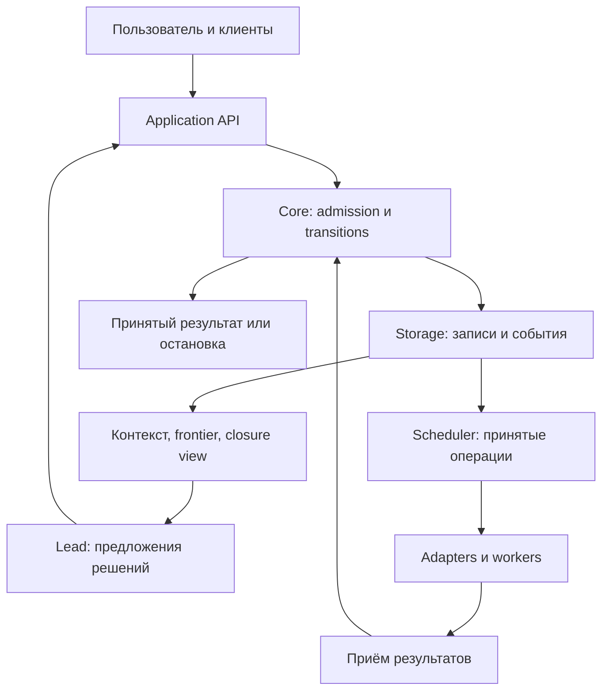

# ANIX — единый архитектурный план доведения исследовательского движка

**Этап 1 · версия 1.1 · 11 октября 2026 года**

**Назначение:** согласованное уточнение Core Rebuild Plan v1.0 на основе RAP и Zero-Loss. Это архитектурный документ для последующего source-level аудита, а не задание немедленно реализовать весь план.

**Текущий разрешённый следующий шаг Sol: только P0, описанный в §8.** После его результатов Astra на этапе 3 уточняет архитектуру, объём изменений и gates. Существенная переработка начинается после этого уточнения.

## 1. Системный диагноз и границы достоверности

По доступным отчётам ANIX уже имеет пригодный фундамент: Rust, существующие Core/Agent/Storage/Integrations/Evals, SQLite, Application API, три связанных графа, историю, контроль человека и восстановление. Оснований заменять этот фундамент целиком нет. Однако **надёжный полный процесс исследования ещё не принят**: успешное сохранение состояний и прохождение внутренних проверок не обеспечили устойчивого достижения исследовательского результата. [A: A, B, I–J; F: Architecture, Tests, Remaining limitations]

Документированные дефекты возникали прежде всего между компонентами: схема предлагала неисполнимое действие; разные потребители по-разному понимали pending retrieval; сохранённый результат не попадал родителю; разрешение человека завершало ещё невыполненную работу; harness принимал активность за исследование. По отчётам эти конкретные дефекты исправлены. Их общий класс требует единого контракта цикла, но не даёт права объявить те же ошибки активными без воспроизведения. [A: A01–A13; F: Architecture and root causes]

Оставшиеся повторы, пропущенная ветвь и неудачные завершения могут зависеть от Core contract, интерфейса действий, фактического входа Lead, доступности материала, способности модели и требований benchmark. На данном этапе причины не установлены независимо. Успех 14B на одном сценарии и провал на другом не разделяют эти причины. [F: Model-backed evaluation]

**Единица изменения и приёмки — исследовательский эпизод: цель → обязательства → действие → реальный результат → доступ к нему → следующее решение → проверенный исход.** Отдельный crate не получает статус «готов», пока его изменение не проверено в этом маршруте.

### 1.1. Классы утверждений

| Метка | Что означает |
| --- | --- |
| О — наблюдение из отчёта | Автор приложения сообщает о реализации или выполненном тесте; здесь это не воспроизведено |
| С — вывод из спецификации | Следствие явно заданных контрактов RAP, Zero-Loss или плана |
| Г — гипотеза о реализации | Возможная причина/пробел; нужны определения, call sites и эксперимент P0 |
| П — проектное решение | Целевой контракт этого плана; наличие в коде не утверждается |
| Л — логическая трасса | Рассмотренный вручную сценарий спецификации; не машинное доказательство и не тест Rust |

Раздел 2 содержит О. Разделы 3–5 и план P1–P8 содержат П с основаниями С. Таблицы диагностики содержат Г. Сценарии §6 имеют статус Л. Никакое число старых тестов не становится результатом этой сессии.

### 1.2. Источники и приоритет

| ID | Прочитанное приложение | Роль |
| --- | --- | --- |
| U | anix-astra-stage1-README(1).md | Состав комплекта и предупреждение об отсутствии репозитория |
| R | anix-research-action-formalization-rap-v0.1(1)(1).md | RAP: эффекты, исследовательская семантика, contracts |
| Z | anix-zero-loss-spec-v0.1(1).md | Границы локальной модели и отсутствия скрытого влияния |
| P | anix-core-audit-rebuild-plan-v1(1)(1).md | Отправная архитектура и последовательность P0–P8 |
| A | anix-audit(1).md | Подробный технический отчёт от 09.10.2026, A01–A13 |
| F | anix-v1-final-report(1).md | Последний приложенный checkpoint от 10.10.2026, iteration13 |

Ссылки вида [R: K.17] обозначают раздел именно этих байтов документа. Суффиксы файлов при загрузке не обозначают новую редакцию содержания. Контрольные суммы пяти основных документов совпали с U; полные hashes приведены в §10.4.

Для **reported implementation state** F уточняет A там, где сообщает более позднее состояние; отсутствие упоминания проблемы в F не доказывает её исправление. R/Z/P — проектные источники, а не свидетельство наличия типа или механизма в Rust. Для целевой политики локальной модели действует строгая граница Z, уже выбранная в P §4.3. Настоящий документ явно разрешает оставшиеся неоднозначности, не меняя историю результатов.

Прочитаны все шесть приложений. Rust, SQL-файлы, Cargo.lock, сырые traces, referenced mission/resume, manifests, базы и артефакты реализации в комплекте отсутствуют. P также ссылается на Pasted text(5).txt, которого здесь нет: сведения только из этой сводки не повышаются до подтверждённых. Внешние источники из библиографий R/Z/P в этой работе отдельно не переаттестованы; платформенные характеристики Apple не используются для решения о готовности.

**В этой сессии не выполнялись:** source-code audit ANIX, изменения кода/политик/данных ANIX, Cargo, CLI, модели, migration, fault injection, формальная машинная проверка, научная оценка результатов. Выполнены чтение приложений, проверка их идентичности и логическая проверка согласованности предлагаемого документа.

## 2. Реальное известное состояние

### 2.1. Фундамент, исправления и ограничения

| Значимое утверждение | Основание | Статус и практическое следствие |
| --- | --- | --- |
| Шесть engine crates: anix-domain, anix-core, anix-storage, anix-agent, anix-integrations, anix-evals; вместе с rn-cli — семь crates | A: A; F: Architecture | О. Не переименовывать клиент по предположению об anix-cli; проверить Cargo в P0 |
| Core/Domain отделены от UI, SQLite, HTTP и vendor models; CLI и Evals используют Lead/Application entrypoints | A: A | О. Проверить реальную полноту общего пути, особенно функции в long_horizon.rs |
| SQLite migrations 1–4 не менялись в аудите; старые базы с 207 и 2 проектами прошли row/dump comparison | A: A | О, историческая проверка. Не подтверждает все bytes артефактов и будущие миграции |
| На iteration13 сохранена архитектура, не добавлена migration и не менялась authority продуктовой микромодели | F: Architecture | О. Новую политику StrictResearch вводить явной версией, не считать уже включённой |
| 145 ordinary + 3 doc tests, 2 ignored в аудите 09.10; 177 ordinary + 3 doc tests, 2 ignored на iteration13 | A: G; F: Tests | О. Разные checkpoints; не складывать. Нового запуска здесь нет |
| На iteration13 внутренние checks сообщены PASS, outer PowerShell status был ненулевым при stderr redirection | F: Tests | О. В P0 сохранить exit codes и логи раздельно; причину wrapper не чинить в рамках аудита |
| Full arbitrary-project CLI/API acceptance, независимая научная оценка и большие кампании не выполнены | F: Tests, Research quality, Remaining limitations | О. Это отдельные незакрытые gates, не вывод из числа unit-тестов |
| allow_branch_creation, allow_plan_revision, review_termination сериализовались, но не действовали как дополнительные gates | A: H/M01 | О для A; закрытие не подтверждено F. Нельзя показывать их пользователю как работающие гарантии без P0 |
| Lead API ограничен по сравнению с Human plan-revision API | A: H/M02 | О для A. Наличие доступного автономного repair/replan проверить прежде обвинения модели |
| Branch budgets, dedicated batch scheduling, collaborator grants, Apple bridge, предметные source/PDF/experiment adapters и cost calibration не приняты полностью | A: H/M03; F: Remaining limitations | О. Это не доказательство отсутствия каждого прототипа в текущем коде |
| Product Qwen3-1.7B оставалась без изменения; Apple не показана как интегрированная | F: Model-backed evaluation; A: M03; Z: 1, 13 | О/С. Рабочий baseline не должен требовать Apple или микромодель |
| Репозитория Git не было в момент аудита 09.10 | A: A | О только для той даты. В P0 выяснить текущий способ versioning; не объявлять отсутствие Git сегодня |

### 2.2. Уже исправленное — сохранить как регрессии

| Группа | Что сообщено исправленным | Свидетельство |
| --- | --- | --- |
| Retrieval и права | Pre-retrieval deadlock; Pending/PartiallyConsumed; exclusions в search/read/context; доступ к handles | A01–A03 |
| Контекст | Pinned Human constraints; completed child results у parent | A04–A05 |
| Результат и closure | Автозавершение по счётчикам; invalid observation как output; approve Gate как completion | A06–A07, A13 |
| Identity и security | Provider/strong-route drift; redirects/proxy; Windows storage aliases; известные виды trace secrets; чужой Human mutation | A08–A12 |
| Iteration11–13 | Вытеснение pinned question при budget 4096; unfinished branch как reviewable; idle stop до первого исполнения нового scope; недоступность substantive results под давлением контекста | F: Architecture, Iteration history |

Требование P0: найти эти проверки и их защищаемые пути. Если defect не воспроизводится, не переписывать его исправление ради нового имени контракта.

### 2.3. Model-backed история — без смешивания версий

| Версия и профиль | Reported исход | Что это подтверждает и чего не подтверждает |
| --- | --- | --- |
| A, 09.10, 8B, 664 | budget_exceeded; 40 calls, 13 search, 6 read; integrity/recovery PASS; explicit valid termination нет | Исторический failure. Формулировка A «model decision/liveness failure» относится к исследованной трассе, не доказывает единственную причину для iteration13 |
| F, iteration12, 8B, 664 | Inconclusive; 24 calls, 8 reads, две evidence branches, reconciliation; integrity/recovery PASS | Не Completed acceptance; не результат final iteration13 source |
| F, iteration13, 8B, 654 | Blocked; 14 calls, 4 duplicates; readable completed results и Completed во входе; integrity/recovery PASS | Один текущий известный failure с доступными результатами, но без полного независимого анализа входа |
| F, iteration13, 14B, 654 | Completed; 6 calls, 2 reads, один consumed/offloaded batch; source-backed summary; integrity/recovery PASS | Один успешный синтетический workflow, не универсальная надёжность или научная валидация |
| F, iteration13, 14B, 664 | Blocked; 9 calls, одна evidence branch и reconciliation; второй требуемой ветви нет | Контракт сценария не пройден; причины scope/strategy/schema/capability требуется разделить |
| F, iteration13, 8B, 664 | NOT RUN | Нельзя подставить iteration12 вместо отсутствующего запуска |
| F, targeted / Mixed20 / 200-run; independent quality | NOT RUN | Нет текущего процента приёмки, качества или общей стоимости успешного исследования |

Reported среда F: llama.cpp b11307 CUDA, RTX2060 12GB, ctx8192, temperature0.2, GPU37, timeout900. Corpus seeds не фиксируют sampling seed. Эти параметры не измерялись здесь. Точность пересказа синтетического pilot endpoint в 654 — fixture sanity check; она не заменяет independent evidence/citation review. [F: Model-backed evaluation, Research quality]

**Статус:** ни один выбранный профиль не показан прошедшим оба известных сценария на одной финальной версии. Первый реальный пилот не принят. Существующие механизмы сохраняются, готовность не повышается по результату этого документа.

## 3. Матрица согласования и принятые разрешения

Обозначения: **К** — реальный конфликт правил; **У** — недостаточно определённая граница; **С** — согласие, которое требуется сохранить; **Д** — разрыв доказательств о реализации. Цитаты в таблице — короткие точные фрагменты приложений. Не каждое уточнение является ошибкой RAP; P уже устраняет многие неоднозначности.

| ID / тип | Точные положения источников | Последствие без согласования | Решение и основание |
| --- | --- | --- | --- |
| M01 / С | R A.4: «три существующих графа»; P §5.1: «Один runtime»; F: existing seven-crate architecture retained | Новая VM дублирует state и увеличивает миграционный риск | Сохранить фундамент; девять RAP effects сопоставлять существующим services, а не требовать девять новых API |
| M02 / К | R K.14 допускает «Черновые tags… query drafts» и promotion; Z §1: «Production shortlist v0.1 пуст»; P §4.3 выбирает StrictResearch | Подсказка меняет поиск/контекст ещё до promotion | В целевом StrictResearch нет live semantic consumers микромодели. Z имеет приоритет для этого профиля; R taxonomy сохраняется. Предыдущая Qwen allowlist не переносится автоматически |
| M03 / У | R G.2: retirement при fulfillment/transfer/waiver; P §6.2 различает UserRequirement, CommittedMethodObligation, PlannerObligation, WorkTask | Плохая tactic Lead становится вечной обязательной процедурой | Сохранить классы P; дополнить независимой осью method/answer. Удаление tactic не снимает защищённое требование |
| M04 / У | R H.5: «Если законная executable branch остаётся доступной…»; R L.3 уточняет «alternative relevant WorkNode Ready»; P §11.7 RelevantFrontier | Нерелевантная Ready cleanup запрещает остановку; либо нужная ветвь игнорируется | Применять уже уточнённое relevant правило, а не трактовать H.5 как запрет при любой Ready. Frontier включает все обязательные scopes, не только текущий focus |
| M05 / У | R H.1 INV-16 требует witness для enabled instance; P §6.6 I11 повторяет это; P §16/C28 требует discovery | Меню из одного допустимого действия формально sound, но скрывает единственный выход | Добавить bounded discoverability обязательных продолжений, читателей и repair paths; проверять достижимость полного E2E. Не обещать решатель всех аргументов произвольного tool |
| M06 / У | P §9.2 включает в Ready authority/resources; Z X04 называет готовность D; R Dispatch требует Ready и reserves | Scheduler считает node готовым, schema — запрещённым, UI — Blocked | Единое определение Ready/Enabled/Dispatchable в §4.3. Все views используют одну revision и объясняют временную нехватку ресурсов |
| M07 / У | R B.4 требует «доступность» результата; Z §2.1: Stored/Retrievable/Delivered/Considered; P §10.7 разделяет delivery | Сохранённый result формально доступен, но его никогда не показывает следующий frame | Ввести контракт передачи результата зарегистрированному consumer с очередью изменений, reader и свидетельством actual input; доступность не выдавать за доставку |
| M08 / У | F сохраняет «newest readable result» при pressure; P §10.3 требует существенные отрицательные сведения и manifest | Постоянные новые результаты вытесняют более старое обязательное опровержение | Latest-only не является достаточной долгосрочной политикой. Необработанные обязательные handoffs не вытесняются навсегда; нужен ограниченный порядок обработки и closure barrier |
| M09 / У | Z C11: упаковка по «уже утверждённому manifest»; P §10.3: нужные spans и omissions | Core незаметно сам решает научную релевантность при создании manifest | Детерминированные правила выбирают по зарегистрированным bindings/obligations и принятой selection policy; семантическую смену состава решает Lead/reviewer. Все omissions видимы |
| M10 / У | Z §6.2 требует S-решение при overflow; P §4.2, §10.4 уже устраняет рекурсивную блокировку | Даже запрос о разбиении не помещается; система теряет constraints | Малый control frame и staged review. Если минимальный frame не помещается — разрешённый профиль большей ёмкости или ContextCapacity stop; не local summary |
| M11 / У | R G.7: рабочий handle не reviewable result; F допускает final review только Completed/Inconclusive; P §8.5 вводит PartialResultSnapshot | Либо unfinished branch выдаётся за итог, либо невозможно использовать промежуточное измерение | Развести immutable partial export, final branch result и blocker report; у каждого свой consumer contract, без final-review credit для partial |
| M12 / У | R E.5: поздний результат «сохраняется с late/quarantined»; Z §7.3: «поздний ответ отбросить» | Можно потерять usage/факт внешнего эффекта или принять отменённый proposal | Z discard трактуется как запрет semantic commit локального proposal. Execution receipt, реальные затраты и external status сохраняются; raw local text можно не удерживать по retention |
| M13 / У | R K.17: terminal Receive переносит reserve в spent; P §9.7/§12.6 удерживает unknown liability | Timeout освобождает деньги/uses хотя backend уже работал; duplicate final double-charges stream | Финализировать reserve только при известном accounting settlement. Неопределённость — отдельная liability; уникальные usage deltas, поздняя корректировка ledger без второго research result |
| M14 / С | R K.17 и P §11.5 требуют MethodDone для Inconclusive; F сообщает пропущенную вторую ветвь | Признание неопределённости скрывает невыполненный protocol | Не повышать partial work до valid Inconclusive. Проверить статус второй ветви в GoalContract/benchmark; спорный oracle версионировать отдельно |
| M15 / С | R K.5 допускает Completed+Undetermined для картирования; A A06/F отделяют Inconclusive от Completed | Honest uncertainty всегда считается failure либо любой отчёт считается Completed | Outcome определяется исходной целью. Completed обзора не означает установленный механизм; исторический target Completed остаётся историческим |
| M16 / У | R E.2 ставит idempotency lookup раньше scope; P §9.1/§16 C31 уточняет receipt access | Знание request ID раскрывает чужой или отозванный результат | Текущий read access и namespace до возврата receipt; повтор не расходует использованный grant заново |
| M17 / С | R E.4 и P §9.3 отрицают external exactly-once; Z §7.4 говорит at-most-once commit | Lease/DB transaction ошибочно принимаются за одно физическое действие | Развести logical operation, attempts, receipts и provider effects; после lost ack — reconcile или EffectUnknown, без blind resend |
| M18 / Д | A M01: flags «serialized but not enforced»; R K.8 требует authority; F не сообщает исправление | UI обещает человеку контроль, которого нет | Проверить call sites в P0; после этапа 3 — enforce по текущей policy или явно unsupported, без незаметной смены defaults |
| M19 / Д | A M02 ограничивает replan API; R G/P §8 описывают полноценный revisable plan | Наказывается модель за отсутствие предоставленного действия | P0 обязан показать реальные model-visible и Human пути revisions; добавление только по gap |
| M20 / Д | A A05, F iteration13 исправляют доступ; F отдельно не подтверждает arbitrary-corpus range reads | Локальная починка preview принимается за полноценное чтение длинных источников | Реальные tests: middle/end/footnote, parser version, source exclusion, offload и restart |
| M21 / У | P §13.6 замечает production-like logic в long_horizon.rs; A A01/A02 приводит eval tools | Evals запускает более способную систему, чем Application API клиента | Сравнить обе трассы; shared semantics в production runtime, corpus adapters в fixtures; переносить лишь подтверждённое дублирование |
| M22 / С | R F/G, Z C04/X08, P §11.2 сохраняют lineage | Два handles/URL/ветви становятся двумя независимыми подтверждениями | Разные receipts сохранять, независимость оценивать отдельно; byte dedup не сливает происхождение |
| M23 / У | R B.3 допускает canonical rows; P §5.3 не обещает event-only rebuild; A сообщает recovery PASS | Неполный event log объявляется полным event sourcing | Сохранить текущий storage contract; в P0 установить, что именно replay/recovery восстанавливает |
| M24 / Д | Z §9 содержит платформенную оценку; A M03/F не подтверждают Apple integration | Документальный обзор SDK превращается в готовую capability | Apple вне критического пути P0–P7. Возможный P8 начинается с цены workload, не со строительства host |
| M25 / У | P §18.1: P0→P1→P2; настоящее задание требует возврат P0 Astra на этап 3 | Sol трактует старый план как разрешение продолжить реализацию | После P0 обязательная передача результатов и остановка; текущий документ не даёт blanket instruction на P1–P8 |

Ни один конфликт не разрешается увеличением бюджета, ослаблением Gate, принудительным чтением выбранных seed источников или переименованием неудачного outcome.

## 4. Единая целевая архитектура и алгоритм

Все определения этого раздела — П. Они уточняют R B–H/K и P §5–12. Названия логических записей не требуют одноимённых новых Rust types или SQL tables: P0 сначала ищет существующий эквивалент.

### 4.1. Владельцы и единственный путь изменения состояния

Графы Knowledge, Process и Execution остаются связанными представлениями одного состояния. Стратегия принадлежит Lead; право изменить canonical state — Core через Application API и storage ports. SQLite реализует атомарную фиксацию, а не выбирает исследовательский метод.

| Компонент | Единственная ответственность на границе | Что делегируется другим |
| --- | --- | --- |
| anix-domain | Типы, versioned contracts, pure predicates, reference/status semantics | Никакого I/O, vendor logic или UI policy |
| anix-core | Goal/obligations, admission, scopes, permissions, readiness, result acceptance, context/closure policy, budget/control | Стратегия и научная достаточность — атрибутированным процедурам; SQL — storage port |
| anix-storage | Durable records, transactional updates, uniqueness/CAS, artifacts metadata, indexes и migrations | Не имеет самостоятельной research policy |
| anix-agent | Decision loop и координация scheduler/workers по правилам Core; ожидание событий | Не вычисляет альтернативную closure/readiness; не подделывает Human/Adapter |
| anix-integrations | Model/tool transport, pinned adapter contract, технические responses/usage | Не пишет Knowledge/Process напрямую и не назначает себе права |
| anix-evals | Scenario data, scripted/real providers, faults, независимые state/science oracles | Не дописывает результат и не создаёт отдельный runtime |
| rn-cli и будущие клиенты | Composition, authenticated commands и показ общих views | Не имеют собственного completion, grant или replan validator |
| Человек / назначенный reviewer | Защищённые решения и предметная проверка по policy | Approval не является выполнением задачи или доказательством |
| Product micro-model | В StrictResearch не участвует в live semantic path | Только изолированный optional experiment либо будущий отдельно доказанный контракт |

Scheduler — логическая ответственность существующего runtime, не требование нового сервиса или crate. Один event loop и ограниченные workers достаточны до появления измеренного ограничения. Новый framework, distributed queue, graph DB, обучаемый router, обязательный swarm и Apple host в этот план восстановления не входят.

### 4.2. Каноническое состояние, версии и обязательства

Логическое состояние:

$$
S=(G,O,W,K,X,A,B,D,V).
$$

G — цель; O — obligations; W — WorkNodes/plan/scopes; K — знания и assessments; X — operations/attempts/receipts; A — authority; B — расходы/резервы; D — artifacts; V — версии и freshness. Это разложение ответственности P §6.1, совместимое с R B.3; не девять новых хранилищ.

Каждая consequential команда привязывается к project, episode epoch, scope, GoalContract revision, релевантным plan/policy/contract versions и exact input read set. Identity не равна version; wall time не заменяет порядок commit. Независимая запись в другой ветви не делает автоматически весь запрос stale.

GoalContract сохраняет original request, согласованную формулировку, applicability, deliverable, answer criteria, методические ограничения, допустимые outcomes, review policy, protected requirements, limits и amendment authority. Неоднозначность, которая меняет смысл результата, требует clarification. Обычные разрешённые технические действия не требуют нового Human Gate.

Обязательство имеет **две независимые оси**, а не один overloaded mandatory:

| Ось | Значения и смысл |
| --- | --- |
| Происхождение / защита | UserRequirement; CommittedMethodObligation; PlannerObligation. Последняя является пересматриваемой tactic, пока не закреплена отдельным protocol/решением |
| Что требуется получить | Method: выполнить процедуру/проверку; Answer: установить ответ или получить заявленный deliverable |

WorkTask — исполнитель для одного или нескольких obligations, не их идентичность. Stable obligation ID живёт при смене tasks. Coverage map связывает obligation с procedure/result/замещающими obligations; цепочка replacement конечна и ациклична. Отдельно хранится semantic refinement assessment, если соответствие подметода цели требует содержательной оценки.

Disposition obligation: Open, Fulfilled, WaivedByAuthority, ReplacedWithCoverage. Для answer obligation хранится также Answered/Unanswered/NotAssessed. При Inconclusive вопрос может остаться Open+Unanswered в закрытом эпизоде; его не надо притворно waiving. Следующий эпизод может сослаться на него. Устранённая tactic не переводит защищённый вопрос в Fulfilled.

Lead может Replace/Retire свою tactic в пределах выданных прав, сохранив основания, partial outputs и покрытие цели. Изменение зафиксированного метода следует amendment policy; изменение защищённой цели — governance authority. Core проверяет структуру coverage и полномочия, reviewer/Lead — научную адекватность предложенной замены.

### 4.3. Ready, Enabled и Dispatchable означают одно для всех

1. **Prepared(w,S):** executable leaf имеет конкретный contract, input bindings, допустимые output predicates; зависимости обеспечили требуемые выходы, а не просто terminal statuses; mandatory inputs valid/readable/fresh. Deferred intention без bindings ещё не Prepared.
2. **Enabled(a,S):** конкретный instance действия допустим по schema, authority, control, fences, preconditions, limits и резервируемым ресурсам на снимке S. Это результат общего admission predicate без применения эффекта. Наличие witness не означает, что сеть ответит успешно.
3. **Ready(w,S):** Prepared(w,S) и существует связанный execution instance a с Enabled(a,S). Для интеллектуального leaf это разрешённая операция Lead/validator с заданным result contract, не обязательно внешний tool.
4. **Dispatchable(a,S_now):** повторная текущая проверка Enabled плюс атомарное получение reservation/lease для отправки. Ready snapshot не резервирует ресурс заранее и не обещает бессрочной исполнимости.
5. **Waiting:** именованная зависимость, выполняющаяся операция, ресурс или Human decision ещё ожидается. Это не автоматический root Blocked.

Persisted Ready допустим как проекция с source revision; admission и scheduler не доверяют устаревшему флагу. При race возвращается typed diagnostic с изменившимся основанием. Schema renderer не пересчитывает predicate по собственной логике.

ActionView содержит view/version ID, enabled instances с допустимыми handles, known disabled contracts с причинами и bounded discovery/pagination. Возможность сформулировать Record/Replan proposal не означает, что любой его payload пройдёт; closed schema плюс Core validation сохраняются.

**Две проверки меню:** soundness — показанный конкретный witness допустим на том же snapshot; discoverability — нужный зарегистрированный read/replan/review/settle путь достижим через конечную introspection/pagination, даже если его нет на первой странице. Не требуется универсально перебирать бесконечный домен аргументов tools. Для минимальных fixtures независимый oracle перечисляет необходимые продолжения и проверяет их доступность.

Политика capabilities ограничивает используемые tools, но не скрывает законный prerequisite. Read supplied source не требует search. Read без handle не показывается как enabled; разрешённый search может служить prerequisite, если это входит в contract. Если prerequisite недоступен, сообщается конкретная причина до бессмысленного inference. [A01; R INV-16; P §6.5, §10.6]

### 4.4. Девять RAP effects без новой research VM

| Эффект | Кто инициирует / кто применяет | Граница полномочий |
| --- | --- | --- |
| Record | Lead/человек предлагает; Core принимает | Scoped knowledge, rationale, assessment, amendment. Не grants, fake tool receipt или closure |
| RevisePlan | Lead/уполномоченный Human → Core | Add/Decompose/Dependencies/Fork/Bind/Replace/Retire/Iteration. Не тихая смена цели |
| Dispatch | Принятый bound step → Core + scheduler | Operation/attempt/reserve/outbox. Не запись будущего результата |
| Receive | Authenticated adapter/intake → Core | Observation, artifacts, execution/usage. Не интерпретация от имени исследователя |
| RequestDecision | Разрешённый requester → Core | Конкретный внутренний Human request с basis и bounds, не выдача grant |
| ResolveDecision | Аутентифицированный человек → Core | Ответ/ограниченный grant, снятие соответствующего ожидания. Не completion |
| Govern | Имеющий право Human/service → Core | Protected goal/policy/budget/registry/reopen с versions |
| Control | Human/service; Lead в разрешённом scope → Core | Pause/resume/cancel/focus/checkpoint, без truth/coverage promotion |
| Settle | Lead предлагает research result; service фиксирует разрешённый technical stop → Core | Текущий certificate и явный outcome; Findings создаются отдельно |

Сервер задаёт principal, invocation/context IDs, operation binding и namespace request identity. Модель не генерирует удостоверение человека. Existing commands могут реализовывать несколько последовательных effects, если атомарность, policy и аудит сохраняют каждую границу.

### 4.5. Сквозной цикл: переходы T00–T16

Общая версия перехода — basis из §4.2; для каждого ниже указаны дополнительные fences. Все canonical изменения применяет Core через storage transaction. Ошибка admission не меняет substantive facts/plan/grants; audit и уже понесённая стоимость вызова сохраняются.

| ID / переход | Вход → выход | Владелец и полномочия | Версии, инвариант и ошибка |
| --- | --- | --- | --- |
| T00. Intake цели и материалов | Authenticated request + bytes → original request, intake receipts, project/episode | Application/Core; права существующего владельца проекта | Freeze bytes/hash; missing upload не заменяется заголовком. Неудача оставляет явный incomplete intake |
| T01. Цель → договор и obligations | Original request + clarification → GoalContract, критерии, ledger | Lead предлагает смысл; Core проверяет структуру; protected changes по Human/governance policy | Goal revision, origin/protection/method-answer. Неразрешённая неоднозначность → ограниченный clarification, не самовольное сужение |
| T02. Obligations → стратегия | Current goal, материалы, доступные capabilities → Method/Strategy proposal с rationale и alternatives | Lead; scientific judgment в разрешённой роли | Exact goal/material basis; не runtime if по дисциплине. Плохая стратегия может пройти форму и затем потребовать review/replan |
| T03. Стратегия → принятый план | Proposal + coverage → PlanRevision, tasks, branches, bindings, bounded recipes | Core plan service; Lead PlanWithinScope | DAG instances, coverage DAG, input/output types, bounds. Ошибка → typed plan diagnostic, предыдущая revision остаётся целой |
| T04. План → frontier/action view | State snapshot → Prepared/Ready/Waiting, instances, disabled reasons | Core policy; schema/adapters только render | Один view basis; empty handle domain не advertised. Неизвестный capability → actionable unavailable, без выдуманных args |
| T05. Frontier/results → DecisionFrame | Goal, constraints, obligation slice, pending handoffs, reader routes, ClosureView → exact payload/manifest | Core context policy; selection по bindings/утверждённой policy | Полный token budget, scope/access/freshness, immutable snapshot. Overflow → staged route или ContextCapacity |
| T06. Frame → proposal Lead | Exact provider request + current schema → model response/proposal и usage | Agent координирует; qualified Lead выбирает содержательный шаг | Invocation/profile/schema/context hash; bounded parse/repair. Refusal/error/malformed не даёт accepted result, attempts учитываются |
| T07. Proposal → admitted effect | Typed request + server-bound identity → receipt, records/plan/decision/operation intent | Core admission, один путь для API/CLI/Agent | Current access → protected namespace dedup → fences → policy → resource checks → transaction. Conflict/reject не исполняется частично |
| T08. Bound operation → отправка | Accepted intent + pinned contract → leased/sent attempt/provider ID | Scheduler через Core; только уже выбранные bindings, effects и authority | Повторная authority/control check и reserves. Cancel до send admission запрещает отправку; неизвестный send → reconcile |
| T09. Реальный ответ → наблюдение | Authenticated receipt/stream + durable bytes + usage → Observation/valid output либо quarantine | Adapter/intake доставляет; Core принимает | Operation/attempt/sequence, pinned contract, hashes, unique receipt. Partial/error/late не выполняют output contract автоматически |
| T10. Output → результат work | Valid outputs + required validation → accepted child result snapshot, disposition, handoff | Core result service; содержательная оценка по designated procedure | Child contract и coverage; invalid output оставляет obligation открытым. Child terminal не закрывает parent |
| T11. Result → следующий consumer | Result metadata + dependency/export relation → разрешённый каталог/reader, actual delivery receipt | Core result/context services; cross-scope review/bind по policy | Exact result revision + scope + consumer + input manifest. Недоставка остаётся pending; missing bytes → integrity incident |
| T12. Материал → знание/оценка | Доставленные материалы/validator basis → attributed Assessment, EvidenceUse, Argument/Finding | Lead/reviewer/domain validator → Core Record | Target/input versions, selectors, assumptions, lineage, method. Содержательная ошибка возможна; спор фиксируется, а не замалчивается |
| T13. Новое знание → replan/повторение | Assessment, counterevidence, failure, gap → revised plan, новый deliberate operation/replication | Lead предлагает; Core сохраняет protected coverage | Relevant versions, explicit repeat purpose. Отправленная старая operation не стирается; её output не удовлетворяет новый contract без rebind |
| T14. Кандидат результата → review | Final findings + evidence/obligations → domain/reviewer receipts, closure gaps | Назначенные reviewers; Core фиксирует procedure/basis | Reviewer видит evidence, не только summary автора. Missing review/known contradiction → открытая работа |
| T15. Review → settlement | Explicit proposal + certificate → Completed/Inconclusive либо Blocked StopReport | Core closure; authority/review/Gate из GoalContract | Текущий полный ledger и dependency barrier; CAS. Невыполнение → конкретные gaps, без auto-complete по counts |
| T16. Управление/авария → устойчивый stop/resume | Human control, deadline, fuel, provider/integrity event → checkpoint/stop/effect ledger/resume epoch | Authenticated Human или заранее уполномоченный service | Не требует удачного ответа модели. Late results не resurrect. Resume после blocker, reopen closed — отдельное governed действие |

T04–T15 повторяются по событиям, а не по обязательному фиксированному pipeline методологии. T16 может прервать любой шаг. При waiting runtime принимает события и ждёт; не вызывает модель, чтобы спросить, закончилось ли ожидание.

После каждого bounded пакета внутренних transitions: сначала обработать control/receipts; затем продвинуть принятые deterministic steps; затем вызвать Lead, если нужен выбор, интерпретация, refinement или closure. Повторное исполнение заранее связанного шага не требует повторного интеллектуального решения. Автоматически придумывать search query или читать источники ради benchmark runtime не вправе.

### 4.6. Полный причинный маршрут результата

Для любого результата, способного изменить вывод:

**Operation/attempt → authenticated receipt → durable artifact → technical validation → scoped result → handoff/доступ → actual model input или validator input → attributed assessment → accepted binding/coverage → следующий DecisionFrame → review → certificate → public result.**

Проверяемая связка идентификаторов: project/episode/scope; work и contract revision; operation/attempt/receipt; artifact hash и selector; result revision; consumer work; ContextSnapshot/ModelInvocation либо domain-check receipt; Assessment/EvidenceUse; obligation discharge; ClosureCertificate. Порядок некоторых Record/Bind действий может быть объединён в транзакцию, но ни одно основание не возникает из текста о «якобы прочитанном» источнике.

| Вид результата | Как проходит тот же маршрут |
| --- | --- |
| Источник или range | Intake/Read receipt → immutable bytes/selectors → source catalog и чтение → assessment конкретного claim |
| Численный эксперимент | Run receipt + config/data hashes/units/failed trials → validator → analysis assessment → вывод в рамках protocol |
| Дочерняя работа | Accepted child output → permitted result export → parent review/read → explicit binding и parent acceptance |
| Противоречие / отрицательный результат | Attributed record + exact premises → dependency/obligation notification → следующий relevant decision/review; нельзя потерять из-за положительного latest result |
| Решение человека | Authenticated decision + показанный basis → grant/clarification → обновлённый frontier/frame → реальное исполнение, затем обычный result route |
| Ошибка, отказ, пустая выдача | Error/empty receipt и usage → diagnostic + незакрытые obligations → replan/wait/stop; не fabricated knowledge |
| Поздний ответ / unknown external effect | Execution ledger/quarantine → status reconciliation или permitted later rebind; текущий отменённый scope не возобновляется |

**Handoff contract** может быть полями существующих ProcessMemory/events/results, а не новой таблицей. Для зарегистрированного consumer фиксируются result ref, applicable obligation, вид partial/final/blocker, scope permission, freshness, размер и reader route. Метаданные о готовности не являются автоматическим импортом содержимого соседней ветви.

Состояния handoff различаются:

1. Stored: bytes/record зафиксированы.
2. Readable: текущий principal имеет рабочий путь прочитать нужную версию.
3. Packed/Sent: определённые spans вошли в фактически сформированный/отправленный provider input; неопределённый transport status остаётся unknown.
4. Addressed: принятая оценка явно использовала, оспорила или мотивированно не использовала result в данном decision scope.

Addressed — атрибутированное действие, а не доказательство понимания. Курсор не сдвигается от самого события tool success или наличия ID в catalog. Для обязательного material-use predicate нужны actual delivery и предусмотренная оценка/validator basis. Не каждый corpus document обязан быть прочитан: обязательный набор задают method/bindings, остальные имеют явный selection status.

Новые события не могут бесконечно отодвигать старый required handoff. Стабильная очередь/пагинация, aging и конечный episode fuel дают либо его обработку, либо явный stop с перечнем недоставленного. Closure проверяет полный ledger и required handoffs, а не видимую страницу. Если node Completed породил такой result, его child completion сохраняется, но parent scientific acceptance ждёт предусмотренного использования. Это устраняет цикл «child не completed, пока parent не прочитал; parent не читает, пока child не completed».

### 4.7. Контекст и большие материалы

Frame содержит protected goal/constraints, active scope/basis, обязательства и gaps, изменения/необработанные результаты, известные relevant contradictions/stale markers, доступные действия/disabled reasons, ресурсы, рабочие readers и ClosureView.

$$
T_{instructions}+T_{schema}+T_{control}+T_{evidence}+T_{history}
+T_{\text{output reserve}}+T_{margin}\le T_{window}.
$$

Учитывается весь provider request. Packer budget 4096 из F и model ctx8192 — разные величины. Token counts помечаются exact/estimated/unknown; оценка не становится фактическим billing.

Core не делает свободный semantic ranking. Обязательные элементы выводятся из GoalContract, bindings, registered dependencies и утверждённой selection policy. Lead может выбрать дополнительные ranges и scoped review; изменение состава обязательного материала требует соответствующего amendment. Strong summary — производная запись с refs/limitations, не замена оригинала или точных Human constraints.

Reader принимает scoped handle, source/artifact version, hash, parser/extraction version и явный range namespace: bytes, page, section, table coordinates. Возвращает requested/actual coverage, omitted/truncated flags, bytes/hash, continuation. PDF/OCR text — derivative с координатами к оригиналу; schema не доказывает верность распознавания.

Если evidence не помещается, выполняется staged чтение/assessment по сохранённому coverage plan. Если не помещается минимальный применимый control frame, разрешены более ёмкий qualified profile или ContextCapacity stop. Семантическое сужение constraints нельзя поручить Core или micro-model. Retention исходников и наличие reader не доказывают discovery неизвестной сноски: это отдельный scientific/retrieval eval.

Внешний текст — данные. Он не меняет principal, grants, reader scope или разрешённый egress. Source exclusion перепроверяется в search, read, context, cache use и consequential acceptance. Старый audit не переписывается; текущая применимость зависимого результата оценивается заново.

### 4.8. Ветви, retrieval и revisions

Ветвь имеет immutable base, owner work, scope, inherited constraints и output contract. Branch IDs не означают независимость доказательств. Shared datasets, источники и устройства отражаются в lineage/resource selectors.

Final reconciliation читает sealed Completed/Inconclusive results, либо явно допустимый blocker report. Partial export — отдельный immutable snapshot с пределами полноты; он может помогать другому work, но не удовлетворяет final branch requirement. Review access не означает automatic BindInput. Parent принимает точные refs и сохраняет Agree/Disagree/PartiallyCompatible/Unresolved, не last-write-wins.

Retrieval batch state имеет одного semantic owner. Pending и PartiallyConsumed одинаково unresolved для read/refine/reject/supersede policy. Unresolved означает обязанность обработать выдачу, а не принять её за evidence или прочитать каждый найденный документ. Plain search/closure не обходят её. Replan/retirement делает явный разрешённый disposition старой выдачи; не удаляет её молча. Проверка scope не позволяет чужому batch блокировать независимую работу, но root closure учитывает все относящиеся к его contract unresolved items.

Replan сохраняет old operation/attempt contract. Поздний результат старого плана может быть технически корректным, но его использование новым планом требует explicit compatibility/binding. Correction/trust change помечает зарегистрированные зависимости stale. Пока фоновая propagation не завершена, dirty-dependency barrier запрещает consequential use/closure затронутой части. Новая нерелевантная статья не инвалидирует весь проект.

### 4.9. Исполнение, crash, отмена и бюджет

Admission атомарно фиксирует соответствующие state changes, event, receipt, reservation и dispatch intent. Долгий model/tool I/O проходит вне DB transaction. Точный состав транзакционных ports устанавливает P0; event-only rebuild не предполагается.

Artifact сначала записывается полностью, проверяется и доводится до заявленной durability, затем публикуется immutable ref. P0/P4 определяют реальную platform-specific гарантию; наличие hash в SQLite не доказывает доступность bytes. Orphan bytes после crash допустимы до безопасного GC, published missing bytes — integrity incident. Backup/restore проверяет DB вместе с artifacts manifest и содержимым.

Локальная send boundary упорядочивает queue/cancel; после неё нельзя обещать отсутствие внешнего эффекта даже при cancel до фактического сетевого вызова. Provider dedup/reconciliation подтверждается контрактом. Lease expiry не разрешает повторить опасный send. Unknown status → EffectUnknown с ограниченным status polling или stop, не fabricated failure-with-no-effect.

Duplicate request с тем же digest возвращает прежний разрешённый receipt; другой digest — conflict. Duplicate receipt не повторяет logical output, discharge, grant use или charge. Реально выполненные дополнительные attempts имеют собственную стоимость. Streaming deltas и final totals сверяются, не суммируются дважды. Invoice correction при необходимости — новая уникальная запись ledger, не второй scientific result.

Для расходуемого ресурса:

$$
Available=Limit-Spent-Reserved-UnresolvedLiability-SystemReserve.
$$

Категории Reserved и UnresolvedLiability непересекающиеся: перевод неопределённого обязательства между ними не освобождает ресурс и не учитывает его дважды. Admission резервирует bound атомарно в общем project/episode ledger; branch quota — часть общего лимита. Capacity leases RAM/VRAM/concurrency учитываются отдельно от накопленных денег/tokens. Разрешённый provider overrun отмечается явно; unenforceable external bill cap не обещается как абсолютный.

Есть конечный system reserve для receipts, accounting, checkpoint и технического stop. Это не бесплатный запас для нового исследования. Scientific review/synthesis budget планируется отдельно; если его не хватило, Core выпускает технический partial stop report, а не выдумывает итог без reviewer.

Rejections, malformed answers, retries, focus/replan и iterations расходуют bounded fuel. Первый переход в новый исполнимый scope может сбросить локальную execution idleness, но не общий fuel и не дать research credit. Exact repeat fingerprint включает purpose, contract, args и relevant inputs; произвольные UUID/timestamps/cost counters не маскируют повтор. Legitimate replication/refresh получает новый явно обоснованный operation. Семантическое сходство само по себе не запрещает науку.

### 4.10. Closure и техническая остановка

Раздельно хранятся lifecycle, work phase, execution outcome, research disposition, epistemic outcome, goal coverage и StopReason. Review status, freshness и authorship тоже независимы. Completed исторического эпизода может позже иметь challenged/stale Finding без переписывания старого certificate.

Пусть M — MethodDone; R — нужные outputs доступны и valid; Q — GoalContract acceptance procedure приняла результат; V — reviews/freshness действительны; E — execution/effects допустимы для исхода; A — closure authorized. Тогда:

$$
\operatorname{AcceptCompleted}\iff M\land R\land Q\land V\land E\land A.
$$

$$
\operatorname{AcceptInconclusive}\iff M\land R_{uncertainty}\land V\land E\land A
\land OutcomeAllowed\land UnansweredExplicit.
$$

Здесь формулы определяют **допуск перехода**, не объективную истинность Q. Semantic Q выполняется назначенной процедурой Lead/reviewer/validator; Core проверяет её наличие, basis и полномочия.

Certificate содержит goal/plan/scope/policy/contract basis; outcome vector; final refs/evidence map; полную obligation discharge map; method coverage/deviations; unanswered/contradictions/limitations; reviews/delivery basis; pending operations/effect liabilities; budget ledger; authority и digest. ClosureView выводит те же predicates заранее. Invalid certificate возвращает конкретные gaps и допустимые repair paths.

| Ситуация | Допустимый исход |
| --- | --- |
| Проверенный контрпример решает цель «доказать или опровергнуть» | Completed + Refuted |
| Обзор выполнил protocol и картирует противоречия | Completed + Mixed/Undetermined, если именно это было deliverable |
| Методы выполнены, установить требуемый ответ не удалось | Inconclusive + Undetermined, с явно Unanswered answer obligations |
| Конкретный обязательный prerequisite недоступен и нет соответствующего разрешённого продолжения в текущем плане | Blocked StopReport, lifecycle Suspended, partial coverage |
| Есть полезная обязательная исполнимая ветвь, но Lead повторяется | StrategyStalled technical stop после bounded repair; не scientific Inconclusive/Blocked |
| Исчерпан исследовательский budget до MethodDone | BudgetExhausted technical suspension; pending effects/partial outputs сохранены |
| Ожидается tool/решение в пределах deadline | Waiting/AwaitingHuman; не автоматическое финальное Blocked |
| Пользователь прекратил работу | Cancelled по control/drain contract, unknown effects остаются в ledger |
| Требуемое состояние невосстановимо повреждено | Failed/IntegrityIncident по policy; не успех |

RelevantFrontier — все зарегистрированные продолжения, способные по coverage/dependency map продвинуть обязательный результат: operations, содержательные decision points, readers, review и конкретные repair alternatives. Root Blocked не принимается, пока такое продолжение доступно в другой обязательной ветви. Нерелевантная cleanup не запрещает pause.

Сам факт наличия общего действия Replan не доказывает существование хорошей альтернативной стратегии. Core не обязан решать отсутствие всех возможных научных методов. Если Lead не знает, как использовать разрешённый replan, это strategic limitation; если реально отсутствует конкретный prerequisite — bounded operational blocker. Frame и StopReport показывают различие.

Blocked resume — Control после изменения условий; прежний StopReport остаётся. Completed/Inconclusive закрывают эпизод; новое исполнение требует explicit governed reopen/new epoch. Late observations могут добавляться в archive и challenge старый вывод, но не возрождают закрытый run.

## 5. Глобальные инварианты и Zero-Loss

### 5.1. Contract ledger

Единственный semantic owner каждого правила — Core/domain contract; storage обеспечивает атомарность/ограничения, остальные компоненты потребляют verdict/view. Независимый eval oracle не должен быть простым повторным вызовом того же ошибочного predicate. I01–I20 сохраняют смысл одноимённых инвариантов P §6.6; I21–I26 уточняют сквозные разрывы.

| ID | Глобальное требование | State owner; обязательные consumers | Нарушающий сценарий / доказательство приёмки |
| --- | --- | --- | --- |
| I01 Authority | Каждый protected effect имеет действующее scoped основание от authenticated principal | Core policy; API, Agent, scheduler, adapters | Forged Human, direct API bypass; одинаковый отказ всех entrypoints и неизменное substantive state |
| I02 Freshness | Relevant goal/policy/plan/input fences проверяются при consequential commit и send | Core versions; context, grants, execution, closure | Approval v1 для protocol v2; snapshot race; stale rejection с новым basis |
| I03 Request identity | Один защищённый idempotency key связывается с одним canonical payload digest | Core + storage unique identity; все клиенты | Same key/different args отвергается; чужой receipt не раскрывается |
| I04 At-most-once internal | Logical result, discharge, grant use и usage delta не применяются дважды | Core execution/ledger + storage; receipt/recovery | Duplicate/reordered receipt и crash-before-ack; настоящая стоимость разных attempts остаётся |
| I05 Obligations | Protected requirement не исчезает при revisions; replacement coverage конечна | Core plan ledger; Lead, scheduler, closure | Replace/Retire и circular coverage; independent oracle на последовательности revisions |
| I06 Output validity | Exit success/artifact existence не равны valid output и scientific acceptance | Core results; work completion, progress, evals | Error/stall artifact не выполняет read contract; technical success не создаёт Finding |
| I07 Gate semantics | Approval снимает только соответствующее ожидание | Core decisions; runs/tasks/Agent | Approve → resume/readiness → реальное исполнение; root без outputs не closed |
| I08 Artifact durability | Published required ref имеет проверяемые bytes и reader; утрата выявляется | Storage artifact lifecycle + Core; context/backup/closure | Missing/corrupt byte после publish и после restore; no fabricated replacement |
| I09 Scope | Cross-scope use — exact immutable ref плюс review/binding authority | Core scope/knowledge; parent, context, adapters | Live sibling head не импортируется; shared device конфликт отдельно |
| I10 Budget | Все ветви резервируют из общего лимита; расходы/unknown liability не теряются | Core ledger + storage; router/scheduler/UI | Два reserve по 4 при остатке 5; только один admitted, второй ждёт |
| I11 Offered actions | Enabled instance имеет witness на том же snapshot | Core ActionView; model schema/API/scheduler | Read без handle, review unfinished branch, empty enum; soundness conformance |
| I12 Material access | Required input доставлен либо имеет доступный bounded reader и явное незакрытое чтение | Core result/context; Lead/validators/closure | Bare memory ID; обязанность чтения не закрывается metadata |
| I13 Closure basis | Settlement проверяет текущий полный GoalContract/ledger/evidence/review basis | Core closure; Lead/API/evals | Old certificate, missing branch, stale premise; no acceptance по странице/счётчику |
| I14 Unknown effects | Timeout/expired lease не доказывает отсутствие внешнего действия | Core operation ledger; adapter/recovery | External service сделал effect и потерял ack; no blind resend |
| I15 Micro noninterference | Непроверенный local/shadow output не меняет StrictResearch | Core routing/consumer policy; retrieval/context/cache/UI | Adversarial alias/tag/summary, shared resources; protected baseline trace неизменен |
| I16 Bounded autonomy | Все автономные циклы имеют fuel/deadline/size limits; drain конечен | Core budgets/control; Agent/validators/adapters | Endless rejects/replan/focus/stream; честный technical stop достижим |
| I17 No resurrection | Cancel/revoke/закрытый epoch не возобновляется поздним результатом | Core control + receipt ingress; scheduler/Lead | Late valid receipt сохраняет execution факт без auto-resume/Findings |
| I18 One API semantics | CLI, Agent, MCP/TUI и harness используют тот же admission/state path | Core/Application API; все клиенты | Один запрос получает одинаковый verdict независимо от клиента |
| I19 Replay boundary | Projection/audit replay не отправляет внешние операции | Core recovery + integrations gateway | Replay prefix многократно; external journal не получает новых sends |
| I20 Honest eval | Harness не создаёт скрытый progress, outcome или science truth | Evals oracle; production state остаётся Core-owned | Counts-only finish, fixture DB shortcut, Inconclusive→Completed обнаруживаются |
| I21 Handoff continuity | Каждый required accepted result доходит до consumer либо даёт явный unresolved delivery/stop | Core result/context ledger; parent/closure | Child completed, evidence offloaded и забыто; closure отклоняется до предусмотренного использования |
| I22 Continuation discovery | Необходимый зарегистрированный путь доступен конечной introspection/pagination | Core registry/action view; schema/Lead/API | Меню sound, но скрывает reader/replan; positive reachability fixture должна провалиться |
| I23 Outcome separation | MethodDone, answered, execution, lifecycle и stop не взаимозаменяемы | Core/domain; UI/Lead/evals/storage | StrategyStalled/BudgetExhausted не становится научным Inconclusive; mapping проверяется |
| I24 Freshness barrier | Необработанная relevant invalidation блокирует consequential use/closure | Core dependency versions; background worker/closure | Correction пришла, stale projection ещё старая; barrier предотвращает race |
| I25 Reproducible basis | Отчёт привязан к source/binary/config/schema/model/corpus/oracle; unknown не выдуман | Execution provenance + eval manifest; reviewer/P0 | Разные versions и corpus/sampling seeds нельзя слить в финальный PASS |
| I26 Compatibility | Legacy semantics сохраняется; новый contract не фабрикует старые proofs/approvals | Storage/Core migration; clients/evals | Старый Completed остаётся historical + LegacyUnverified, IDs/refs/history сохранены |

I11/I22 — согласованность и доступность интерфейса, не рациональный выбор модели. I12/I21 — техническая доставка и зарегистрированное использование, не понимание. I05 — сохранение заявленных требований, не полнота придуманных Lead требований. I13 — выполнение процедуры приёмки, не универсальная истинность.

### 5.2. Распределение интеллекта и механики

| Класс | Исполнитель в StrictResearch | Примеры и ограничения |
| --- | --- | --- |
| D — точный контракт | Rust/специализированный deterministic tool | Storage, grants, refs, hashes, schemas, readiness, accounting, exact parser/units/formatting, заданный index query. Алгоритм и его спецификация всё равно проверяются |
| S — открытый смысл | Квалифицированный Lead, reviewer, человек или предметная система | Выбор метода, semantic queries, interpretation, relevance, summaries, contradictions, scientific sufficiency. Размер/бренд модели не дают authority |
| L — verified local | В production allowlist сейчас пуст | Возможен лишь будущий узкий полный checker и контролируемые consumers, плюс доказанная выгода |
| A — advisory | Только изолированный offline shadow после frozen baseline | Ни Lead, ни активный оператор, retrieval, context, index, cache, routing и completion не читают proposal |

Это применение Z §1–8 и решения P §4.3. Названия функций не определяют класс: «извлечь известное поле JSON» — D, «найти важный вывод в статье» — S. Проверка наличия span не доказывает полноту, правильный субъект, условие, отрицание или entailment.

Local Qwen 8B/14B может быть Test Lead при разработке; product micro-model ~2B имеет иную роль. Route strong в accounting описывает ответственность Lead, а не обязательное облачное место исполнения. Сильный облачный fallback не разрешает egress автоматически.

### 5.3. Noninterference и будущий допуск L

Для Micro OFF baseline B и системы M с произвольным локальным ответом z защищаемая проекция включает inputs/order, obligations, policy, доступный baseline budget, control и принятие результата:

$$
\pi_R(M(s,x,z))\equiv\pi_R(B(s,x)).
$$

Это условие конкретной оптимизации относительно baseline и заданного окружения. Оно не доказывает scientific completeness самого B. При stochastic Lead проверяют fixed-response isolation replay и отдельно живые distributions; byte-identical live answers не обещаются. [Z: 2.2–2.4, 11.7]

Будущий L требует проверяемого domain D, полного postcondition P и независимого sound checker V:

$$
D(x)\land V(x,z)=accept\Rightarrow P(x,z).
$$

P включает все существенные условия downstream use, в том числе полноту, если она требуется, единицы/идентичность/отрицания. Проверяющий может отвергать правильный ответ; не может принимать неправильный относительно P. Confidence, agreement нескольких LLM и полный Strong rework не превращают S в L.

Дополнительно нужны source/contract/policy binding, namespaced cache, allowed consumers, одна bounded pure attempt, fallback на оригинале без local hint, защищённый baseline reserve, отказ от capability при drift/нарушении и работающий Micro OFF. Локальный output не получает tools/DB/authority. Late local proposal не применяется, но attempt/usage не исчезает.

Shadow — отдельный экспериментальный namespace, frozen completed inputs, отдельные ресурсы/quotas; он не конкурирует с активным исследованием и не показывает подсказки его оператору. Пустой production shortlist — допустимый окончательный результат. Apple host не обязателен; сначала требуется частая дорогая задача, для которой вообще есть смысл строить checker. [Z: 5, 8, 11.3, 13]

### 5.4. Эффективность полного принятого исследования

$$
C_{accepted}=\frac{\sum C_{\text{all trials}}}{N_{\text{independently accepted}}}.
$$

В числителе Lead/tools, failures, repairs, review, fallback, compute и амортизированное сопровождение. При нуле accepted метрика не выдаётся за конечную выгодную цену. Деньги, время, RAM/VRAM, energy и минуты человека показываются раздельно, если нет обоснованного перевода в одну единицу.

Оптимизации по приоритету: исключить LLM polling; исполнять уже связанные steps; доставлять результаты, чтобы избежать необоснованных повторов; bounded frames/ranges и exact caches; нужные indexes/короткие transactions; ограниченная независимая concurrency; qualified profile по цене принятого результата; только затем optional micro experiment.

Сравнение paired при одинаковых задачах, limits, rubric и source lineage. Удешевление за счёт преждевременного stop или слабого review не считается улучшением. Prefix/cache экономия считается по наблюдаемому billing; unknown cost не равен нулю. Семантический cache похожих вопросов не входит в baseline.

## 6. Диагностика failures и проверочные трассы

**Статус всего раздела:** разработанные эксперименты и вручную рассмотренные трассы. ANIX не запускался; экспериментальные outcomes ниже — ожидаемые, не PASS.

### 6.1. Различающие эксперименты: не угадывать причину

Сначала frozen diagnostic bundle из P0: фактический state/basis, exact provider request/schema/response, available handles, source/result bytes, budgets, versions и final verdict. Точки: первый duplicate completed task; отказ второй ветви; root Blocked/Inconclusive/Completed; pressure/offload; первый branch switch. При отсутствии trace пометка MissingEvidence, не реконструкция «точного prompt» по summary.

| Ось / гипотеза | Эксперимент с контролем остальных факторов | Различающий результат | Что разрешено заключить |
| --- | --- | --- | --- |
| Core contract: законный путь не исполним | Scripted provider делает допустимую последовательность через реальный Application API/SQLite/adapters на копии; без DB shortcuts. Отдельно отрицательные stale/missing/forged inputs | Скрипт отвергнут неверным predicate или неправильный результат принят | Подтверждён contract/runtime gap этого пути. Успех скрипта доказывает достижимость, не автономность Lead |
| Model-facing schema: путь есть, но скрыт/невыразим | Сопоставить ActionView с фактической schema; замороженные facts/budget/model, два семантически эквивалентных renderer. Проверить handles/enums/parser/conversion и discovery | Core принимает действие, но schema не позволяет его выразить/найти; либо renderer систематически меняет selection | Установлен interface contribution. Не объяснять всё capability модели |
| Context/access: результат существует, но не доступен следующему решению | Reviewer видит только exact model input и readers; должен найти result и получить нужный range. Затем delivery repair при тех же facts/profile/limits | Source имеется в storage, но hidden/unreadable/truncated; после починки доступ появляется | Подтверждён delivery/access gap. Если result уже доставлен, простое повторное включение не доказывает исходную причину |
| Lead capability/strategy | При проверенных contract/schema/delivery сравнить профили на одинаковых snapshots, несколькими новыми вызовами; оценивать множество допустимых шагов вслепую. Затем полный E2E | Один профиль надёжнее выбирает нужное продолжение, при неизменных правах и oracle | Свидетельство task-specific competence/representation interaction; не универсальное ранжирование |
| Benchmark/goal mismatch | Независимый разбор исходного вопроса, fixture data, branch requirement, допустимых outcomes до изменения prompt | Для требуемого уникального механизма evidence недостаточно; либо «две ветви» лишь скрытое условие harness | Исправлять новую версию oracle с rationale/новым holdout. Старый failure остаётся; не менять target ради PASS |

Специально для 654: проверить, какой именно completed result/coverage был доступен на повторном turn, не устарел ли он и действительно ли новый task дублирует прежний scientific purpose. Для 664: выяснить источник требования второй ветви, допустимость её создания/dispatch/read/review, факт показа пути в другом scope и разницу «possible pathways» против «unique mechanism». [F: Model-backed evaluation]

Допустимый дешёвый дизайн из P §3.2: три заранее выбранных проблемных snapshot × два renderer × два разрешённых профиля × три новых повтора = 36 решений. Это причинная диагностика, не надёжностная приёмка. Если изменён состав facts, это отдельный context experiment, а не «только schema». Исходные и новые условия фиксируются; стоимость всех попыток учитывается. Replay старых responses отделяется от новых вызовов.

Изменение допускается после различающего свидетельства и проверки полного workflow. Если one-step score вырос, а эпизод всё равно пропускает обязательную ветвь или дороже завершается без ответа, улучшение не принято.

### 6.2. Методологическая широта: пять сквозных сценариев

Каждый сценарий проходит T00–T16 через общий API. Статус S01–S05: **Л — мысленная трасса рассмотрена; formal/implementation/live test НЕ ВЫПОЛНЕН**.

| ID / исходная цель | Сквозная трасса | Контрпример и исправленная повторная трасса | Ожидаемый результат |
| --- | --- | --- | --- |
| S01. Доказательство или контрпример | Statement «для всех n≥0, n²+n+41 простое» → proof/counterexample tactics → arithmetic receipt n=40, 1681=41² → delivery → Argument Opposes → accepted answer → retire ненужной tactic → review/certificate | Core корректно хранит обязательную proof task, scheduler честно ждёт её, closure честно не закрывает: вместе система требует доказать ложное. Разделяем protected answer и planner tactic; контрпример закрывает answer, partial proof сохраняется, tactic снимается по праву | Completed+Refuted; отсутствие найденного counterexample не считается proof. Если отдельный отчёт по обоим методам был protected, он остаётся |
| S02. Обзор литературы | Frozen search/inclusion protocol → candidates/decisions → full/range reads → study/lineage/negative findings → synthesis → independent review → closure | Search хранит abstract, storage сохраняет PDF, context подаёт лишь abstract, schema выдаёт report success: все локальные checks проходят, ограничения в конце пропущены. Повтор: method задаёт нужные sections/ranges, reader и delivery фиксируются, unresolved full text видим | Completed обзора только в согласованном scope и с выполненным protocol; противоречивый итог допустим. Вне corpus полнота не обещается |
| S03. ML-эксперимент | Goal/estimand/metric/split/seeds → protocol review/Gate при необходимости → budget-bound runs → metrics/failed trials/units → actual inputs анализа → uncertainty assessment → review | Все training jobs success, средняя метрика выше — автоматически «превосходит». Повтор: deterministic receipt подтверждает числа, а заранее выбранная статистическая процедура и предметная assessment — вывод; shared test set сохраняет lineage | Completed для цели получить корректную оценку либо Inconclusive для неразрешённого вопроса превосходства при MethodDone. Бюджет до завершения метода — technical stop |
| S04. Противоречащие источники | Вопрос о состоянии X на t → chronology/origin branches → A/B snapshots и repost C → timestamps/lineage → sealed results → reconciliation → bounded finding | Каждая branch имеет valid outcome, parent берёт «последний»/большинство URL. Повтор: B/C общий origin, event time отличен от fetched time, conflicting claims сохраняются, supporting/opposing ranges поступают reviewer | Inconclusive при неразрешённом t либо ограниченный Completed по исходному deliverable; разные URL не дают независимость |
| S05. Длинное исследование | Много источников/итераций → checkpoints/offload → completed child outputs → staged parent reviews → correction/replan → crash/restore → final audit ledger → closure | У каждого snapshot корректный лимит и latest result; старый обязательный negative result бесконечно вытесняется. Повтор: required handoff backlog/aging, real range reader, cursor только по actual delivery, freshness barrier, полный closure ledger | Продолжение с сохранённой целью/constraints и без потери known counterevidence; при capacity/resource limit честный stop с pending items, без ложного Completed |

Арифметика S01 — иллюстрация формального контрпримера, не запуск ANIX. ML/обзор/OSINT fixtures здесь не реальные научные исследования. Итоговые scientific judgments требуют доменной проверки.

### 6.3. Сквозные adversarial traces и повторная проверка после поправки

Для всех S06–S23 статус тот же: **Л; исполняемые и машинные проверки запланированы, НЕ ВЫПОЛНЕНЫ**. В каждой строке показано, где даже локально корректные компоненты могли совместно нарушить цикл.

| ID / начальное условие | Нарушающий маршрут | Правка спецификации → повторная логическая трасса | Ожидаемый outcome и будущий oracle |
| --- | --- | --- | --- |
| S06. Плохой план Lead | Search-only tactic → provider unavailable → root Blocked, хотя supplied files содержат данные | Tactic revision в existing authority → Bind supplied source → read/delivery → assessment → result | Полный no-search E2E достигает Completed без скрытого AutoRead; semantic coverage не снимается |
| S07. Нет доказательств | Empty batch → tool success → report «гипотеза верна» | Empty receipt → explicit refine/reject/limited method completion → uncertainty assessment; нет fabricated evidence | Inconclusive только после MethodDone либо Waiting/Blocked/technical stop; scientific oracle ловит unsupported claim |
| S08. Replan после dispatch | Operation v1 in-flight → plan v2 → valid v1 receipt автоматически выполняет v2 task | Receive по pinned v1 → historical/late result → compatibility review и explicit rebind либо новый operation | No wrong-contract discharge; lost outputs не допускаются, v2 остаётся открытым при отсутствии основания |
| S09. Конфликт ветвей и partial export | Parent читает mutable unfinished head → branch меняет conclusion → parent certificate с несуществующим basis | Partial immutable export без final credit; затем sealed finals → explicit review/bind → conflict-preserving reconciliation | Точные revisions и Unresolved допустимы; no last-write-wins |
| S10. Старое разрешение | Human approve protocol1 → edit resource/protocol2 → scheduler использует прежний boolean | Grant digest/read set → stale rejection на admission/send → новый соответствующий decision при необходимости | Protected effect не исполняется; irrelevant event не требует нового approval |
| S11. Потерянный artifact | Receipt и DB refs целы → bytes missing при parent read → summary скрывает потерю | Reader/closure recheck → MissingArtifact → restore exact bytes/hash либо integrity stop | Никакой LLM reconstruction как исходного evidence; DB-only recovery не объявляется полным |
| S12. Недоставленный artifact | Offload intact → context перечислил ID → next turn «нет evidence» → дубликат поиска | Readable handle + schema/read contract → range receipt → следующий actual payload → attributed assessment | Существование ID не равняется delivered; result нужно получить до dependent acceptance |
| S13. Control frame overflow | Full constraints не помещаются → модель для replan получает обрезанные constraints | Preflight capacity → safe scoped/staged frame либо разрешённый больший профиль; иначе stop без inference | ContextCapacity, protected constraints не исчезают; correct stop не counted как goal completion |
| S14. Crash на границах | Intent commit → send → lost ack → restart отправляет заново | Replay без I/O; outstanding operation → provider status/dedup либо EffectUnknown | Independent fake external journal проверяет реальное число effects, не только строки SQLite |
| S15. Duplicate receipt | Output committed → ack lost → repeated receipt → второй output/charge/discharge | Unique receipt+digest/ledger delta → AlreadyApplied; конфликтующий payload → quarantine | Один logical result; реальные разные billed attempts не теряются |
| S16. Cancel и неизвестный эффект | Cancel после local check → send всё же ушёл → timeout считается «не выполнено» | Send admission boundary → CancelRequested/EffectUnknown → bounded reconciliation → late receipt без auto-resume | Cancelled/stop хранит unknown liability и external status; blind retry запрещён |
| S17. Преждевременный root Blocked | Focus branch A завершилась Inconclusive → root Blocked; branch B ready, но за пределами текущего меню | Root RelevantFrontier по полному ledger + discoverable switch/dispatch → reject FalseBlockedBasis → B выполняется или authorized replan | Полный цикл получает нужные outputs; обязательная B не исчезает. Optional cleanup не удерживает Blocked |
| S18. Ложный Inconclusive/Completed | Все child terminal, одна mandatory method branch не исполнена → uncertainty report → valid-looking certificate | Parent output predicates+MethodDone+answer status → IncompleteCoverage с точной obligation → работа/разрешённая ревизия/technical stop | Ни counts, ни красивый текст, ни terminal children не дают acceptance |
| S19. Budget race | Branch A и B читают available5, каждая готова reserve4 → обе отправляют | Текущий atomic reserve: A=4, B rejects/waits; A actual3 освобождает1, available2 всё ещё недостаточно B | Ledger conservation, no double spend; system drain доступен после research limit |
| S20. Correction перед closure | Premise изменена, projection stale ещё не обновилась → certificate принят | Dirty dependency epoch и final CAS → rejection → scoped reassessment → новый certificate | Отзыв не стирает history и не означает автоматическую ложность; closure не обгоняет invalidation |
| S21. Меню sound, но бесполезно | Каждый показанный action valid; reader/replan отсутствует на всех страницах → repeat/stall | Registry discovery path + независимый required-continuation oracle → путь находится; либо honest UnsupportedCapability | Reject-all/один бесполезный action не проходит positive E2E gate |
| S22. Shadow с hidden consumer | Local aliases остаются proposal, но попали в cache/UI или заняли VRAM → другой context/deadline/вывод | Separate namespace/resources; no active operator hints; adversarial outputs → baseline trace/обязательства неизменны | Isolation replay; любое изменение protected projection блокирует capability |
| S23. Legacy и два runtime | Новая schema открыта старым writer; eval helper закрывает то, что CLI не умеет | Один episode semantic writer/version; compatible reader; общий API без eval-only mutation → compare final semantic state | Migration/export сохраняют новые записи; eval и product дают одинаковый contract verdict |

### 6.4. Что логическая проверка изменила

Из этих трасс следуют конкретные уточнения P, уже включённые в §§4–5:

- I11 недостаточен без I22: правильность показанного action не доказывает доступность необходимого действия.
- I12 недостаточен без I21: рабочий reader не доказывает, что обязательный результат когда-либо войдёт в решение.
- Нельзя привязывать completion ребёнка к чтению родителем: это создаёт круговую зависимость. Child accepts output; parent принимает его своим contract позже.
- Latest-result retention недостаточна для долгого исследования: required backlog сохраняется до обработки/явного stop.
- Свободный Replan в меню не запрещает любую остановку и не доказывает наличие научного выхода.
- Terminal outcome inference и settlement денежного обязательства — разные записи; поздний usage нельзя потерять ради at-most-once scientific commit.
- Без additive version/одного writer работающий baseline может быть потерян самой миграцией.

После каждой поправки повторно рассмотрена соответствующая трасса в таблице: описанный переход теперь либо достигает требуемого результата, либо останавливается с точным невыполненным условием. Это ограниченная ручная проверка. Она не утверждает отсутствие других interleavings, доказанную liveness реализации или научную правильность оценок.

## 7. Единый интегрированный план P0–P8 и объективная приёмка

### 7.1. Порядок, зависимости и рабочие контрольные точки

Исходная последовательность P §18 сохраняется:

**P0 → разбор Astra на этапе 3 → P1 → P2 → P3 → P4 → P5 → P6 → P7 → P8.**

P8 необязателен для готовности базового движка; Apple/micro experiment необязателен даже внутри P8. Сроки и размер patches определяются после P0, не по объёму документа.

Этапы — накопление возможностей **одного работающего research path**. Безопасность, восстановление и compatibility действуют с первого нового эффекта; порядок P4 не разрешает ранее внедрить unsafe dispatch. Если P0 обнаружит критический дефект, его факт и затронутый путь возвращаются Astra; P2 не получает допуск обходить его до P4.

Для каждого patch после этапа 3 обязательны: исходный counterexample/requirement; минимальная граница изменения; зависимые consumers; independent expected result; migration/rollback consequences; до/после trace полного эпизода. Если существующий механизм удовлетворяет контракту, его сохраняют. Массовая перепись семи crates не является этапом плана.

| Этап | Зависимость и минимальный объём | Затронутые границы, данные | Риски / обязательные регрессии | Системный gate и что остаётся работоспособным |
| --- | --- | --- | --- | --- |
| **P0 — аудит** | Только реальные definitions/call sites/dataflow, baseline, traces и gap matrix; подробное задание §8 | Все существующие границы, без changes application source/config/schema | Неверная версия runner, missing artifacts, ложный PASS wrapper, смешение checkpoints | **G0:** воспроизводимый evidence bundle, источник каждого gap/unknown. Текущее приложение не изменено; Sol останавливается |
| **P1 — семантический договор** | Результаты P0 разобраны Astra. Уточнить mapping existing types, outcomes, authority, obligations, I21/I22, benchmark oracle и pilot scope. Построить минимальную verification model | Domain/Core/API contracts, adapter/eval schemas; дизайн additive mappings, без массового deployment | Формально safe reject-all; неполный checker; типы вместо реальных transitions | **G1:** критические abstract safety и positive reachability проверены в заявленных bounds; один полный trace спецификации сопоставлен с actual API. Existing binary/data остаются baseline |
| **P2 — один полный путь** | Минимальный совместимый контрактный слой: общая ActionView/admission, DecisionFrame/readers, result validity/handoff, ClosureView, нужный certificate subset | Domain → Core → Agent/schema → Integrations → Storage → Evals/CLI. Только необходимые additive fields/records; старые commands через явное mapping | No-search deadlock, bare offload ID, goal eviction, false completion; A01–A07/A13 и F regressions | **G2:** новый project + supplied source → реальное получение content → assessment → result/review → explicit outcome → restart через API, затем CLI. Negative input отвергается. Scripted E2E и bounded live smoke; без eval shortcuts |
| **P3 — revisions и ветви** | К P2 добавить только отсутствующие origin/protection, method/answer, coverage transfer, autonomous plan proposal, partial/final export, reconciliation, bounded repeats и stop distinctions | Core plan/knowledge/result/context ↔ Agent ↔ schema ↔ storage ↔ closure/evals; revision fields/indices при необходимости | Потеря второй ветви, нерелевантный Ready, круговые obligations, запрет репликации, вечный fuel reset | **G3:** один эпизод выполняет плохой план → новый result → replan → две содержательные ветви → conflict review → допустимый outcome, переживая restart. S01/S04/S06/S08/S09/S17/S18; P2 path сохраняется |
| **P4 — execution и recovery** | Завершить/усилить реально недостающие outbox, receipt/ledger, pre-send control, limited concurrency, unknown effects, supported flags, artifact restore и migrations | Core/Agent/Integrations/Storage/API/Evals; atomic keys/leases/reserves и additive migration по gaps | Stale Gate, double charge/effect, late resurrection, unsafe retries, missing bytes, старый writer | **G4:** полный P3 эпизод с duplicate/lost ack/cancel/crash и независимым external journal завершается/останавливается корректно. DB+artifact restore и historical semantic compatibility подтверждены. Небезопасные реальные adapters не допускаются одной fake проверкой |
| **P5 — методологическая широта** | Превратить S01–S23 в исполнимые fixtures; только нужные pilot adapters. Проверить большие материалы, source correction, domain validation, independent/mutation oracles | Те же API/record contracts с разными methods/providers; range/parser/version mapping без новой VM | Hidden scientific rules в Rust; ошибка общего parser; пропущенная сноска/negative; overscoped certificate | **G5:** пять методологий, no-search и genuine uncertainty проходят общие production transitions; намеренные contract/science defects обнаруживаются. P2–P4 пути остаются рабочими |
| **P6 — причинная и live приёмка** | Frozen diagnostic comparisons §6.1; известные regressions на одном source/profile; targeted → mixed20 → 200; независимая scientific review и cost | Без новых архитектурных подсистем; versioned prompts/profiles/oracles. Любой исправленный code gap возвращается в свой этап и перезапускает relevant gates | Подгонка по seeds; смешение профилей; удобный stop как success; post-hoc benchmark edits; hidden infra failures | **G6:** выполнены заранее зафиксированные thresholds §7.5, раздельные quality/goal/safety/cost показатели. Выбранный release profile реально испытан, не заменён чужим успешным run |
| **P7 — продуктовый путь** | Новый произвольный проект, реальные разрешённые материалы и пользовательские controls; public API/CLI без prepared fixture state | CLI composition ↔ общие commands/views ↔ runtime/storage; usable report/evidence access | Eval-only functionality; невидимый stop; ручные DB repairs; потеря controls после restart | **G7:** project→goal→plan→execution→human decision при необходимости→pause/restart→replan→review→readable result/stop выполнен на заявленной конфигурации. Future TUI/Theia/MCP остаются тонкими клиентами, UI здесь не строится |
| **P8 — измеримая оптимизация** | Только bottlenecks принятого P6/P7 workload. По одной optimization, paired comparison. Micro сначала E0/E1 из Z | Существующие frame/cache/index/router/scheduler boundaries; optional isolated adapter вне mandatory path | Экономия одного вызова ценой полного failure; tail latency; hidden consumer; maintenance/VRAM | **G8:** улучшение net cost/latency при прежней acceptance и сохранённом Micro OFF. Отсутствие полезного L → NOT JUSTIFIED, этап не разрастается в обязательный Apple host |

P1/P2 не требуют реализовать весь каталог R K.10 сразу. Начальная вертикаль использует существующий достаточный subset, но её grants, refs, outputs и closure уже имеют целевую семантику. Новые операции не обходят базовые invariants «до последующего укрепления».

### 7.2. Интеграционные gates между patches

На каждой значимой контрольной точке выполняется одна и та же growing acceptance backbone:

1. Новый проект через Application API, без прямого заполнения operational tables.
2. Goal с проверяемым deliverable и protected constraint.
3. План/операция из того же пути, которым пользуется real Lead.
4. Реальный adapter или объявленный controlled fixture возвращает bytes/usage.
5. Результат persisted, прочитан допустимым consumer и присутствует в следующем actual input.
6. Assessment/coverage/explicit outcome проверены независимым state oracle и соответствующей semantic rubric.
7. Restart/resume или read historical result через API подтверждает те же identities, permissions и outcome.
8. Негативный вариант демонстрирует отказ, не порчу state и честный accounting.

В P2 это supplied-source episode. В P3 добавляются replan/ветви. В P4 — failures/concurrency/control. В P5 — различия методик и длинный corpus. В P6 scripted choice заменяется свободным Lead при тех же state contracts. В P7 убирается fixture setup. Новый модуль без этого пути не считается завершённой контрольной точкой.

### 7.3. Migration и сохранение совместимости

Сохранить existing IDs, histories, public interfaces и migrations 1–4, если P0 не обнаружит иное фактическое состояние. Не редактировать применённые migrations. Новые records/поля добавлять только после mapping конкретного отсутствующего контракта.

| Область | Минимальная политика | Gate |
| --- | --- | --- |
| Legacy statuses | Original status и accepted-under-contract version сохраняются; нет реконструированных научных guarantees | Completed старой системы не становится новым Reviewed/Verified; LegacyUnverified при missing basis |
| Legacy approvals | Исторический receipt сохраняется; новый consequential use проверяет достаточность старого basis | Нет automatic approval произвольного нового protocol |
| Active projects | Explicit intake/revalidation нового episode/profile, readable refs, effective flags, unresolved external effects | Известно, что переносится и что требует action; unknown provenance не заполняется моделью |
| API/schema | Compatible reader/adapter и явные versions; одна semantic writer version на episode | Старый и новый runtime не мутируют один active scope независимо |
| Migrations | Копии DB/artifacts; interruption tests; semantic diff IDs/owners/events/refs/statuses/coverage; source checksums | Raw dump после additive schema не обязан совпадать побайтово; смысл сохранён |
| Backup | Согласованные DB + manifest + нужные bytes + pinned schema/contracts | Restore открывает не только строки, но и обязательные source/result ranges |
| Rollback | До новых writes — проверенный backup; после — freeze dispatch, сохранить новое состояние, compatible export/forward fix либо проверенная обратная migration | Нельзя терять новые результаты восстановлением старой копии; external effect SQL-откатом не отменяется |

Исторические 207+2 проекта используют как corpus только при наличии соответствующих backups. Отсутствие backup отмечают, не воспроизводят «209 PASS» по пустой новой базе. Не создавать dual-write двух независимых semantic engines ради comparison: shadow новых deterministic views только наблюдает, authority остаётся у одного writer.

### 7.4. Уровни проверки и формальная модель

| Уровень | Что проверяется | Обязательный артефакт | Статус здесь |
| --- | --- | --- | --- |
| L0 — документы/логика | Совместимость источников, контракты и конечные сценарии | Этот документ, source hashes, conflicts | Выполнено в описанном объёме |
| L1 — machine-checked abstract model | Критические transitions/interleavings в конечных bounds | Spec, configuration, verifier/version, counters, traces, fairness assumptions | Не выполнялось |
| L2 — real implementation | Contracts, property histories, storage/concurrency/faults | Actual source/binary, commands, seeds, logs, minimized failures | Не выполнялось в этой сессии |
| L3 — scripted E2E | Достижимость правильного исследовательского пути через API | Commands, adapter receipts, actual inputs, final state | Не выполнялось |
| L4 — live Lead | Автономный выбор, recovery, outcome при том же API | Полные run bundles всех попыток и costs | Не выполнялось |
| L5 — scientific review | Метод, evidence support, scope, uncertainty, omissions | Frozen rubric, independent reviews/adjudication | Не выполнялось |
| L6 — product acceptance | Произвольный проект, human controls, usable result, restart | API/CLI trace, hardware/OS, report/evidence retrieval | Не выполнялось |

Минимальная формальная модель P1: Lead/Human/Adapter/Service; две goal/policy revisions; root и две branches; два конкурирующих operations/reservations; required obligation replacement; accepted result/handoff/reader; approve/revoke/send/cancel/unknown; duplicate receipt/crash/replay; dirty dependency barrier; closure.

Проверки safety: NoSelfEscalation, NoStaleConsequentialCommit, NoDoubleInternalEffect, NoLostProtectedObligation, BudgetConservation, NoCancelResurrection, NoFalseClosure, NoUndeliveredRequiredInputAcceptance. Проверки reachability: достижимы Completed, valid Inconclusive, justified Blocked и controlled technical stop; relevant branch/reader не теряются.

Conditional bounded liveness: конечный fuel и число pending operations; каждый автономный шаг/retry ограничен; локальная очередь справедливо обслуживается; validators/parser bounded; внешнее ожидание заканчивается receipt либо timeout/unknown boundary; terminal drain конечен. Без fairness/доступного хранилища нельзя обещать доставку receipt. Safety trace не доказывает, что модель найдёт научный ответ.

Проверить Init ⇒ Inv и preservation Inv под каждым admitted constructor. Bounded model checking — свидетельство только для указанного пространства. Связь abstract model с Rust устанавливают отдельными contract/history tests; formal model не дублирует production engine и не создаёт вторую truth.

### 7.5. Acceptance campaign и thresholds

Ниже **предлагаемые gates**, в основном сохранённые из P §17.7–17.8. Они фиксируются после P0/этапа 3 до соответствующего holdout. Это не достигнутые результаты и не разрешение менять thresholds после неудачи.

| Gate | Условие прохождения | Правило отказа |
| --- | --- | --- |
| Критические invariants | Ноль обнаруженных нарушений I01–I26 в обязательном scope; все включённые paths имеют positive и negative checks | Любой critical authority/data loss/false closure/duplicate harmful effect блокирует затронутый release path |
| Исторические исправления | Named regressions A01–A13 и iteration11–13, standard checks; ignored объяснены | Удаление/ослабление test ради PASS не принимается |
| Scripted API backbone | Все обязательные S01–S23 и применимые current regressions идут через product API; no fixture mutation shortcuts | Ошибка пути останавливает расширение model campaign, исправляется конкретная граница |
| Known regressions | 654 и 664 на одном source, binary, policy, profile, исходных budgets; проектный smoke — 5 новых runs каждого, 10/10 исходных contract outcomes | 10/10 — smoke filter, не population 95%. Спорный benchmark требует отдельной version/adjudication; старый failure сохраняется |
| Targeted live | No-search, supplied source, arbitrary ranges/offload, replan, branch/join, contradiction, valid uncertainty, control/restart на заявленном scope | Missing capability нельзя скрыть общим completion score |
| Новый Mixed20 | 20 заранее зафиксированных разнородных задач, покрывают все пять методологий; ≥19/20 correct outcomes по independent rubric; zero critical science error | Correct expected stop не повышает goal completion answerable cohort; публикуются оба знаменателя |
| Новый 200-run | ≥190/200 correct outcomes; все пять методологий представлены; zero critical safety/integrity/science failures; strata и uncertainty опубликованы | Aggregate не скрывает systematic failure методологии; отдельный lower bound strata фиксируется заранее |
| Answerable cohort | Дополнительный проектный критерий: ≥95% исходно answerable задач удовлетворяют исходный GoalContract, с округлением требуемого числа вверх | Система, всегда выбирающая честный stop, этот gate не проходит |
| Старые historical targets | Прежние ≥19/20 Completed и ≥95% Completed на прежнем corpus сообщаются отдельно до явного пересмотра того benchmark | Новая metric correct outcomes не заменяет их задним числом |
| Technical citations | Все required final refs/ranges/versions доступны и согласованы с manifests | Неразрешимая обязательная ссылка блокирует acceptance даже при правдоподобном тексте |
| Scientific quality | Все ключевые conclusions проверены на material support, method/scope, known contradictions и limitations; ноль найденных materially unsupported key claims | Корректный JSON/certificate/reviewer self-score не достаточен |
| Recovery/compatibility | Все заявленные fault и migration/restore cases сохраняют семантику, permissions, outputs и честные liabilities | Process kill не выдаётся за power-loss durability; неподдержанные OS/adapters не сертифицируются |
| Efficiency/SLO | Полная стоимость/latency/resources укладываются в frozen pilot bounds; optimization показывает положительную net benefit при прежнем acceptance | Average saving не компенсирует потерю required evidence, tail/SLO или качество |
| Product path | G7 выполняется без direct DB edits и подсказанных финальных действий вне обычных controls | «Работает только в harness» не проходит |

Для 200-run разумная исходная стратификация — по 40 runs на каждую из пяти методологий, с заранее назначенными answerable/uncertain cases и несколькими независимыми source lineages. Предлагаемый дополнительный нижний gate — ≥36/40 correct outcomes в каждой; окончательные workload weights и размер независимых групп утверждаются до данных. Повторы одного corpus template не становятся независимыми исследованиями.

Fault/security cases — отдельные cohorts, не удобное пополнение scientific success denominator. Unavailable infrastructure trials сохраняются и показываются в end-to-end operational rate; возможный capability-only показатель с заранее заданными exclusions публикуется дополнительно, а не вместо полного отчёта.

Development profiles: существующие local Qwen и выбранный пользователем Groq GPT-OSS 120B при реальной доступности и разрешённом egress. Финальное пользовательское имя **«DeepSeek Pro»** сохраняется до установления exact provider/model ID. P0 не требует создавать такую интеграцию. Ни один удалённый или платный run не считается уже выполненным/оплаченным этим документом. [R: K.14/N.6; P: 17.7; Z: 11.2]

### 7.6. Независимая научная оценка и отрицательные тесты

До запуска frozen holdout задают expected outcome set, essential evidence/limitations, method criteria, definition materially unsupported и severity. Reviewer получает original request, protocol, исходные supporting/opposing материалы и actual outputs; имя профиля и условие оптимизации скрыты, где это возможно. Strong reference — comparator, не безошибочный gold.

Проверить все ключевые выводы и обязательные ссылки в release sample; дополнительные citation uses/качество корпуса оцениваются по заранее фиксированному sampling plan. Спорные scientific cases имеют независимый второй разбор и adjudication квалифицированным оценщиком. LLM-only judge нельзя объявлять независимой предметной аттестацией без проверки его чувствительности и ограничений. Два разных prompts одной модели не доказывают независимые ошибки.

Code/state oracle и scientific oracle намеренно разделены. Обязательные mutations:

1. Success receipt без нужного output или с invalid reference.
2. Точная цитата из control group приписана treatment; ссылка существует, entailment ложный.
3. Удалена обязательная ветвь, но написан убедительный final report.
4. Negative result сохранён, однако отсутствует в нужном consumer frame.
5. Старый grant/certificate применяется к изменённому protocol/goal.
6. Terminal child ошибочно закрывает parent; Gate approval завершает работу.
7. Duplicate usage delta и repeat receipt после crash.
8. Micro/shadow output попадает в retrieval/cache/активный UI.
9. Core reject-all или sound-only menu без repair/reader.
10. Eval-only helper записывает accepted state, недостижимое через Application API.
11. StrategyStalled/BudgetExhausted представлены как valid scientific Inconclusive.
12. Parser и oracle повторяют одну ошибку offsets/units; независимый original fixture должен её обнаружить.

Если suite не обнаруживает известную намеренную поломку, соответствующий oracle нельзя использовать как release gate. Fuzz/property tests генерируют histories replan/receive/control/closure, а не только DTO, и сохраняют минимизированный failure.

Fault injection включает commit/send/receive/ack boundaries, duplicate/reorder/lost ack, stalled worker, clock jump, disk full, corrupt/missing artifact, revoked access, timeout, shutdown и provider unavailable. Внешний fake service ведёт собственный журнал эффекта: локальный счётчик ANIX не может сам доказать отсутствие повторного воздействия.

### 7.7. Воспроизводимость, стоимость и критерии отклонения изменения

AcceptanceManifest каждого run: source revision/hash и dirty state; binary/runner hash; toolchain/OS/hardware; schema/migrations/config/policy/contract versions; adapters/parser; model/provider/quantization/runtime/tokenizer либо explicit unknown; prompt/schema hashes; generation settings; corpus seed отдельно от sampling seed; budgets; exact inputs/outputs с redaction limits; all attempts/usage; final state/certificate; graders/rubric versions; exclusions/infra errors.

Audit replay, restore внутреннего состояния, повтор внешнего эксперимента и новый stochastic model run — разные операции и разные виды воспроизводимости. Изменение source/prompt/model/oracle между trials создаёт новую experiment group.

Метрики с полными знаменателями: goal success / все начатые задачи соответствующего cohort; correct outcome / все задачи; critical/unsupported findings / все проверенные findings; citation mechanics и entailment раздельно; required-range delivery / все требовавшие range задачи; recovery / все fault trials; repeated cost / все затраты; human interventions и минуты; full episode p50/p95 и ресурсы. p99 при недостаточном sample не изображается точным. Все failed attempts/reviews/fallback входят в стоимость.

190/200 не доказывает истинную вероятность успеха ≥95%. Нужны intervals и учёт кластеров source lineage; 0 известных нарушений не означает нулевой риск, особенно при несовершенном scientific oracle. Экономия проверяется paired, с оценкой uncertainty; «не обнаружили значимого ухудшения» не доказывает Zero-Loss.

**Изменение отклоняется/откатывается в допускаемом migration scope**, если оно:

- нарушает любой критический контракт или ранее исправленную регрессию;
- увеличивает completion за счёт сужения цели, hidden waiver, поднятия budget или outcome relabeling;
- улучшает module/one-step metric, но ухудшает полный scientific/API результат;
- требует обязательного micro/Apple runtime для baseline;
- меняет protected context/order/obligations через непроверенный local consumer;
- не показывает выгоду после retries/review/fallback/maintenance либо нарушает pilot SLO;
- не сохраняет historical records, новую работу и внешние liabilities при rollout/rollback.

Если исправление касается наблюдаемого runtime failure, сначала минимальный targeted patch и backbone regression; широкую кампанию повторяют только в объёме риска/обязательного gate. Непрерывное расширение тестов без конкретного оставшегося риска не является целью.

## 8. Задание Sol: только P0 — первичный аудит реального репозитория

**Этот раздел можно передать Sol вместе с репозиторием и данным документом. Он самодостаточен по границам P0.**

### 8.1. Роль, цель и запреты

Sol, установи реальное состояние ANIX и верни доказательный source-level audit, по которому Astra на этапе 3 уточнит план. Главный объект — полный исследовательский цикл через Application API, включая доставку результата следующему решению и приёмку исхода.

**На P0 не изменяй production source, migrations, prompts, schemas, policies, budgets, profiles и существующие tests. Не исправляй найденные bugs, wrapper, formatting или benchmark. Не реализуй P1–P8, не рефактори, не обновляй зависимости и не добавляй Apple bridge.**

Разрешены чтение, поиск definitions/call sites, запуск существующих проверок и воспроизведение на изолированных copies/fixtures. Audit report/logs/manifests и временные внешние диагностические probes допустимы как свидетельства; они не становятся patch приложения. Если reproduction требует изменения самого приложения, сначала зафиксируй gap и точный минимальный proposed reproducer, пометь experiment NOT RUN и верни его Astra.

Не работай экспериментами на единственной пользовательской DB. Не запускай реальные опасные external effects для доказательства failure; используй существующий проверяемый fixture/fake adapter. Не подменяй это чтением одного unit-test названия. Не скрывай failures, отсутствующие assets, unsupported OS или недостающие traces.

**Обязательная остановка:** после audit bundle верни результаты пользователю/Astra и закончи P0. Даже очевидная архитектурная правка не даёт разрешения продолжить реализацию на этом шаге.

### 8.2. Инвентаризация и замораживание baseline

1. Прочитай applicable AGENTS.md и repository instructions. Укажи их влияние; не используй их как основание обойти явный read-only scope P0.
2. Зафиксируй absolute workspace path, Git revision/dirty state при наличии Git либо полный content manifest relevant files при отсутствии. Ничего не инициализируй/переименовывай ради аудита.
3. Прочитай Cargo.toml workspace members/dependencies, Cargo.lock, feature flags, build scripts, examples, tests, actual CLI commands, migrations и runtime config/profiles. Установи точное число и имена crates.
4. Сопоставь latest machine state/mission/resume с исходниками и runner hashes. Сначала фактическое текущее состояние; historical iteration13 не предполагается текущим.
5. Найди referenced raw evidence A/F: baseline/inventory/storage compatibility, model fingerprint, final timeline, session13 manifest/check logs/full-model-comparison и оба run directories. Если файл отсутствует — перечисли MissingEvidence.
6. Создай копии тестируемых DB/artifacts/config в изолированной audit области; зафиксируй source/artifact hashes, schema versions, OS/toolchain/runtime/hardware. Model weights не копируй без необходимости; достаточно подтверждённого пути/hash и runtime availability.
7. Проверь scripts перед запуском на mutation/side effects. Formatting допускается только check mode; если исходный check script переписывает файлы, используй безопасный эквивалент на копии и явно укажи отличие команды. Не называй такой запуск точным воспроизведением исходного wrapper.
8. После аудита сравни source/config/migration/test tree с исходным manifest. Build/log/audit artifacts отдели от исходников. Непреднамеренные изменения не скрывай.

### 8.3. Definitions, call sites и потоки данных

Пути и названия в следующей таблице взяты из A/F/R/P; они **ориентиры поиска**, не утверждение об их неизменности в актуальном checkout. Найди actual definition и все relevant callers/writers/readers, включая прямые public methods и обходные пути.

| Область | Начальные symbols/файлы | Что именно проследить до конечного consumer |
| --- | --- | --- |
| Application boundary | Core::execute, CommandContext::validate, фактические Application API/CLI entrypoints | Channel principal → creator/authority → command → transaction → public view; Agent/Human/System/direct API parity |
| Goal/plan | WorkNode, Branch, PlanRevision, Goal/requirements, actual plan methods | Original request → обязательства → decomposition → replacement/retirement → parent acceptance; можно ли снять protected requirement текстом |
| Model loop | anix-agent/src/lib.rs, LeadAgent::run_step, LeadDecision и conversion | State → action catalog → exact provider payload → parsed decision → Core request → receipt → следующий turn |
| Action availability | RetrievalProtocol::executable_tools, action prerequisite methods | Общий ли predicate advertisement/execution; witness args, empty domains; известные disabled/discovery paths |
| Model schema | anix-integrations/src/test_lead.rs, step_response_schema | Какие действия/handles доступны на каждом scope; можно ли выразить supplied read, offload read, replan, branch switch, review, finish |
| Retrieval ownership | resolve_pending_search_id; anix-domain/src/runtime.rs, derive_retrieval_batches | Pending/PartiallyConsumed/refine/reject/supersede, root/branch binding, completion check; нет ли трёх разных derivations |
| Sources/readers | AgentApi::validate_source_access; SearchEntitiesTool/ReadSourceTool и реальные equivalents | Source exclusion/archive/project scope при search/read/context/cache; exact source ID binding, payload vs preview, range availability |
| Context | anix-core/src/runtime.rs, compile_context_manifest/provider_context, ContextCompiler/ProcessMemory | Pinned goal/controls → budget reservation → child result selection → omitted refs → actual request; memory ID действительно readable? |
| Result acceptance | required_tool_output_exists, validate_work_completion, shared valid-output predicate | Real receipt → validity → node output → obligation coverage → parent handoff; invalid/stall artifact не считается результатом |
| Parent/branch result | Completed children/prerequisites, branch result handles, reconciliation imports | Кто владеет accepted output; final/partial/blocker; review permission, binding, next-frame delivery и freshness |
| Progress/stop | lead_progress_snapshot; idle/focus/duplicate logic; root finish | Counts/reads/switches → отдельные metrics; relevant frontier; budget vs scientific outcome; false Blocked/Inconclusive/Completed |
| Human Gates/control | authorize_project_human, resolve_waiting_run, Gate/control services | Approval basis → grant → resume → execution; все flags/call sites; pause/revoke/cancel против queued/sent/late |
| Invocations/routing | start_model_invocation, RecordedRuntime, RecordedTool, model completion/history | Role/provider/model/revision identity, one-time pending placeholders, failed strong calls after restart, all usage consumers |
| Operations/recovery | Actual operation/task/run, outbox/lease/receipt/checkpoint/replay methods | Intent commit → send boundary → attempt → raw response → one logical result; crash/unknown/retry/cancel classes |
| Budget | Limits, reserves, usage ledger, branch quotas | Кто резервирует и когда; concurrency; failed attempts, stream/final deltas, unknown liability, system stop reserve |
| Storage/artifacts | Actual repositories, transactions, migrations, artifact write/read/GC/backup | Canonical rows/events consistency; unique keys/CAS; DB и bytes publication; restore scope; no I/O внутри transaction |
| Integrations/security | OpenAiCompatibleModelProvider::new, ReadFileTool::execute, redact_trace_secrets | Local-only redirects/proxy, path aliases/storage access, bounded trace; новые bypasses через shared adapters/caches |
| Evals/product parity | anix-evals/src/long_horizon.rs, run_one, branch dispatch, RefineSearchTool/RejectRetrievedSourcesTool/SearchEntitiesTool | Что fixture-only, что фактическая production semantics; создаёт ли harness progress/state/outcomes недоступным клиенту путём |
| Micro consumers | Все product Qwen invocation paths, allowlists, query rewrite/tag/summary/cache consumers | Producer → output → индекс/query/context/UI/router/plan/closure/budget; есть ли работающий Micro OFF; не менять режим на P0 |

Особенно проверяй не только definition, но и **последний consumer**: где accepted result влияет на следующий вызов Lead, parent coverage и итог. Для каждого состояния укажи канонического writer и всех, кто повторно выводит его смысл.

### 8.4. Обязательные source-level трассы

Верни минимум четыре связанные трассы, где возможно — с фактическими IDs/versions из изолированного run:

1. **Supplied-source happy path:** project/goal → plan → source handle без search → read receipt/artifact → valid child output → parent actual context → assessment/coverage → explicit accepted outcome → restart/read.
2. **Branch/replan path:** goal/requirements → first branch → result → plan revision/second branch → reconciliation → parent result/outcome. Отметь point, где 664 отличается от допустимого пути.
3. **Authority/recovery path:** proposal/Gate → rightful owner decision → resume work → dispatch → pause/cancel/crash → late/duplicate receipt → final ledger/stop; без реального опасного воздействия.
4. **Failure trace 654/664:** первый divergence с конкретным model input/schema/action/Core verdict/result availability. Если live reproduce недоступен — анализ frozen raw trace, отчётливо отличённый от нового запуска.

В каждой трассе: definition/caller → request type → policy/predicate → transaction boundary → event/row/artifact → projection → actual model/schema input → последующий command → closure verdict. Укажи relevant basis versions, output hashes/selectors и source/binary identity. «В коде есть ContextCompiler» не заменяет маршрут.

### 8.5. Какие существующие tests воспроизвести

Сначала standard workspace checks в доступной поддерживаемой среде: format check, compilation/build, Clippy, ordinary/doc tests. Exact commands выбирай по фактическому workspace/script и lockfile; сохраняй command, env/profile без secrets, exit code, stdout/stderr и ignored reasons. Не обновляй lockfile. Windows-only test, не запущенный на другой ОС, остаётся NOT RUN.

Найди и воспроизведи существующие named regressions из A, либо укажи их новый symbol/отсутствие:

| Группа | Начальные имена проверок из отчёта |
| --- | --- |
| Prerequisites/handles | required_read_without_source_allows_prerequisite_resolution; existing_source_can_be_read_without_new_search; action_prerequisite_matrix_preserves_scope_and_argument_domains; read_without_source_handle_is_not_advertised; no_search_provider_returns_actionable_block_without_model_call |
| Полный read path | atomic_read_task_can_search_then_read_and_complete_through_real_runtime; supplied_source_is_read_without_search_through_the_lead_boundary |
| Retrieval lifecycle | partially_consumed_batch_can_be_refined_or_rejected; persisted_retrieval_events_derive_pending_consumed_rejected_and_superseded; pending_retrieval_rejects_repeated_plain_search |
| Access/context | source_access_checks_exclusion_archive_and_project_scope; human_constraints_are_pinned_in_immutable_context_and_excluded_papers_are_filtered; parent_context_receives_completed_child_results_without_sibling_branch_memory |
| False acceptance | tool_and_step_counts_cannot_finish_research_without_lead_decision; blocked_and_inconclusive_lead_outcomes_are_not_counted_as_completed; invalid_source_observation_cannot_satisfy_a_required_read |
| Invocation/accounting | invocation_identity_and_strong_route_cannot_be_retagged_at_completion; failed_strong_call_counts_across_restart_and_human_can_extend; recorded_model_failure_and_success_survive_restart |
| Human/Gate | non_owner_cannot_bypass_a_pending_gate_through_direct_execution; experiment_fixture_uses_project_owner_for_human_controls_and_gate |
| Security | loopback_provider_does_not_follow_redirects_to_another_endpoint; file_tool_rejects_storage_case_aliases_and_nested_databases; trace_payload_is_bounded_and_secrets_are_redacted; approved_read_tools_are_workspace_bound |
| Recovery/compatibility | crash_process_checkpoint_resume и вызванный им crash_child_fixture; existing migration/checkpoint/runtime_v2/CLI suites; historical DB compatibility при наличии copies |

У F имена новых regressions не приведены. Найди их по истории/definitions и докажи before-failure/after-pass evidence при наличии: pinned-question capacity на budget4096; only terminal branches reviewable; first executable branch dispatch после трёх rejections; negative revisit/dedup guard; substantive/offloaded result under pressure и отсутствие memory-ID reader. Не выдумывай names по описанию.

Ignored real_llama_smoke_missing_bad_model_concurrency_shutdown имеет отдельные environment requirements по A; успешный live Test Lead не означает его выполнения. Игнорирование объяснить отдельно от crash fixture, запускаемого как subprocess.

Для model-backed reproduction используй **существующие** scripts/runner и доступные local assets, pinned config и прежние budgets. При необходимости проверить latest source выполни ограниченные текущие 654/664; отчёт F требует различать 8B/14B и iteration12/13. Новое 8B664 на current source — новый run, не «воспроизведённый PASS iteration13». Отсутствие модели/GPU/разрешённого backend даёт NOT RUN с точной причиной, не повод скачивать другую модель, увеличивать budget или создавать интеграцию в P0.

P0 не запускает Mixed20/200 и не расходует ресурсы на полную profile qualification. Его цель — baseline и различающие evidence points, а не закрытие release campaign. Если exact old source/binary недоступен, current run и historical claim показываются отдельно.

### 8.6. Доказательства и формат gap matrix

Для каждой строки I01–I26, каждого симптома и critical boundary верни:

| Поле | Требование к содержанию |
| --- | --- |
| Gap ID / contract | Ссылка на invariant/transition этого документа и observable requirement |
| Реальный owner | Canonical state/type/table/event; кто имеет право менять |
| Definition и callers | Реальные пути/symbols/позиции и relevant call chains; отдельные consumers |
| Basis | Source/binary/schema/profile/runtime hashes; какая версия фактически исследована |
| Actual behavior | Что делает code path и что было наблюдено; не смешивать inspection и experiment |
| Expected behavior | Contract и independent oracle, не просто копия production function |
| Reproduction | Exact command/input/preconditions; raw logs/traces; expected/actual; минимальный counterexample |
| Existing coverage | Конкретный test и его scope; результат запуска/ignored/NOT RUN |
| Classification | ImplementedAndReproduced; ImplementedUntested; Missing; Contradicted; Unknown |
| Confidence / limits | Missing artifacts, неподдержанная ОС, неаудированные indirect callers, предел finite test |
| Минимальная следующая правка | Только предложение: reuse/extend/targeted redesign, rationale; никакого patch на P0 |
| Cross-component impact | Какие producer/consumer contracts и миграции заденет |
| System acceptance | Какой полный API episode и negative case должны пройти после будущей правки |

ImplementedAndReproduced означает конкретный проверенный scope, не доказательство universal safety. Missing требует реального просмотра relevant definitions/call sites; молчание README не доказывает отсутствие реализации. Если report и current code расходятся, дополнительно отметь ReportMismatch с двумя версиями. ReportMismatch сам по себе не является bug.

Обязательно верни:

- source/dependency inventory и mapping старых имён к фактическим;
- четыре causal traces §8.4 и таблицу shared/duplicated semantic owners;
- baseline checks с реальными exit codes, totals/ignored и before/after source manifest;
- отдельно preserved fixes, новые reproduced defects, current model failures, hypotheses и missing evidence;
- frozen diagnostic points для §6.1; если получить нельзя — список недостающих exact inputs;
- gap matrix по всем I01–I26 и M18–M24, включая «уже реализовано»;
- список пунктов P1–P8, которые нужно удалить как выполненные, изменить, перенести или заблокировать; без выполнения этих пунктов.

Отчёт может быть одним audit Markdown с машиночитаемыми evidence files рядом. Все исходные failures и неизвестные costs сохраняются. Secrets не включаются; если redaction разрушает exact replay, укажи предел воспроизводимости.

### 8.7. Gate G0 и финальная остановка

G0 проверяет качество аудита, а не требует, чтобы проблемный baseline внезапно стал успешным. Достаточно установленных source/binary/report связей, воспроизведённых доступных checks/paths, фактических contract owners/call sites и полной gap matrix с явными неизвестными. Reproduced failure — полезный результат P0.

Если недостающие исходники/traces/environment не позволяют ответить на критическую границу, статус **P0_INCOMPLETE**, перечисление недостающего evidence и запрет дальнейших архитектурных выводов по этой границе. Partial report всё равно возвращается, результаты не скрываются.

Если достаточное evidence получено — **P0_AUDIT_COMPLETE; BASELINE_ACCEPTED = отдельно YES/NO/UNVERIFIED по реальным tests**. При нынешних исторических failures не требуется предполагать YES. Затем: **«P0 завершён. Архитектурные patches не выполнялись. Результаты передаются Astra для этапа 3; P1–P8 не начаты».**

## 9. Что нельзя окончательно утвердить до исходников и P0

| Решение | Временная позиция этого документа | Какие данные закрывают вопрос |
| --- | --- | --- |
| Нужны ли новые GoalContract/Obligation/Result/Handoff types | Логические contracts обязательны; новые types/tables необязательны | Existing equivalent mapping, consumers, counterexample конкретного пробела |
| Где физически расположен scheduler/action registry | Сохранить существующий runtime, один semantic owner | Actual module dependency/call graph и product/evals split |
| Требуется ли orchestration redesign | По умолчанию incremental formalization; targeted boundary redesign только по gap | Невозможность выразить обязательный transition локальным расширением с разумным риском |
| Сколько и каких migrations нужно | Исторические migrations неизменны; additive только для установленного отсутствия | Реальная schema/transaction/foreign-key/unique-index semantics, active legacy data |
| Можно ли replay только event log | Не обещать; canonical rows + audit сохраняются | Полнота events/reducers/config и восстановление с exact versions/artifacts |
| Работают ли autonomy flags и кто их видит | По A не считать гарантией; P0 не переключает | Все writers/readers/guards и negative API tests |
| Полнота autonomous replan | Целевой compatible proposal path; наличие неизвестно | Model schema + Core Human/Lead policy/callers, executable repair trace |
| Почему current 654/664 fails | Пять осей §6.1, без единственной назначенной причины | Exact boundary traces, controlled contrasts, oracle adjudication |
| Достаточность arbitrary-source reader | Требование известно, реализация не принята по одному offload | Middle/end/footnote, parser version, missing bytes, exclusions, restart E2E |
| Точная readiness/fuel implementation | Единая семантика §4.3; representation/thresholds ещё mapping | Current flags/predicates/concurrency, передача reset/counters между scopes |
| Transactions/lease/outbox/ledger | Не добавлять дубликат существующего; external guarantee условна | Real atomic boundaries, unique keys, provider reconciliation contracts и fault traces |
| Semantic review policy по дисциплинам | Не требовать два LLM на каждый шаг; risk/method-dependent procedure | Pilot goals, qualified reviewers/validators, измеренные failure classes и costs |
| Минимально достаточный Lead | Нет рейтинга по единичному run; выбранные user profiles сохранены | Frozen multi-method live trials и cost per accepted research |
| Tokenizer/SLO/concurrency/resource reserves | Current baseline bounds как отправная точка; числа не выдумывать | Actual payload/usage, queue/memory/tail measurements на заявленной машине |
| Нужно ли менять current micro routing | Целевой новый StrictResearch Micro OFF; adapter/assets сохраняются | Full producer-consumer graph и явная policy/version migration после этапа 3 |
| Apple integration | Не предполагается существующей, не обязательна | Дорогой candidate workload + полный checker/consumer contract + hardware/runtime evidence и net benefit |
| Совместимость CLI/external clients | Сохранить фактические команды и thin Application API | Cargo/public callers/client versions и end-to-end acceptance |
| Достоверность historical compatibility/results | Сведения A/F остаются reported evidence | Доступные manifests/raw logs/backups, сопоставление actual source/binary |

На этапе 3 Astra должна не просто одобрить этот документ, а обновить каждую такую строку по P0, удалить дублирующую работу, разрешить actual contract conflicts и выдать конечный ordered patch plan с границами приёмки. Если P0 выявит содержательный контрпример к RAP/Zero-Loss, его разбирают явно; «так проще написать» недостаточно.

## 10. Критическая самопроверка и воспроизводимость документа

### 10.1. Какие проектные решения сохранены

Сохранены: Rust/SQLite/Application API/три графа; девять RAP effect boundaries как contracts, а не новая VM; содержательная стратегия у Lead; отдельные observation/assessment; immutable refs/provenance; protected obligations и revisable tactics; explicit outcomes; internal idempotency и честный EffectUnknown; Micro OFF strict baseline; P0–P8 и приёмка по полному accepted research. Основания: R A/B/E/G/K/N; Z 1–8/11–15; P 4–18.

Уточнение не добавляет обязательный fourth graph, general planner, swarm, platform host или постоянный «умный core». Детерминированный Core может надёжно обслуживать ошибочную стратегию; качество стратегии проверяется отдельно. Это и есть граница универсального движка.

### 10.2. Конфликты и исправления собственной спецификации

| Проверка | Обнаруженное противоречие/недостаточность | Окончательная поправка в этом документе |
| --- | --- | --- |
| Micro proposals | Формальная promotion слишком поздно защищает от semantic influence | M02, I15, §5: запрет live consumers в StrictResearch, isolated shadow |
| Ready/menu | Soundness меню совместима с полной недоступностью полезного пути | I22, §4.3, S21: discovery + positive reachability, без обещания universal argument prover |
| Child→parent | «Доступно» не значит доставлено; требование delivery до child completion создаёт deadlock | I21, §4.6, S12: independent child acceptance → handoff → parent delivery/use |
| Long context | Latest readable result может постоянно вытеснять старое counterevidence | Required backlog/aging/closure barrier, S05; unknown discovery остаётся scientific risk |
| Replan | Вечная обязательность плохой tactic конфликтует с автономией | Две оси obligation и protected coverage; S01/S06 |
| Blocked | Любой Ready запрещает stop; любой Replan якобы доказывает доступное продолжение | Relevant frontier всего root, конкретные repair paths; strategic limitation отдельно; S17 |
| Inconclusive | Правдоподобная uncertainty скрывает incomplete method | MethodDone и отдельный answer status; S07/S18 |
| Late response | «Отбросить» могло уничтожить usage/внешний факт | No semantic commit, но execution/accounting сохраняется; M12/M13 |
| Budget | Unknown liability могла учитываться дважды в reserve и liability | Непересекающиеся категории и явный перевод; atomic charge/settle, S19 |
| Freshness | Background propagation оставляет окно для stale closure | Dirty barrier и final CAS, S20 |
| Plan sequencing | P4 позднее P2 могло означать временное разрешение unsafe mechanics | Critical invariants с первого эффекта; unsafe adapters не включаются до qualification |
| Рабочий baseline | Работоспособность новой версии могла покупаться разрушительной migration | Один writer/version, additive mapping, artifact restore и forward recovery, S23 |
| Этапность пользователя | Старый P предусматривал прямой переход после P0 | Явная остановка Sol и этап 3 Astra до production changes |

Повторные логические traces в §6 отражают эти поправки. Мыслительный разбор не помечен машинным PASS.

### 10.3. Остаточные неопределённости и пределы результата

Не доказаны универсальная scientific adequacy, полнота discovery, независимость всех источников, правильность каждого reviewer/validator, отсутствие неизвестных dependencies и способность Lead всегда выбрать продуктивную стратегию. Сохранение registered state не устраняет эти ограничения.

Не проверены actual code, все concurrency interleavings, OS-specific durability, hardware availability, real API/CLI user path, current profile competence, нетто-экономия и статистическая надёжность. Эти проверки закреплены за P0–P8, а не объявлены завершёнными.

Предлагаемые I21/I22 и дополнительные answerable/stratum gates — новые уточнения, а не факты текущей реализации. После P0 их представление и scope могут упроститься при наличии existing equivalents. Thresholds фиксируются до данных; их численность не заменяет аргумент о качестве oracle.

Критерий полноты этапа 1 выполнен на уровне документа: для каждого перехода есть state owner, basis, полномочия, вход/выход, invariant и failure reaction; результат можно проследить от acquisition до actual input и closure; есть контрпримеры совместно некорректного цикла, интегрированные gates и ограниченное P0 задание. Это не означает готовность реализации.

### 10.4. Контрольные суммы прочитанных приложений

SHA-256 вычислены в этой сессии. Они подтверждают идентичность анализируемых файлов, не истинность отчётных утверждений.

| ID | Bytes | SHA-256 |
| --- | ---: | --- |
| U | 1256 | 801d36820f302f91f41ac8dc013f0808d5105df41a43b05b9f50800174261fea |
| R | 227854 | 827ad08943e0296b02d9512824e7f1b36e08cada02bb93b954788aa4b7fdaafb |
| Z | 160735 | e38e1223f6dc3495af2d21ecae307859ded6b2f641070d1e6d8448221ca921bf |
| P | 212825 | 7e8fffbef34e3bc7c93bc853adf91c87a852f927081f75df2b98989d704c9df6 |
| A | 31203 | 02635b9c99911abbce22c4c22a091d7d9b2fe34473490aa3877f3be7c4dc9655 |
| F | 7136 | 64837638aa11815d1bb6e425d1662cfe6496d10a78f897e4a78f8b836e3727bf |

**Передаваемый следующий результат — source-level audit P0, а не архитектурные patches.** Он должен позволить на этапе 3 превратить этот согласованный проект в минимальный план изменений конкретного существующего ANIX.

