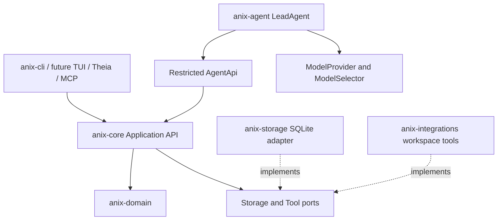

# Architecture

For the durable V2 runtime, its three graphs, checkpoints, context compiler and model boundaries, see [runtime-v2.md](runtime-v2.md). Concrete llama.cpp/Apple runtimes live in `anix-integrations` and implement the `ModelRuntime` port from `anix-agent`; `anix-domain` and `anix-core` contain no HTTP, runtime processes or provider SDKs.

Dependency direction is inward: domain has no application, SQL, provider, filesystem, or UI dependency. Core depends only on domain and serialization/time utilities. Storage and integrations implement application ports. Agent depends on Core's restricted API and domain types. CLI composes adapters and forwards parsed commands.

`Core::new(Arc<dyn Storage>)` is the composition boundary. Service views (`projects`, `questions`, `sources`, `papers`, `claims`, `hypotheses`, `experiments`, `findings`, `artifacts`, `graph`, `evidence`, `gates`, `tasks`, `runs`, `events`, `provenance`, `research`) share one mutation coordinator. They do not own independent connections. Dedicated commands carry typed IDs; JSON only appears in explicit extensible payloads.

ProjectState is a typed local aggregate used inside the transaction port. The SQLite adapter reads an aggregate under a snapshot and writes changed records into dedicated tables under `BEGIN IMMEDIATE`. SQL history is append-only. This simple implementation favors correctness for local V1 projects. Reading an aggregate includes its history, so very large histories will eventually benefit from narrower repository operations and pagination behind the same API.

Events are published after the storage adapter commits. A mutation coordinator preserves event order for callers sharing one Core. Subscriptions are local to that Core instance, bounded to 256 events, and disconnect a slow consumer. The persisted timeline is the recovery path. Separate processes do not share an in-process event bus.

Final architecture review:

| Question | Result |
| --- | --- |
| Can UI be removed without changing Core? | Yes; no UI dependency exists. |
| Can Theia/CLI/MCP share the application API? | Yes; all services use typed commands/queries. |
| Can SQLite be replaced? | Yes; implement the transactional Storage port. |
| Can model replacement preserve research state? | Yes; providers operate over retrieved context. |
| Can AgentApi approve a gate or access storage? | No; compile-fail tests check the capability boundary. |
| Can provenance, evidence, and timeline be queried without a model? | Yes. |
| Can a stale gate change newer state? | No; affected versions are rechecked before applying. |
| Does state survive restart? | Yes; acceptance tests close and reopen SQLite. |

The capability boundary constrains RN's agent implementation. This is a local application, not an OS sandbox for arbitrary malicious native code. Registered adapters and applications constructing human command contexts are trusted.
