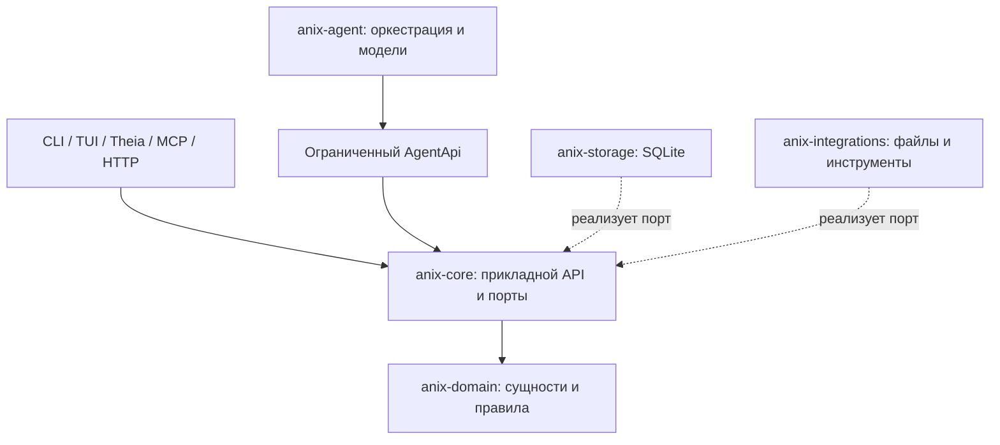

# Руководство по разработке независимого ANIX Core

Для runtime V2 также следуйте [runtime-v2.md](runtime-v2.md): отделяйте Knowledge Graph, Process Graph и Execution Graph; закрепляйте Run за неизменяемой ревизией; сохраняйте snapshot и checkpoint через Core. ModelRuntime, HTTP, llama.cpp и Apple SDK принадлежат адаптерам. Микромодель получает только LocalIntelligence и изолированные входные DTO; научные команды и Storage ей не передаются. Измеренное низкое качество должно блокировать локальный маршрут.

Этот документ задаёт правила для дальнейшей разработки ANIX. Используйте его при добавлении сущностей, сервисов, моделей, инструментов и клиентов. Текущая архитектура описана в [architecture.md](architecture.md), модель данных — в [domain-model.md](domain-model.md), хранение — в [persistence.md](persistence.md), агентная система — в [agent-architecture.md](agent-architecture.md).

Независимость ядра означает, что исследование, его правила и история сохраняют смысл при замене интерфейса, базы данных, модели или исполнителя. Создание проекта, работа с evidence, принятие решений и чтение истории должны быть доступны через прикладной API без запуска TUI, Theia или модели.

## 1. Направление зависимостей



Прикладной код объявляет необходимые ему контракты. Инфраструктура реализует эти контракты. Конкретные реализации выбираются в точке сборки приложения: сейчас это `anix-cli`, в будущем — отдельный launcher или сервер.

| Crate | Что размещать | Допустимые зависимости внутри workspace в production |
| --- | --- | --- |
| `anix-domain` | Сущности, типы ID, статусы, переходы, совместимость relations, действия, определения событий, доменные ошибки | Другие crates RN не нужны |
| `anix-core` | Сервисы, команды, запросы, транзакционный контракт, Gates, Tasks/Runs, evidence, ограниченный API агента, порты инструментов | `anix-domain` |
| `anix-agent` | ContextBuilder, LeadAgent, ModelProvider, ModelSelector, обработка структурированных ответов, выбор разрешённых инструментов | `anix-core`, `anix-domain` |
| `anix-storage` | SQL, migrations, преобразование строк БД в доменные типы, реализация транзакций | `anix-core`, `anix-domain` |
| `anix-integrations` | Workspace, файловые операции, хэши, внешние адаптеры, проекции | `anix-core`, `anix-domain`; для будущего адаптера ModelProvider допустим `anix-agent` |
| Клиенты и точка сборки | Разбор аргументов/запросов, отображение, выбор адаптеров, запуск приложения | Нужные прикладные crates и адаптеры |

Таблица относится к production-зависимостям. `dev-dependencies` могут подключать адаптеры для интеграционных тестов, как сейчас делает `anix-storage`.

Не добавляйте в `anix-domain` и `anix-core` библиотеки SQLite, HTTP-транспорта, UI, конкретного AI SDK или запуска Codex. Внешний SDK подключайте в адаптере. Если `anix-agent` нужен инструмент, передавайте реализацию порта `Tool`; зависимость агента от `anix-integrations` для вызова конкретного файлового инструмента создаст неправильное направление зависимостей.

## 2. Как выбрать место для новой возможности

| Новая возможность | Место реализации |
| --- | --- |
| Правило перехода Hypothesis в Supported | Политика в `anix-domain`, вызов политики в сервисе `anix-core` |
| Запрос evidence для графического интерфейса | Типизированный query API в `anix-core` |
| Горячая клавиша, сортировка панели, диалог подтверждения | Соответствующий клиент |
| Новый индекс или SQL-запрос | `anix-storage` и новая migration |
| Новый AI provider | Адаптер `ModelProvider`, подключаемый в точке сборки |
| Формирование контекста для модели | `anix-agent` с чтением через ограниченный API |
| Запуск Python, Git или coding executor | Инфраструктурный адаптер за прикладным портом |
| Сохранение научного результата такого запуска | Сервис `anix-core` с событием и provenance |
| Markdown-представление гипотезы | Перестраиваемая проекция из данных Core |

Выносите правило в домен, если оно описывает исследовательскую сущность независимо от способа хранения и использования. Последовательность прикладных действий и границу транзакции размещайте в Core. Детали протокола, SDK, SQL и файловой системы размещайте в адаптере.

## 3. Правила для модели и публичного API

Используйте отдельный ID type для каждой сущности. Строка из CLI или HTTP должна превращаться в типизированный ID на границе клиента. Внутри сервисов работайте с `ProjectId`, `HypothesisId`, `ExperimentRunId` и другими конкретными типами.

Все исследовательские сущности принадлежат проекту. Проверяйте принадлежность каждого ссылочного объекта, включая источники Claim, концы Relation, родительский Run и артефакты эксперимента. Сохраните проверку в приложении и соответствующее ограничение в БД.

Статусы выражайте enum и меняйте через проверяемую политику переходов. Для изменяемой сущности используйте `Meta.version`, время UTC и ожидаемую версию команды. Интерфейс может предлагать переход, но решение о его допустимости принимает Core.

Публичные команды описывают исследовательское намерение, например `ReviseHypothesis` или `ActivateExperiment`. Не создавайте API, смысл которого определяется экраном: `confirm_current_dialog`, `update_selected_row` или `save_editor_widget`.

Query API возвращает типизированные данные для разных клиентов. Ошибки возвращайте через доменную модель ошибок, чтобы клиент мог отдельно обработать конфликт версии, недопустимый переход, отсутствие объекта или необходимость Gate. Формат сообщений и локализацию определяет клиент.

Не возвращайте из Application API соединение SQLite, SQL transaction, изменяемый репозиторий или ссылку на внутреннее изменяемое состояние. Возвращаемый DTO является снимком: изменение его полей вызывающим кодом не должно менять сохранённое исследование.

Разделяйте чтение и изменение. Запрос evidence или timeline не должен запускать модель, создавать Run или записывать новые научные выводы. Для такой работы нужна отдельная явная команда.

## 4. Единственный путь изменения состояния

Все изменения канонического исследовательского состояния проходят через сервисы `anix-core`. В текущей реализации они используют закрытый координатор `Core::mutate` и транзакционный порт `Storage`.

```text
Команда + CommandContext
    → проверка actor и входных данных
    → загрузка актуального состояния в транзакции
    → проверка project, переходов, версий и policy
    → изменение сущностей
    → добавление provenance и DomainEvent
    → сохранение и COMMIT
    → публикация live events
```

Записывайте значимые изменения, событие и provenance в одной транзакции. При ошибке состояние, результат действия и решение Gate должны откатиться вместе. Live event публикуйте только после успешного commit.

В `CommandContext` указывайте actor, причину изменения и доступные Run/correlation/causation связи. Отдельно сохраняйте автора предложения и человека, разрешившего действие. Одна строка `"agent"` без идентичности не позволяет восстановить происхождение решения.

Повторная команда не должна повторно применять действие. Для ProposedAction используйте `ActionEnvelope.id` и сохранённый результат. Повторное одобрение Gate возвращает прежний результат; другой payload с тем же ActionId должен давать конфликт.

Не держите транзакцию открытой во время сетевого запроса, генерации модели или длительного эксперимента. Сначала сохраните Task/Run и необходимые версии, выполните работу через адаптер, затем отправьте результат отдельной командой. Core повторно проверяет состояние перед применением.

## 5. Human Gates и граница агента

В точке сборки передавайте LeadAgent только `core.agent_api(identity)`, провайдер модели, selector и разрешённые инструменты. Полный `Core` и `Storage` остаются у доверенного прикладного кода.

Модель возвращает структурированный ответ. Изменение исследовательского состояния оформляйте как версионированный `ProposedAction`. Решение о необходимости подтверждения принимается централизованно через `GatePolicy`; текст ответа модели и флаг из UI не являются разрешением выполнить действие.

В текущей V1 автоматическое выполнение допускается для References/RelatedTo relations. Семантические изменения проходят через Gate. Расширяя эту политику, явно опишите, какое действие разрешается автоматически, почему оно обратимо, и какие побочные эффекты имеет.

Gate должен хранить действие, affected entities, expected versions, причину, риск, автора и связь с Run. При approve проверяйте актуальные версии и полную допустимость действия заново. Проверки при создании предложения недостаточно: состояние могло измениться до решения человека.

Не добавляйте в `AgentApi` методы, позволяющие одобрять Gate, подставлять Human actor или выполнять произвольную запись. Сохраните compile-fail проверки недоступности Core/storage и человеческого API агенту.

`Actor::Human` в текущем Core является указанием доверенного вызывающего приложения. Сам enum не аутентифицирует пользователя. При добавлении HTTP/MCP с недоверенными вызывающими проверяйте их права в доверенной границе приложения; модель не должна конструировать человеческий `CommandContext`.

Для моделей сохраняйте ограниченные DTO контекста. Не передавайте провайдеру весь ProjectState, соединение БД или изменяемые репозитории. Retrieval, размеры текстов, количество шагов и объём tool outputs должны иметь явные ограничения.

## 6. Хранение, миграции и файлы

Канонические структурированные данные находятся в SQLite. Файлы артефактов находятся в Workspace. Domain Events и Provenance сохраняют историю. Markdown строится из этих данных и может быть удалён и создан заново без потери исследовательского состояния.

Новые основные сущности сохраняйте в отдельных таблицах с явными структурными полями. JSON используйте для extensible metadata и структурированных action/audit payloads. Не возвращайте основное хранение к таблице `entities(type, json)`.

Для изменения схемы добавляйте новый файл `migrations/0002_...sql`, затем регистрируйте его в runner `anix-storage`. После того как migration применена к сохраняемой БД, её содержимое неизменно: новая правка схемы требует следующей migration. Проверяйте upgrade на БД предыдущей версии с существующими данными, повторное открытие, FK и сохранность истории.

Текущий Storage port загружает типизированный агрегат проекта и записывает изменившиеся строки. При переходе к более узким репозиториям сохраните единицу работы: проверки, entity writes, Gate, action receipt, provenance и события одного действия остаются атомарными. SQL-оптимизация не должна менять прикладные правила.

Порты для других хранилищ должны сохранять семантику текущего `Storage`: согласованный снимок для чтения, сериализацию записей, однократный вызов transaction callback и возврат только закоммиченных событий. Не добавляйте SQLite-specific методы в этот контракт.

Записывайте новые артефакты через Workspace с относительным нормализованным путём, хэшем и защитой от перезаписи. Затем регистрируйте metadata через ArtifactService. Файлы и SQLite не имеют общей транзакции: предусмотрите обработку незарегистрированного файла при ошибке регистрации. Перезаписывать важный пользовательский файл ради устранения такой ошибки нельзя.

Доступ инструмента к файлам ограничивайте Workspace и проектом. Не передавайте инструменту произвольный filesystem handle или доступ к `.anix/state.sqlite`. Для внешних и изменяющих инструментов сначала спроектируйте прикладное разрешение и связь с Gate; текущий ApprovedTools допускает только чтение.

Ключи и credentials принадлежат конфигурации адаптера. Не включайте их в metadata, события, provenance, ошибки Run или raw provider logs. Проверяйте новые сохраняемые payloads через существующую валидацию и тест на отсутствие секретов в БД.

## 7. Как добавить новую возможность

1. Опишите исследовательский смысл, владельца-проект, правила изменения и наблюдаемый результат. Определите, требует ли действие Human Gate.
2. Добавьте доменные типы: ID, сущность или поля, статусы, relation compatibility и typed errors. Обновите политики.
3. Определите прикладную команду и query DTO. Для изменения существующих объектов задайте expected version, для повторяемого действия — правила idempotency.
4. Реализуйте сервисный flow в `anix-core`, включая provenance и события. Новый ProposedAction должен проходить одинаковую проверку при proposal, direct execution и approve.
5. Добавьте migration и реализацию хранения в `anix-storage`. При необходимости объявите новый узкий порт в потребляющем его внутреннем слое и реализуйте адаптер снаружи.
6. Для агентной возможности расширьте структурированный контракт, ContextBuilder или разрешённые инструменты. Проверьте GatePolicy и capability boundary.
7. Подключите возможность к CLI либо другому клиенту через готовый API. Клиент отвечает за ввод, отображение и доставку человеческого решения.
8. Добавьте тесты на реальные риски, выполните необходимые проверки и обновите архитектурную документацию.

Пример использования существующего сервиса:

```rust
let result = core.hypotheses().revise(
    project_id,
    hypothesis_id,
    expected_version,
    new_statement,
    human_context,
)?;
```

Этот вызов одинаково подходит для CLI, TUI и будущего API. Клиент передаёт намерение; сервис отвечает за версию, правила, транзакцию и историю.

Для новой клиентской интеграции собирайте Core с адаптерами в launcher. Сам клиент не должен повторять доменные переходы, выполнять SQL или применять ProposedAction самостоятельно. Он читает DTO, отправляет команды и показывает результат либо ошибку.

## 8. Проверки для изменения

| Что меняется | Что проверять |
| --- | --- |
| Доменные правила | Допустимые и запрещённые переходы, некорректные значения, project ownership |
| Mutation или Gate | Expected versions, stale proposal, idempotency, rollback, provenance и события |
| Storage/schema | Upgrade migrations, FK/constraints, restart, сохранность данных и истории |
| Event flow | Отсутствие публикации при rollback, видимость данных после получения события, порядок событий |
| Agent/model/tools | Fake provider, ограниченный контекст, GatePolicy, отсутствие обхода API, allowlist, файловые границы |
| Клиент | Вызов того же сервиса, корректные ID/версии, обработка ошибок и ненулевой exit code для CLI |

Используйте центральный сценарий [tests/acceptance.rs](../tests/acceptance.rs) как защиту исследовательского цикла. Тесты ядра и агента должны работать без интернета и API keys. Тестирование конкретного внешнего адаптера организуйте отдельно от обязательного offline набора.

Перед завершением изменения Rust-кода выполняйте:

```sh
cargo fmt --all --check
cargo check --workspace
cargo clippy --workspace --all-targets -- -D warnings
cargo test --workspace
```

На текущей Windows-машине для согласованного выбора rustup toolchain используйте:

```powershell
.\scripts\check.ps1
```

Для правки только документации проверьте согласованность описания с кодом, относительные ссылки и наличие упомянутых команд. Перезапуск полного test suite для такой правки не требуется.

## 9. Архитектурное ревью перед завершением

- Можно ли удалить или заменить клиент, сохранив работу прикладного API?
- Можно ли сменить AI provider без изменения или потери research state?
- Остаются ли SQL, SDK и файловые детали в адаптерах?
- Проверяет ли Core правила независимо от проверки во фронтенде?
- Проходит ли каждое значимое изменение через одну транзакцию с provenance и событием?
- Повторная команда, retry или stale Gate сохраняют согласованность?
- Можно ли объяснить происхождение Claim, Finding и изменения Hypothesis без LLM?
- Получает ли агент только ограниченную capability и необходимый контекст?
- Сохраняются ли данные после restart и удаления generated Markdown?

Если новый код делает ответ отрицательным, исправьте границу или flow до завершения изменения. Существенное архитектурное решение запишите в `docs`: проблема, выбранный контракт, последствия для клиентов/данных и необходимые проверки. Документировать причину исключения полезно, но это не заменяет восстановление независимости ядра.
