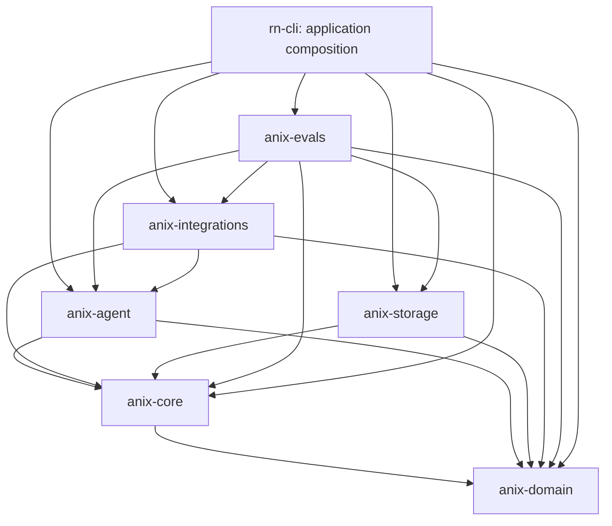

# ANIX architecture

ANIX is the independent research core. Researcher's Notes is the application and retains the `rn` binary and `rn-cli` package. The workspace has seven crates; no new crate or orchestration framework was added.

ANIX executes and controls plans created by the researcher or Lead; it does not implement one universal algorithm of scientific research.

## Actual dependency map

Storage has test-only dependencies on Agent and Integrations. Core and Domain have no SQLite, HTTP, model SDK or UI dependency. Core reexports Domain through `anix_core::domain`.

| Crate | Files and boundaries |
|---|---|
| anix-domain | entities.rs: typed scientific state; runtime.rs: work, branches, plans, execution, retrieval; policy.rs: transitions and relation validation |
| anix-core | lib.rs: Core mutation coordinator and restricted AgentApi; services.rs: application facade; actions.rs: proposal/Gate validation; queries.rs: projections; runtime.rs: DAG, context, execution and checkpoints; human_control.rs: versioned creator controls; tools.rs: adapter ports |
| anix-storage | lib.rs: typed table maps, hydration, serialized transactions, migrations 1-4, FTS5/BM25 |
| anix-agent | lib.rs: approved tools, model requests and Lead step execution; intelligence.rs: deterministic/local/strong routing; durable.rs: invocation recording |
| anix-integrations | lib.rs: workspace boundaries and projections; bootstrap.rs: verified downloads; model_runtime.rs: runtime processes and adapters; test_lead.rs: OpenAI-compatible structured provider; recorded_tool.rs and offload.rs: durable bounded outputs |
| anix-evals | lib.rs: eleven synthetic scenarios and invariant auditor; long_horizon.rs: real Lead loop and telemetry; true_capabilities.rs: branch lineage, offload and context assertions |
| rn-cli | main.rs: JSON application client, composition and diagnostics; tests/cli.rs: persistent API behavior |

## Three graphs and execution

Knowledge/Evidence Graphs store Questions, Sources, Papers, Claims, Hypotheses, Experiments, Findings and typed Relations. WorkNode execution success does not establish a hypothesis's truth. Candidate promotion checks quotes and source attachment and requires Human authority. Experiments and consequential proposals use the same validation and Gate path as other clients.

Process Graph contains WorkNodes, Contains/DependsOn edges, Branches and immutable PlanRevisions. Branches pin a base checkpoint and isolate work/retrieval by branch. Existing scientific entities remain shared project knowledge. A new plan revision appends history; it does not change an ExecutionBinding's historical revision.

Execution Graph contains Tasks/Runs, ModelInvocations, ToolInvocations, immutable ContextSnapshots and checkpoints. Core mutations commit state, events and provenance in one SQLite transaction; live notifications are published afterwards. Recovery reconstructs exact historical plans and context. Interrupted models remain counted; uncertain tool side effects are exposed for reconciliation and are not automatically replayed.

The research loop is Project -> WorkNode -> compiled snapshot -> LeadDecision -> validation -> tool/process action -> persisted observation -> next decision. The Lead chooses evidence tasks and termination. Atomic means one verifiable task and can require several approved auxiliary calls.

## Retrieval prerequisites

`RetrievalProtocol::executable_tools` computes the approved current set and `LeadAgent::run_step` uses that same set to validate execution. Read actions require actual authorized unread batch handles. A required read with no handles can search only when the configured prerequisite search tool is registered. Existing batch handles allow a read directly. Source/Paper references explicitly supplied in the current WorkNode contract also receive scoped E1/E2 handles and a title catalog; these can be read without a new search. Runtime binds the source identity and rejects a stale binding if material or policy changes during inference. Direct reads retain source-access receipts rather than inventing a retrieval batch. Pending/partially consumed batches allow read, justified refinement and rejection, with ordinary search and completion denied. Empty batches permit refinement/rejection without a fabricated read enum. Runtime binds search invocation IDs and checks branch/root-run scope; the model never copies internal IDs.

When no prerequisite action is available, execution closes its Run, appends a Blocked transition with a concrete reason, and returns before calling the model. Humans can supply resources and move the work back to Ready or revise the plan. Generic tools still use approved adapter-defined input contracts; the prerequisite mechanism is currently specialized to the existing retrieval protocol.

## Context and models

ContextCompiler packs pinned entries, graph neighbors, FTS/BM25 candidates, bounded artifact summaries and current/ancestor ProcessMemory plus results from completed contained or prerequisite work on the same branch. Parent tasks prioritize bounded source-content observations from completed children; unfinished children and sibling branches do not contribute result memory. It persists immutable text/version references and conservative byte-token estimates. Typed exclusions filter sources and attached paper content. Active Human constraints are reserved in the token budget and stored as immutable process memory referenced by the snapshot, so later policy changes do not alter a replayed snapshot.

The Lead request separately carries the current WorkNode, contract, branch, pending obligations and dynamic handles. The adapter verifies measured rendered input tokens before inference. Exact traces are opt-in and bounded; credential patterns inside serialized JSON/text are redacted. The Test Lead HTTP adapter disables redirects and ambient proxies, so a loopback route cannot escape through either mechanism. The file tool rejects case/trailing-dot aliases and nested `.rn` storage paths. Compact output remains limited to one action; retries/stall budgets were not increased.

Micro routing retains its low-risk allowlist and quality gates. Product micro profile is Qwen3-1.7B Q8_0; Lead validation uses Qwen3-8B Q4_K_M, local-only loopback, CUDA 37 layers, context 8192, temperature 0.2. Models receive no Storage/Core authority. Apple native bridge, collaborator authorization and a separate Batch scheduler remain future work.

## Persistence and interfaces

All Human mutations pass the shared project-creator authorization before state changes; read projections remain available through their existing ports. Resolving the final Gate resumes Ready/Running bound work instead of marking its Run successful. Work contracts and explicit Lead termination remain responsible for completion. Legacy unbound task resolution remains supported.

Canonical data remains `.rn/state.sqlite`; migrations 1-4 and historical IDs/events are unchanged by the rename. Input/output artifacts remain in their original workspace paths. The CLI calls application services and has no SQL implementation. Model weights, endpoints and profile names are compatibility identifiers and were not renamed.

See [migration](anix-migration.md), [audit evidence](anix-audit.md) and [roadmap](anix-roadmap.md). The complete file/hash inventory is [anix-inventory.json](anix-inventory.json); the pre-edit baseline is [anix-baseline.json](anix-baseline.json).
