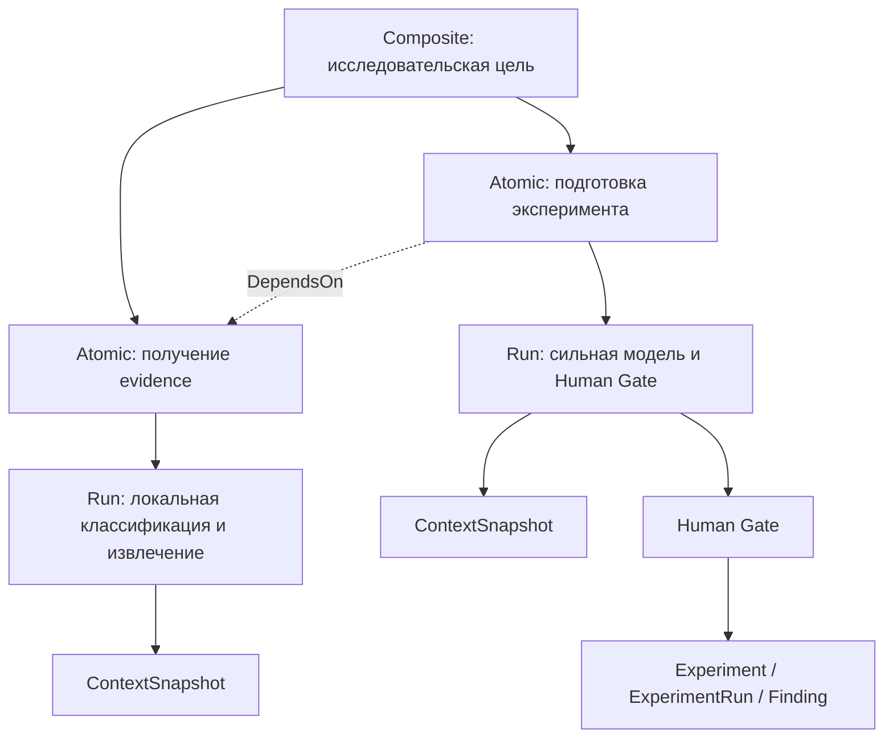

# ANIX Core V2: исследовательский runtime

## Три разных графа

Knowledge Graph содержит научные сущности и evidence. Research Process Graph содержит `WorkNode` и `WorkEdge`. Execution Graph объединяет `Run`, привязки к работам и ревизиям, контрольные точки, обращения к моделям, инструментам и события. Эти структуры читаются через Core без вызова модели.



Atomic означает одну осмысленную работу. Она может иметь несколько запусков, модельных обращений и инструментальных вызовов. Composite объединяет работы. `Contains` не разрешается для Atomic. Проверяются зависимости, циклы, принадлежность проекту и ветви, версии и допустимые переходы.

## Контракты и история планов

`OutputContract` требует конкретные научные сущности, артефакты и минимальное число завершённых дочерних работ. Текст ответа модели сам по себе не завершает работу. Перед `Succeeded` Core проверяет ссылки, отсутствие архивирования, завершение детей и отсутствие активных запусков.

`set_work_contract` позволяет человеку уточнить проверяемые результаты после их регистрации. Это создаёт новую ревизию. В сквозном тесте evidence заканчивается контрактом на подтверждённый Claim, а подготовка и выполнение эксперимента — контрактом на Finding.

Создание работ, добавление рёбер, смена состояния и изменение контракта сохраняют неизменяемую `PlanRevision`. `ExecutionBinding` связывает Run с WorkNode, Branch и конкретной ревизией. Последующее редактирование плана эту привязку не меняет.

Ветвь ссылается на родительскую ветвь и базовую контрольную точку. При fork копируется снимок плана с новыми идентификаторами работ; научные сущности, файлы и база данных не копируются. История каждой ветви имеет собственную голову. `process_graph` читает текущую либо заданную историческую ревизию.

## Контрольные точки и восстановление

Контрольные точки создаются вместе с изменением плана, завершением работы, до/после Human Gate и до/после инструментального вызова. Пользовательский исполнитель также может сохранить `Suspended` и собственное версионированное `execution_state`.

Запись состояния, событий, provenance и контрольной точки проходит в одной SQLite-транзакции. Прямые обновления и удаления ревизий, снимков контекста, привязок и контрольных точек запрещены триггерами и адаптером.

`resume_checkpoint` возвращает точную историческую ревизию, снимок контекста, Run, ожидающие Gates и незавершённые инструментальные вызовы. Прерванные модельные обращения получают `process_interrupted`. Незавершённый инструмент может иметь неизвестный побочный эффект, поэтому автоматически повторять его нельзя. Исполнитель должен согласовать результат такого вызова. Восстановление не обращается к LLM.

`resumable_work` возвращает незавершённые работы с выполненными зависимостями. Завершённые A/B не планируются повторно. Отдельный тест запускает дочерний процесс, сохраняет A/B/C и checkpoint, затем завершает его через `process::exit` без деструкторов и закрытия SQLite; родитель восстанавливает C.

## Контекст

Слои памяти имеют разные роли:

| Слой | Представление |
|---|---|
| L0 | Временные данные обработки запроса, не канонические факты |
| L1 | Run, invocation records, input/output artifacts, checkpoint execution state |
| L2 | `ProcessMemory`, с привязкой к работе и namespace |
| L3 | Научные сущности Knowledge Graph |

Общий `write_memory` запрещает namespace `ScientificKnowledge`. Научные изменения проходят через специализированные сервисы, проверку источников и существующие Human Gates.

Компилятор контекста получает WorkNode, проверяет его наличие в закреплённой ревизии, собирает pinned references, соседей Knowledge Graph, результаты SQLite FTS5/BM25 и память процесса. Затем фильтрует нерелевантное и архивированное, укладывает данные в бюджет и сохраняет `ContextSnapshot`.

Pinned-данные не удаляются ради бюджета: переполнение возвращает ошибку и откатывает транзакцию. Снимок хранит версии ссылок, точные тексты выбранных сущностей, ссылки на неизменяемую память, версии инструкций и skills, оценку токенов и её метод. `compile_context_manifest` принимает версии инструкций и skills явно. `provider_context` восстанавливает содержимое из снимка и исторического плана, а не из сегодняшней версии WorkNode.

Бюджет рассчитывается по UTF-8 байтам с запасом на структуру и специальные токены. Это консервативная эвристика для byte-based tokenizers, а не точные provider tokens. Реальное использование отдельно записывается в ModelInvocation. Опциональное сжатие доступно через `LocalIntelligence.compress_context`; основной компилятор работает детерминированно без модели. Vector DB не используется.

## Инструменты и артефакты

`RecordedTool` сохраняет вход и результат вызова как артефакты, включая небольшие результаты. Большой результат, превышающий конфигурируемый `threshold_bytes`, заменяется в ответе ссылкой на Artifact, схемой, описанием, размером, хешем и относительным путём. `read_range` проверяет границы, размер и SHA-256 перед чтением диапазона до 1 MiB.

Регистрация execution artifacts разрешена только runtime actor для Output/Document в активном Run, привязанном к работе. Это не даёт инструменту права создавать канонические Claims или разрешать Gates. Обычная регистрация артефактов человеком сохраняет прежние правила V1.

ModelInvocation хранит модель, revision, runtime, snapshot, инструкцию, схему, время, задержку, status и usage. RecordedRuntime также сохраняет точный вход, инструкцию и структурированный результат в operational metadata; `model_output` читает успешный результат после restart без повторного inference. ToolInvocation хранит инструмент, версию, Run/WorkNode, input/output artifact refs, время, status и код ошибки. `RecordedRuntime` и `RecordedTool` сохраняют начало вызова до его исполнения и результат после него. Ошибки также остаются в execution history. События публикуются после commit.

## Модели и маршрутизация

`ModelRuntime` — порт в anix-agent: generate, structured output, streaming capability и availability. LlamaCppRuntime и AppleFoundationModelRuntime находятся в anix-integrations. SDK, HTTP, модельные файлы и процессы не входят в anix-domain/anix-core.

`LocalIntelligence` предоставляет только шесть операций: classification, query rewrite, candidate extraction, tagging, short summary и context compression. Инструкции находятся в `BuiltinMicroTemplates` адаптера. Этот API не предоставляет Core, SQLite или научные команды. `SkillRegistry` содержит версии literature search, evidence extraction, contradiction search и experiment preparation; `WorkerRequest` передаёт отдельную работу, snapshot, capabilities, budget и output schema.

Маршрутизатор сначала выбирает реализованную детерминированную операцию. Затем локальную модель допускают только для разрешённой простой задачи, с подходящими capabilities, контекстом и измеренной оценкой качества. High-impact, complex reasoning и остальные задачи сразу идут сильной модели. Private-запрос не отправляется внешней сильной модели.

Проверяются JSON schema, enums, длина, обязательные факты, точные source quotes и лимиты. Допускается одна повторная попытка при некорректном локальном результате. Unavailable/timeout, переполнение, низкая оценка качества и исчерпанные попытки ведут к эскалации. Model confidence не используется. Для встроенных контрактов реализован явно ограниченный набор JSON Schema, не полный стандарт.

`measured_capabilities` проверяет соответствие evaluation profile модели, версии инструкций и fixtures. Самостоятельно объявить высокую уверенность недостаточно. `DurableRouter` сохраняет агрегированное usage и обезличенные решения маршрутизации в Run. Число предотвращённых cloud tokens обозначено как оценка; цены API не выдумываются. Telemetry автоматически никуда не отправляется.

## Локальная модель и запуск

Основной manifest: `models/manifest.toml`. Default product micro-model: `models/qwen3-1.7b/Qwen3-1.7B-Q8_0.gguf`, `Qwen/Qwen3-1.7B-GGUF`, revision `90862c4b9d2787eaed51d12237eafdfe7c5f6077`, 1834426016 байт, SHA-256 `061b54daade076b5d3362dac252678d17da8c68f07560be70818cace6590cb1a`. Qwen3-0.6B доступна только явным `economy` профилем.

Отдельный `local-test-lead` profile использует конфигурацию `config/local-test-lead.toml`, а веса и revision закреплены в `models/profiles/qwen3-8b.toml`. Default target — Qwen3-8B Q4_K_M в отдельном llama-server процессе на loopback endpoint. Для CPU-пакетов доступен отдельный Qwen3-4B Q4_K_M profile (`test-lead-4b`); он настраивается через `config/local-test-lead-4b.toml` и отдельный порт 8083. `OpenAiCompatibleModelProvider` реализует обычный порт `ModelProvider`; Core не содержит названия модели или зависимости от llama.cpp. `LocalOnlyTestProvider` запрещает endpoint вне loopback до сетевого вызова. Endpoint, модель, размер контекста, temperature, timeout и capabilities настраиваются независимо.

```powershell
.\scripts\bootstrap-model.ps1
.\scripts\bootstrap-runtime.ps1
```

```sh
./scripts/bootstrap-model.sh
cargo run -p anix-cli -- model bootstrap
rn model bootstrap --profile economy
rn model bootstrap --profile test-lead
```

Test Lead server и OpenAI-совместимый health/completion smoke запускаются через `scripts/start-test-model.ps1` или `scripts/start-test-model.sh`.

Оба model-скрипта используют Rust bootstrap. Существующий файл проверяется полностью. Загрузка идёт в уникальный `.partial`; размер и SHA-256 проверяются до атомарной установки без перезаписи через hard link в том же каталоге. Конкурентный победитель проверяется повторно. Неверный существующий файл вызывает ошибку, а не молча используется. Ошибка и частичная загрузка очищают staging. Unit tests используют крошечный HTTP fixture и не скачивают модели.

Windows CPU runtime — официальный llama.cpp `b11307`, архив с SHA-256 `558e7563b9816ab7e0ce3cbd91e8f76507a64dc96abc8871989fb67c5f525d30`. Адаптер запускает скрытый дочерний llama-server на loopback с одним slot, CPU и 4096 context. Процесс закрывается при drop. Scheduler сериализует запросы и поддерживает отмену ожидания. Постоянный daemon не нужен.

Apple adapter — отдельная native bridge boundary с availability check. На Windows/Linux он недоступен; policy выбирает Qwen. Native Foundation Models bridge и проверка на поддерживаемом Mac требуют соответствующего host и оборудования; на этой Windows-машине они не реализованы и не проверялись. У конкретных CPU/Apple адаптеров streaming capability сейчас false; порт позволяет добавить поддержку без изменения Core.

## Проверки и ограничения

`scripts/check.ps1` проверяет formatter, compilation, Clippy и весь workspace. Реальный smoke запускается явно:

```powershell
cargo test -p anix-storage --test runtime_v2 real_llama_smoke_missing_bad_model_concurrency_shutdown -- --ignored --exact
cargo run -p anix-integrations --example eval -- .
cargo run -p anix-integrations --example eval -- . models/qwen3-1.7b/Qwen3-1.7B-Q8_0.gguf eval/results-qwen-1.7b-iteration3.json models/manifest.toml
cargo run -p anix-integrations --example bench -- . models/manifest.toml eval/benchmark-qwen-1.7b.json
```

Fake runtime, routing, graph, migrations, rollback, immutable snapshots, branches, process crash, artifact offloading и полный исследовательский сценарий покрыты обычными тестами. Реальный smoke, evaluation и benchmark выполнены отдельно; CI не обязан иметь модель.

The 100 synthetic evaluation fixtures are a small check of contracts and known errors, not evidence of quality on arbitrary scientific text. Iteration 3's Qwen result is historical; the current paired synthetic and realistic runs are summarized in `docs/minicpm5-micro-eval.md`.

Локальные development runs запускаются отдельно от CI: `rn eval research run basic-evidence --profile local` или `rn eval research batch --profile local --count 10`. Offline corpus и ground truth находятся в `tests/research-packs/catalog.json`; отчёты — в `eval-results/`. Команды `rn eval research inspect <project-id>` и `bundle <project-id> <directory>` реконструируют сохранённый run без нового inference. Стандартный CI не требует model weights.

За пределами текущего исполнения: native Apple SDK bridge, GPU-профили CUDA/Vulkan/Metal на соответствующем оборудовании, полный JSON Schema validator, автоматическое согласование неизвестных side effects, точный tokenizer для каждой модели, внешний inference daemon и крупный независимый научный evaluation corpus. TUI не добавлен.

## Micro-model trust boundary

The micro-model is an optimization worker. It is not a decision authority and cannot perform consequential research decisions. `LocalIntelligence` exposes only typed, bounded transformations; it has no Core, Agent API, or Storage handle. Model output can supply candidates and text, but only the normal validated Core mutation path can create canonical research state.

The hard-coded `MicroTask` allowlist is `QueryRewrite`, `CandidateExtraction`, `Tagging`, `ShortSummary`, `ContextCompression`, and `Classification`. Every request also carries an explicit impact class (`LowRisk`, `Consequential`, or `HighImpact`); only `LowRisk` can use the micro route. The router requires an exact task-kind-to-enum match, an available runtime, supported structured output, a measured quality score at or above policy thresholds, and a context that fits the local runtime. A task is eligible only if both the pinned 100-case synthetic set and pinned 140-case realistic set have 100% schema validity; its recorded quality is the lower of the two scores. Unknown tasks and all tasks without a `MicroTask` use the strong route. Classification remains on the strong route unless both sets reach the configured 97% gate. Model-reported confidence, reasoning, tool-use, or benchmark scores never change this policy.

Planning, Lead decisions, next-action selection, research-dependent WorkNode decomposition, plan or branch revision, hypothesis decisions, scientific conclusions, evidence sufficiency, contradiction resolution, experiment design or activation, Finding approval, synthesis, Gate decisions, high-impact actions, canonical Claim/Finding creation, direct database or graph mutation, and research completion are outside the micro interface. A micro failure or invalid structured response is retried at most once, then escalated to the strong runtime; private work fails closed instead of being sent to a different provider.

Compression and summaries are process artifacts, not canonical scientific truth. Provenance identifiers are selected and retained by deterministic code and are validated before use; model text cannot promote a candidate or mutate the Knowledge Graph.

## ANIX audit updates - 2026-10-09

Current names and verification are recorded in [ANIX audit](anix-audit.md). Atomic retrieval work now uses shared action prerequisites; a required read can search for missing material through its approved provider, and an unavailable prerequisite produces a persisted Blocked state without a model call. Pending and partially consumed batches use the same binding/validation rules. Context includes active Human constraints and the result memory of completed child/prerequisite work on the same branch. The research harness requires explicit Lead termination, consumed content and completed work contracts; counts alone cannot complete research. Historical numbers above describe earlier source versions.
